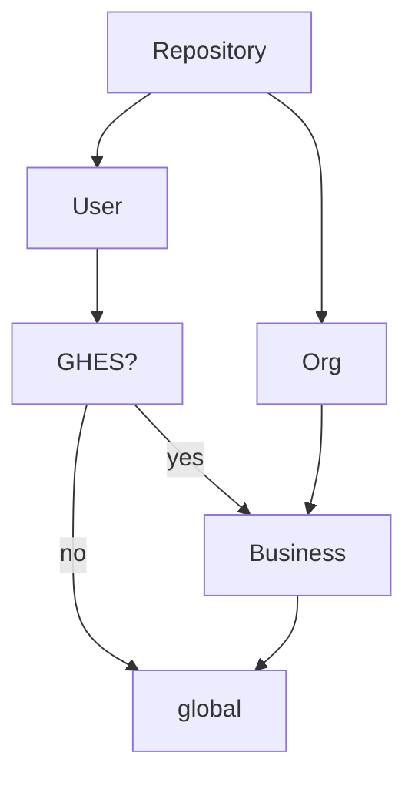
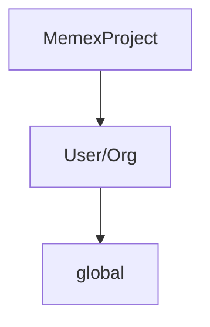

# Hierarchy Resolution

When resolving the effective configuration value for a target, the following hierarchy structures describe the prioritized paths for discovering configuration values:

## Repository

## Memex Project

The following targets have no hierarchies defined:

- `Customer`
- `Gist`
- `RepositoryNetwork`
- `Team`
