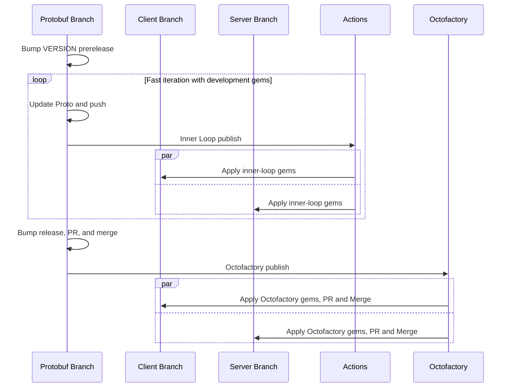

# Protobuf definitions for Monolith-as-server Twirp APIs

This folder contains protobuf contracts for Twirp APIs where dependabot-api is the client and github/github is the server.  These are colloquially called "monolith-twirp" gems and use [a custom build system](https://github.com/github/monolith-twirp).

## Making changes to monolith-twirp gems

Making changes to monolith-twirp gems consists of two phases to cut down on the number of PRs needed.
1. fast iteration using development gems
2. publishing and consuming production gems

Overall, this looks like


### Fast iteration using development gems

**The gems built during this process should not be used in production.  Please follow the steps [above](./#monolith) to publish and consume a production gem once you are happy with the proto contract.**

This process uses 3 branches to iterate on a monolith-twirp API.  
1. a dependabot-api branch to make changes to the proto files
2. a dependabot-api branch to implement the client and/or usage of the changed API
3. a github/github branch to implement server changes for the API

In dependabot-api proto branch:
1. Make changes to a monolith-twirp proto contract in [proto/monolith/twirp](https://github.com/github/dependabot-api/tree/main/proto/monolith/twirp)
2. Bump the VERSION to the next pre-release, e.g. `1.2.3-1`
3. Push your changes to GitHub
4. Look for the [Build Monolith Twirp Gems action workflow run for your branch](https://github.com/github/dependabot-api/actions/workflows/build-monolith-twirp-gems.yml)
5. If the workflow run finishes successfully, download monolith-twirp-gems.zip from the workflow summary
   - (on local computer) unzip the file to access the gems

In dependabot-api client changes branch:
1. Reference the new/updated monolith-twirp gem(s)
   1. Copy the new/updated monolith-twirp gem to [vendor/cache](https://github.com/github/dependabot-api/tree/main/vendor/cache)
   2. Update [Gemfile](https://github.com/github/dependabot-api/blob/main/Gemfile) to reference the new/updated gem
   3. Install the new gem(s) `bundle install && script/bootstrap`
   4. Update sorbet.  In `script/app-env`: `bundle exec tapioca gem; bundle exec tapioca dsl`
2. Implement changes for new gem(s)

In github/github server changes branch:
1. Reference the new/updated monolith-twirp gem(s)
   1. Copy the new/updated monolith-twirp gem to [vendor/cache](https://github.com/github/github/tree/main/vendor/cache)
      1. If you are updating a monolith-twirp gem with a new gem of the same version, then comment out the previous gem from [Gemfile](https://github.com/github/github/blob/master/Gemfile) and run `script/bootstrap` before copying the new gem
   2. Update [Gemfile](https://github.com/github/github/blob/master/Gemfile) to reference the new/updated gem
      1. If you commented out the gem in the previous step, uncomment it to restore the gem entry.
   3. Install the new gem(s) `script/bootstrap`
   4. Update sorbet `bin/tapioca gem; bin/tapioca dsl`
2. Implement changes for new gem(s)

### Publishing and consuming production gems

Once you've iterated on both the client and server and are happy with the shape of the protobuf contract, it's time to start releasing changes!

As mentioned previously, we cannot release pre-production monolith-twirp gems to the production environment.  Once the production gems are available we need to replace the pre-production gems that were vendored into dependabot-api and github/github with production gems pulled from Octofactory.  Production gems are built when protobuf changes are pushed to main in dependabot-api, and once built they are accessible from Octofactory.  There should be no functional changes to the gem code at this point, so replacing the pre-production gem should not affect any code.

1. Bump the VERSION of the protobuf changes to a full release, e.g. `1.2.3`
2. Open a PR for the branch with protobuf changes and go through the normal flow: review, deploy, merge
3. When the protobuf changes are merged to main, the [Build Monolith Twirp Gems action](https://github.com/github/dependabot-api/actions/workflows/build-monolith-twirp-gems.yml) will re-build the gems and this time the changes will be published to Octofactory.
4. In each of the dependabot-api client and github/github server branches, run `script/vendor-monolith-twirp-gem` to pull the newly published gem from Octofactory and vendor it into the branch.
   - You will need to [log into dev-vpn in your codespace](https://github.com/github/codespaces-vpn?tab=readme-ov-file#dev-vpn-connect) with your GH password before this succeeds
   - And log into Octofactory(see below)
   ```bash
   # example
   # script/vendor-monolith-twirp-gem dependabot settings 1.10.0

   script/vendor-monolith-twirp-gem dependabot $API_NAME $VERSION
   ```
5. After updating the client and server branches with the production gem pulled from Octofactory, open a PR for each change and follow the normal PR process to release the changes.

#### Authenticating to Octofactory

The `vendor-monolith-twirp-gem` script will prompt you to complete steps if you have not taken them. The steps involved are
generally:

1. Connect to the dev-vpn (`dev-vpn connect`)
  * "Password" is your GitHub.com password
  * "Token" is the token generated by the Fido auth process
2. Generate an Octofactory token by following [these instructions](https://github.com/github/octofactory/blob/main/docs/usage/access.md#get-a-token) (access to Octofactory can be gained through Okta)
3. In your Codespace, issue `bin/bundle config https://octofactory.githubapp.com/artifactory/api/gems/monolith-twirp-gems-releases-local $GH_USERNAME:$OCTOFACTORY_TOKEN`
  * Make sure to use your handle for `$GH_USERNAME` and the token from step 2 for `$OCTOFACTORY_TOKEN`
