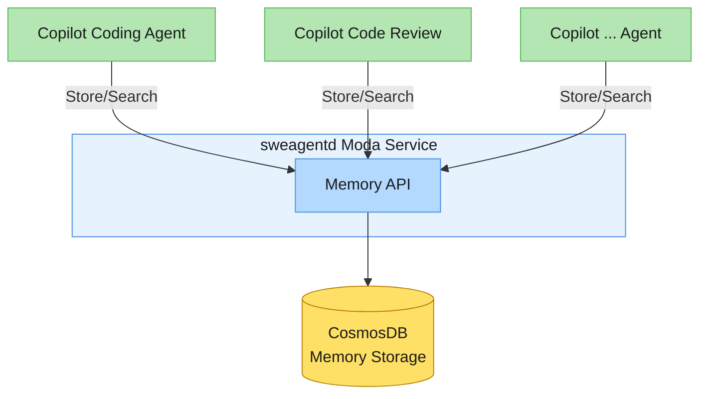

# ADR-0002: Memory API for Agentic Memory Storage

Status: Scoping

Deciders: @c0deking @gundermanc @tiferet @josebalius @Chuxel

Related issue: https://github.com/github/sweagentd/issues/3832

## Context

In response to the [Copilot-wide agentic memory](https://github.com/github/core-productivity/discussions/716) discussion, we're prototyping what it means to store "Agent Memories" across various Copilot agents. In order to support the rapid prototyping of Agentic Memories, this ADR describes the memory service that will be required to enable this product exploration. 

## TL;DR

We're implementing a Memory API within the `sweagentd` service to enable rapid prototyping of agentic memory capabilities. The API will use CosmosDB for storage and provide two main endpoints: `PUT /internal/memory/v0/` for storing memories with structured metadata, and `POST /internal/memory/v0/search` for querying.

### Memory API



The memory API will exist within the `sweagentd` Moda service, it will facilitate the storage, retrieval, and evolution of agentic memories. While the memories endpoints/functionality will exist within the `sweagentd` service, we will develop the Memory domain in a modular fashion, to keep this new product domain isolated from the `sweagentd` product. 


#### Proposed Endpoints

We will start by implementing the following core endpoints based on our initial requirements. Additional endpoints will be added as needed based on the requirements of subsequent experiments.

##### Store Memory

Stores a new memory entry with structured metadata.

**Endpoint**: `PUT /internal/memory/v0/`

**Request Body**:
```javascript
{
    // The topic this memory relates to (1-2 words). Examples: "naming conventions", "testing practices", "documentation", "logging", "authentication", "sanitization", "error handling"
    "subject": "string",
    
    // A clear and concise description of a fact about the codebase or convention
    "fact": "string", 
    
    // Array of sources for this fact (e.g., file paths and line numbers)
    "sources": ["string"],
    
    // Detailed explanation of why this fact should be stored as a memory
    "reason": "string",
    
    // The type of memory being stored
    "category": "string",
    
    // Metadata about the agent interaction that created this memory
    "source": {
        // To tie us back to the product that gave us this data
        "integrationId": "string",
        // Unique ID representing the source of this knowledge
        "interactionId": "string",
        // Repository ID
        "repoId": "int"
    }
}
```

##### Search Memories

Searches for relevant memories using natural language queries.

**Endpoint**: `POST /internal/memory/v0/search`

**Request Body**:
```javascript
{
    // A natural language question about memories that might have been learned
    "question": "string"
}
```

### Storage

Storing memories will leverage the [CosmosDB Paved Path](https://github.com/github/cosmosdb/blob/main/docs/getting-started.md) for storing and retrieving memories. Data will be stored according to the schema of the `Memory` object, with the following partition key construction:

```
partitionKey=memory:repo:{REPO_ID}:v0
```

We will construct the `partitionKey` in the application code to enable the team to iterate on the ideal partition key design. 

## Alternatives considered

We considered two main alternatives in this design: Azure Blob Storage, and storing memories in a Repository. 

### Azure Blob Storage

Azure Blob Storage was evaluated as an alternative storage mechanism for agentic memories.

**Pros:**
- Simple, unstructured storage model allows for rapid iteration without schema constraints
- Flexible data formats (JSON, binary, etc.)

**Cons:**
- Limited querying capabilities compared to traditional databases
- No native indexing for complex search operations
- Manual implementation required for data organization
- Blob lifecycle management adds operational complexity

We decided against this approach because the overall management of blobs and the lack of querying capabilities were determined to be equally constraining to leveraging a NoSQL database, while providing fewer benefits.

### Repository File

We evaluated storing memories as git artifacts within repositories, treating them as versioned files in the codebase.

**Pros:**
- No additional storage infrastructure required
- Automatic versioning through git history
- Easy to inspect and debug memory data

**Cons:**
- Limited to repository-scoped memories, constraining cross-repository insights
- Difficult to implement complex search and filtering
- No support for cross-repo storage (User, Organization, Team scopes)
- No natural memory storage mechanism for agents that don't directly push to the repo (e.g. chat, code review).  
- Increased Git utilization

We decided against this approach because agentic memories need to exist across many dimensions (e.g. `User`, `Organization`, `Team`) and storing them in repository files would significantly constrain where and how we can leverage the data. 

### Deploying in CAPI

CAPI already exists as a "Mini Monolith" for Copilot APIs. We considered deploying this within CAPI, similar to the session service. 

**Pros:**
- Centralized location for all Copilot-related services
- Could leverage existing CAPI infrastructure and scaling patterns

**Cons:**
- Less flexibility for rapid iteration during the prototyping phase
- Increases the (already bloated) operational burden for the CIP organization

We decided against this approach, opting to keep the code highly modular, and located close to one of its consumers (Copilot Coding Agent). 

### New Memory Service

We considered creating a completely separate microservice dedicated to memory storage and retrieval. This is agreed to be the desired state for the Memory service if this experiment is successful. 

**Pros:**
- Complete separation of concerns and independent scalability
- Could be designed specifically for memory storage patterns
- Independent deployment and release cycles
- Could potentially serve multiple products beyond sweagentd and CCA

**Cons:**
- Additional operational overhead (and this team is not fully staffed yet)
- Need to establish new service boundaries and API contracts
- Premature optimization for a feature still in experimental phases

We decided against this approach for the initial implementation because it introduces operational overhead during this experimentation phase with limited traffic. However, this remains a viable option for future iterations if memory usage grows significantly or if we need to serve multiple products.

## Decision

We have decided to implement the Memory API using **CosmosDB** as the primary storage mechanism for agentic memories within the `sweagentd` Moda service.

As we experiment with this new primitive, we'll colocate the APIs within sweagentd for faster bootstrapping and a helpful head start. Additionally, we will be collaborating with the Agents and Experiences teams to develop `agentsd`, a new service that will be designed to contain shared functionality across various Copilot Agents ([ADR](https://github.com/github/agents/pull/6)). 

Once the `agentsd` service is ready to support production traffic, we will extract the memory domain to that service; regardless of the current state of the memory domain's maturity.

For this reason, all API endpoints are prefixed with `/internal` to indicate the experimental/limited scope of this work. 

### Key Decision Points:

1. **Storage Technology**: CosmosDB will be used leveraging the [CosmosDB Paved Path](https://github.com/github/cosmosdb/blob/main/docs/getting-started.md) for storing and retrieving memories.

2. **Partition Key Strategy**: We will use a repo-scoped partition key design:
   ```
   partitionKey=memory:repo:{REPO_NWO}:v0
   ```
   This partition key will be constructed in application code to enable future iteration on the optimal partitioning strategy.

3. **API Design**: The Memory API will expose two primary endpoints:
   - `PUT /internal/memory/v0/` for storing memories with structured metadata (subject, fact, sources, reason, category, nwo, user, source)
   - `POST /internal/memory/v0/search` for querying memories using natural language questions

4. **Modular Architecture**: The Memory domain will be developed as a modular component within `sweagentd`, maintaining clear separation from the core sweagentd product to enable independent evolution.

This decision enables rapid prototyping of agentic memory capabilities while providing a foundation that can scale to support Copilot-wide memory features across multiple agent types and interaction patterns.

## A Note to Experimentation

This ADR and the resulting Memory API implementation are specifically designed to enable rapid prototyping and concept development for agentic memory capabilities. The decisions outlined here prioritize speed of iteration and proof-of-concept validation over production-ready considerations.

**Important:** Before this system can be shipped to any external traffic or moved beyond internal experimentation, concerns around data privacy, security, lifecycle management, and product integration will be addressed through additional ADRs and review.