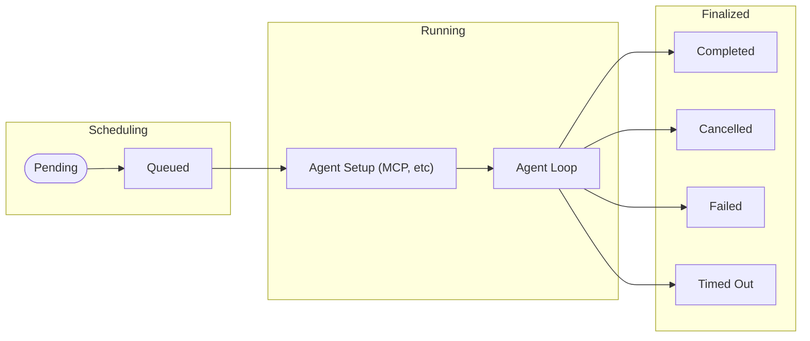
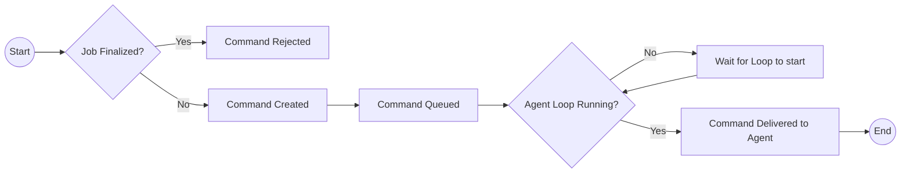

# Mid-session Steering

Status: accepted

Related issue: https://github.com/github/sweagentd/issues/890

## Context

One of the most highly requested features for CCA was to have the ability to be able to interact with the agent throughout its Session. This would allow users to provide more context or bring the agent back on track quicker whenever it starts getting lost.

This ADR describes the low-level implementation of this capability.

### Example scenarios

Below is a non-exhaustive list of potential scenarios we'd like to support through this feature

#### Sending a new text comment to the agent
**Status:** ✅ Implemented

**Why:** This is the primary way the user will be able to interact with the session and provide further context to the agent.

At the moment this functionality is available through the "View Sessions" (aka session logs UI) page and there is an ongoing effort to port it to "Mission Control". Further use-cases may be added in the future (e.g. CLI).

#### Linking specific Files/Issues/Pull Requests
**Status:** ❌ Not planned

A user would be able to provide more context on what the agent is working on by providing it with links to specific files, issues, or pull requests through the steering comment, giving it more focus and potentially increasing its accuracy.

#### Adding attachments
**Status:** ❌ Not planned

Similar to the scenario above, we could allow a user to provide additional attachments (images, diagrams, etc) in order to increase the agent's accuracy.
This work would benefit from [this issue](https://github.com/github/sweagentd/issues/3980) being implemented first.

## High level design

The high-level design of the mid-session steering feature revolves around the concept of user commands that can be issued to the agent during its execution. This design allows for a flexible and extensible way to interact with the agent, providing it with additional context or guidance as needed.

A high-level architecture diagram is shown below:
![Mid-session steering architecture][mid-session-steering-architecture]

[Figma Link][mid-session-steering-architecture-figma]

## Approach

Throughout this section we will explore the core changes done to our product in order to support mid-session steering.

### Steering through Commands

While our current implementation only supports raw text messages, it was important that we'd design a system that could be easily extended to other use-cases. It was for this reason that the concept of a `Command` was introduced to our service.

`Command` is an abstraction that **represents an action taken by the user on an ongoing `Job`**. A command has [a series of properties](https://github.com/github/sweagentd/blob/bc6e973129ec62ff26fce3491502f0ec0932db69/internal/jobs/command/command.go#L22), out of which is important we explore the following:

- `Type`: An enum which represents (as the name suggests) the "type" of a command. At the time of writing the only supported type is `"user_messages"`, but the idea would be to also support types like `"attachment"` or `"issue_number"` in the future.
- `Status`: Each command has its own lifecycle which this property keeps track of. We will explore this further in the next section
- `ExternalTimestamp`: Since commands can be emitted to `sweagentd` from integrators, this guarantees we can deliver commands to the agent in the same order our integrator processed them

#### Command Lifecycle

Commands follow a lifecycle that closely aligns with the Job's execution phases. The diagram below illustrates this relationship:



Users can submit commands to interact with an agent while the Job is in either of the "Scheduling" or "Running" states mentioned in the diagram above. Once a Job reaches any of the "Finalized" states (Completed, Cancelled, Failed, or Timed Out), the system will reject any new command submissions.

**Important timing consideration:** While the system accepts commands during both Scheduling and Running phases, **commands are only delivered to the agent when it's actively executing its main loop.** This means commands submitted during the scheduling phase will be queued and delivered once the agent begins execution.

Equipped with this knowledge, we can then map out the complete lifecycle of a command:



### Accepting Commands

Commands can be submitted to `sweagentd` via a Twirp endpoint: `CreateCommand`.

This endpoint accepts a `CreateCommandRequest` which contains the following fields:
- `job_id` (string, required): The ID of the job to which the command should be associated.
- `type` (enum, required): The type of command being created. Currently, the only supported type is `user_message`.
- `content` (string, required): The actual content of the command, such as the text message to be sent to the agent.
- `timestamp` (timestamp, optional): An optional timestamp indicating when the command was created externally. If not provided, the server will use the current time.
- `owner_id` (string, required): The ID of the owner of the repository where the job is running.
- `repo_id` (string, required): The ID of the repository where the job is running.
- `actor_id` (string, optional): The ID of the user or system that is creating the command. 

On success, the endpoint will return a `CreateCommandResponse` containing the ID, if provided, the external ID and associated job ID of the newly created command.

Additionally, the endpoint will return appropriate error codes in the following scenarios:
- `404 Not Found`: If the specified job does not exist or the actor ID doesn't have access to the job.
- `400 Bad Request`: Missing required fields in the request.
- `412 Precondition Failed`: If the job is in a finalized state (Completed, Cancelled, Failed, or Timed Out) and cannot accept new commands.
- `500 Internal Server Error`: For any other unexpected errors.

### Delivering Commands to the Agent

Commands are delivered to the agent during its main execution loop. We achieve this by expanding the existing logic that the agent uses to report progress back to `sweagentd`. In that callback, the agent provides a custom parameter, `accepts_user_messages`, which indicates to `sweagentd`, as the name suggests, that it is ready to receive user messages.

> [!IMPORTANT]
> We aren't exposing the concept of commands to the agent directly. Instead, we are only exposing the subtype of user messages. This is to keep the agent implementation simple and avoid coupling it too tightly with our internal command structure, since the handling of other command types will likely require different logic.

After `sweagentd` receives a progress update from the agent with `accepts_user_messages` set to true, it will check if there are any pending user message commands for that job. If there are, it will deliver them to the agent in the order they were created.

The agent, in turn, will process these messages, and include them in its context for subsequent reasoning and actions. It will also include the message into its Session Logs in the form of a `UserMessageEvent`, for example:

```json
{
  "kind": "message",
  "message": "Please make sure to also add unit tests for the new feature",
  "source": "command-<command_id>"
}
```

### Capturing the agent's attention

Whereas every feature implemented in Copilot Coding Agent so far has focused on improving the agent's outer loop experience, mid-session steering is the first feature that directly impacts the agent's inner loop. As a result, it was important that the experience of sending a message to the agent felt as conversational as possible.

This is currently being achieved through prompt engineering. The agent's system prompt has been updated to include the following instructions:

```
<new_requirement_instructions>
* New requirements will be enclosed in <new_requirement> tags.
* Acknowledge the new requirement by restating it back to the user in your next response.
* Address the new requirement as soon as possible.
* Always validate that your changes don't break existing behavior.
</new_requirement_instructions>
```

And, as suggested by the prompt above, every single user message provided to the agent will be wrapped in `<new_requirement>` tags, for example:

```
<new_requirement>
Please make sure to also add unit tests for the new feature
</new_requirement>
```

[mid-session-steering-architecture]: ./img/mid-session-steering-architecture.png
[mid-session-steering-architecture-figma]: https://www.figma.com/board/5HoxXETb0pZN6VT5JJl4fk/CCA-Mid-session-Steering?node-id=0-1&t=wpXvy9k8aqDLuCVD-1