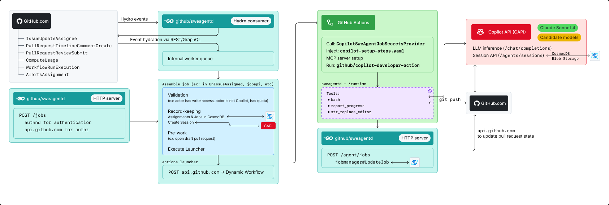
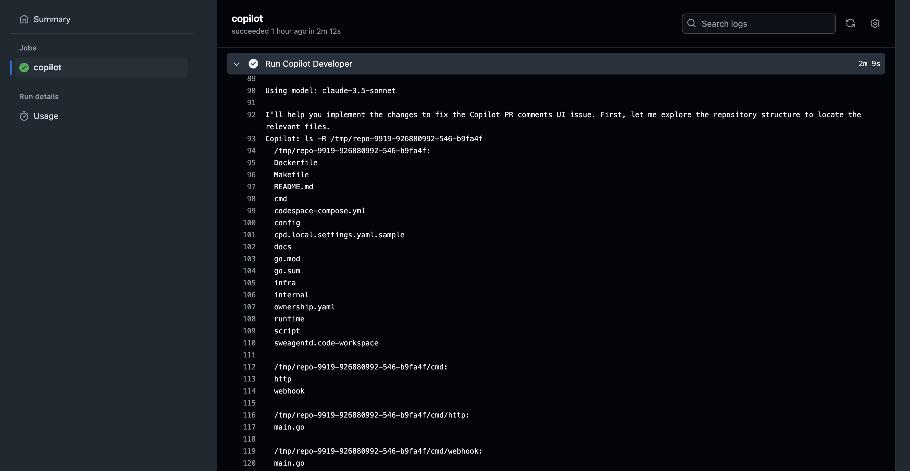

# Architecture of Padawan

## Hydro events

The primary way to trigger the Padawan event loop is via Hydro events. `sweagentd`, a **Go service running in Moda**, listens to a few Hydro events (list not complete):

* `github.v1.IssueUpdateAssignee`
* `github.v1.PullRequestTimelineCommentCreate`
* `cp1-iad.ingest.github.v1.PullRequestReviewSubmit`
* `cp1-iad.ingest.github.actions.v0.ComputeUsage`
* `github.actions.v0.WorkflowRunExecution`
* `code_scanning.v0.AlertsAssignment`

Upon receiving an event, `sweagentd` does a few basic checks (ex: Feature Flags, via [`vexi-go`](https://github.com/github/feature-management-client-go/blob/main/vexi/README.md)).

Then, we **hydrate the event** - Hydro events are lightweight and only contain a subset of the information we need. We use the public GitHub API (REST and GraphQL)[^1] to get the rest of the information we need.

### CosmoDB for "assignments"

When a valid[^2] event is received, we create or retrieve an "assignment" in CosmoDB[^3]. This is a record of the original task, and is used to correlate future events to the original request. For example, an assignment is created when Copilot is assigned to an issue - and when a user submits a pull request review, we look up the assignment to include the original issue in Padawan's context.

## Compute via Actions' Dynamic Workflows

Once we've deemed an event "valid", and we have an assignment, we initiate "compute". In production, this is done via GitHub Actions' Dynamic Workflows[^4] - where we send Actions a YAML string for it to execute, in the context of the repository.

Before actually executing that YAML workflow, Actions calls the [`CopilotSweAgentJobSecretsProvider`](https://github.com/github/github/blob/master/app/api/internal/twirp/actions/core/v1/job_secrets_provider/copilot_swe_agent_job_secrets_provider.rb) in `github/github`, to get the secrets that Padawan needs to run.

The workflow YAML itself contains a small number of steps:

* Download the [`github/copilot-developer-action`](https://github.com/github/copilot-developer-action) - this is a _private_ repository, and contains the "runtime" of Padawan. It is the compiled distributable of `sweagentd`'s `/runtime` directory.
* Run `github/copilot-developer-action`.

### copilot-setup-steps.yaml

Prior to calling Actions' Dynamic Workflows endpoint, we see if there is a `copilot-setup-steps.yaml` file in the repository. If it exists, we partially inject it in the workflow YAML. This file allows users to partially customize the Actions workflow. Customizations include changing the workflow timeout, and user-defined setup steps that run before the agent's runtime is executed. These customizations enable users to customize the environment in which the agent runs, such as installing additional tools or setting up configurations, and place limits on the agent's execution. See [Preinstalling tools or dependencies in Copilot's environment](https://docs.github.com/en/enterprise-cloud@latest/copilot/customizing-copilot/customizing-the-development-environment-for-copilot-coding-agent#preinstalling-tools-or-dependencies-in-copilots-environment).

### MCP

MCP servers can be run locally within the Actions workflow. See [Extending Copilot coding agent with the Model Context Protocol (MCP)](https://docs.github.com/en/enterprise-cloud@latest/copilot/using-github-copilot/coding-agent/extending-copilot-coding-agent-with-mcp#example-configurations).

## Runtime

The runtime itself is where the magic happens. It is the "agent" that runs in the context of repository; it orchestrates over a set of tools, inspired by [Claude SWE-Bench Performance | Anthropic](https://www.anthropic.com/engineering/swe-bench-sonnet). During the agent's orchestration, it calls `sweagentd`'s HTTP endpoint to "callback", so that we can update the pull request with progress. This includes updating the PR's description, posting comments, etc.

Because the runtime runs in Actions, all of the logging that the agent does is available in the Actions UI. This is useful for debugging, and also for the user to see what the agent is doing:

|  |
| --- |

## Job API (preview)

There is also a Job API that can be used to programmatically trigger the agent. This is used by the Dotcom Chat skill (`codeagentskill`). It is a REST API that allows users to trigger the agent with a specific task, that takes a problem statement and a target repository. Internally, the API calls much of the same code as the Hydro event loop to create a new assignment/job in CosmoDB, a session via CAPI, and then trigger the agent via Actions.

### CAPI

The runtime calls CAPI for inference, using a user-to-server token minted in the aforementioned `CopilotSweAgentJobSecretsProvider`. At time of writing, we are using `claude-sonnet-3.5` and `claude-sonnet-3.7`. We are also intending to use any proprietary models that are developed for this kind of scenario: writing code, inspecting codebases.

#### Sessions

The Session API is also called from both the service and the runtime, to track _user-facing_ session information. This is designed to include things like logs, user-friendly status updates, and detailed information outside of raw logging. That information is stored in a CosmoDB in CAPI, and later queried from GitHub.com to be presented to the user in the UI.

For each job, a new session is created before executing the Actions workflow, and the session ID is passed to the runtime. The runtime then uses this session ID to append logs to the session, which is later displayed in the UI.

---

[^1]: We use the public API because it is easy and robust - overtime, we will look at building out lighter-weight internal Twirp APIs for performance/load.

[^2]: "Valid" means that the event is not ignored (ex: the repository has the appropriate feature flags, the actor isn't Copilot, the actor isn't spammy, etc). This is a subset of the "basic checks" mentioned above.

[^3]: This is a CosmoDB instance dedicated to `sweagentd`. The Session API in CAPI uses a CosmoDB database owned within CAPI.

[^4]: In local development, we also use a Docker "launcher" to execute the agent. The key here is that the compute environment doesn't matter as much as what tools it has access to - and the agent may deem it necessary to install new ones into its sandbox.