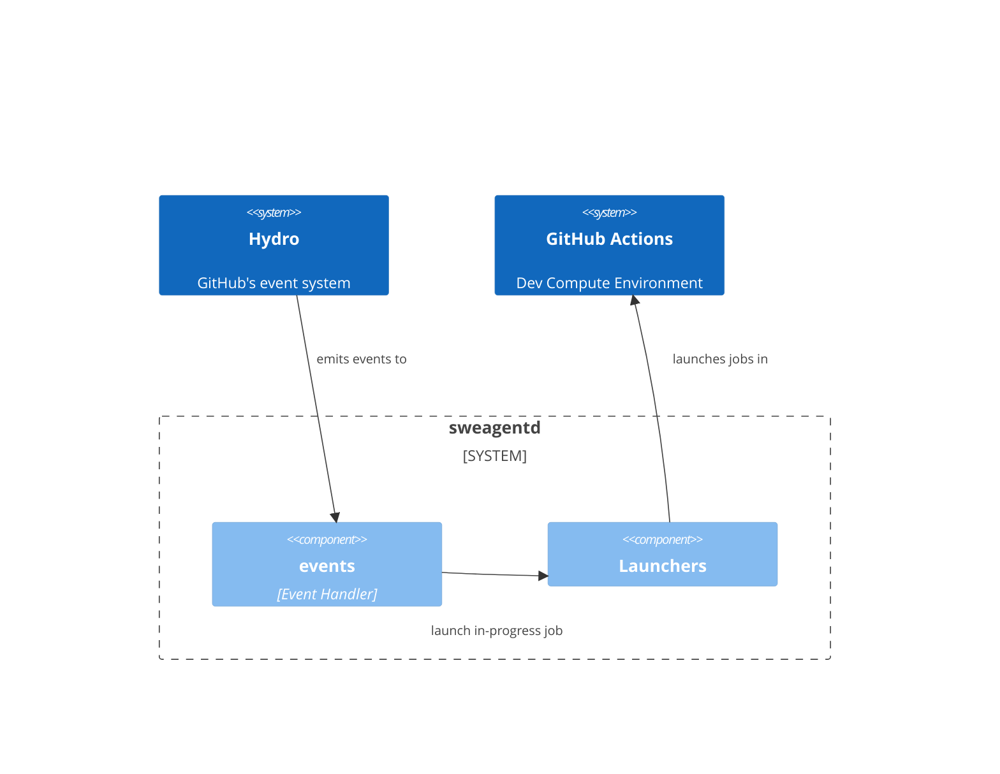
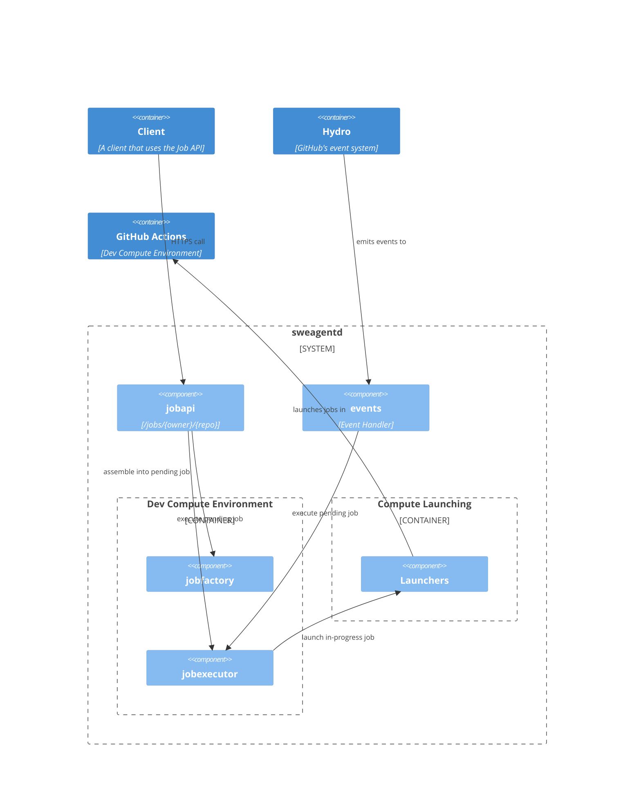
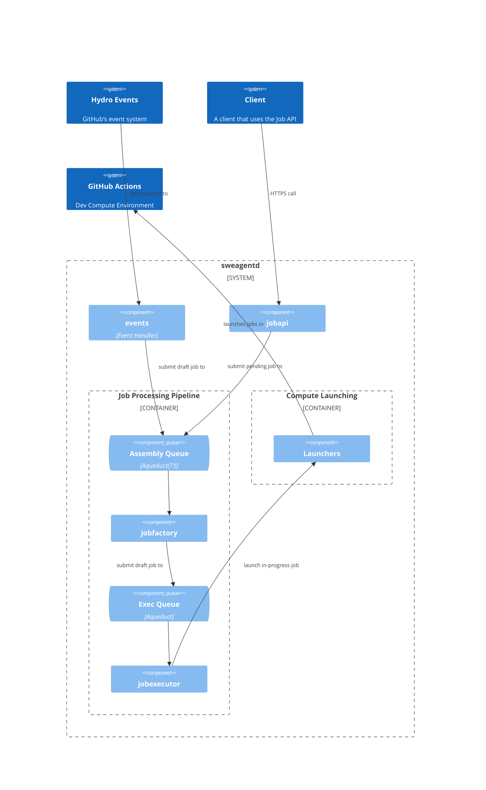
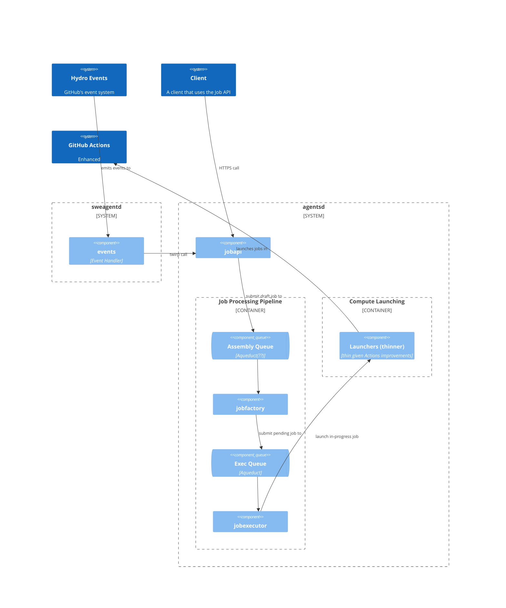

# AI Agent "Job" Architecture and API

## Background
The `sweagentd` service currently is responsible for the following:
* Event handling
    1. Determining whether `hydro events` emitted from the rest of GitHub should be processed by the agent, and responding appropriately if not.
    2. Gathering any additional context not available in the hydro event payload required to process the event.
* Job assembly and execution
    1. Assembling an AI agent `job` associated with needed downstream concepts to respond to the user triggering the event (e.g., a PR, a session).
    2. Provisioning needed "developer compute" (e.g. Actions environment, a dev container) and triggering the agent within it.
    3. Monitoring the job execution and providing feedback to the user based on what was assembled in step (i).

Event handling is very specific to GitHub's implementation of Copilot coding agent and is not generalizable for the most part since it is oriented around a specific workflow and available data.  Job assembly and execution can be generalized to other AI agent implementations, and is the focus of this document.

While the hydro event-based system originally put in place was powerful for use within the service side of GitHub itself, the need for more flexibility quickly became apparent as we looked to integrate workflows that exist in external systems (e.g., VS Code, Slack, Teams, Mobile, etc.) and where need a more direct response than an event can provide (e.g., chat UX in GitHub). We also began talking about integration into non-web based client systems and tools that need to be able to poll or stream responses instead rather than relying exclusively on service callback-like approaches. Furthermore, the event model created a tight coupling, where other teams within GitHub had to add event handlers into the `sweagentd` code base to support their workflows which is always challenging to do well - particularly given the amount of copy-paste involved. Finally, as we expected, there's interest in being able to reuse what we've already put together for a wide variety of other use cases, including those that are not directly related to coding.

Given these different challenges, we realized we needed a more formalized interface that any client could use to submit work into the agentic system.

### The Job API and enhanced agentic scenarios

Rather than starting over from scratch, this led to the creation of a **Job API** on top of the existing execution code that was in `sweagentd`. The API is intended to be broadly used, and is oriented around the idea of "assembling" the needed information into a AI agent "job" that is then orchestrated and executed by one or more agents under the hood. A job you can think of as the system's view of a task that needs to be accomplished by an AI agent.

Initial API goals:
1. Provide a common interface for job assembly and execution that can be used by any client.
1. Allow arbitrary problem statements to be submitted - have no coupling between the source of the problem statement (e.g., an issue) and the underling "job". (There should be no hard tie between an issue and Job for example.)
1. Allow clients to trigger the agent to work on any branch for a repo. (Currently external limitations prevent anything other than `copilot/*` branches from working, but this is a temporary limitation.)
1. Allow external clients to specify a "response type" or progress callback (possibly configured on the GitHub/OAuth App used to call the API) that indicates where the result of AI interactions should be sent. This would be something the `agentcallback` package would use to trigger updates. Currently this is fairly limited, but you can see the beginning of this functionality in support for custom PR titles and descriptions, and a "body suffix" that should always appear as the AI provides updates. One flavor of this would be to emit hydro updates only, but given we need to factor in external systems, this won't be the only response type. Currently progress is always updated on a PR, we should at a minimum support emitting hydro events only, and as we think about 3rd party scenarios a HTTP callback(e.g configured via the GitHub App used to call the API). This would allow clients to poll or stream updates as needed.

Beyond these baseline goals, we also want to expand and broaden the agentic scenarios we can handle today. In particular:
1. Submit jobs that can continue to work on an an initial task that was already completed. (Put another way, a job related to another job that was already completed.) This allows essentially triggering a "system"-like message with a button press rather than requiring the user to go interact with something like chat interface to accomplish something.
    * For example, this would allow the agent to propose a set of suggested tasks that is presented as a list on a PR or session, and the user can click an "execute" button to trigger the agent to do the work without the user having to key in which task should be started. Similarly, we can layer in buttons to "fix merge conflict" on an existing PR - whether the PR was agent created or not. While we can already do this to generate a new PR and assignment (more later), the additional requirement is to be able to perform these kinds of activities on an existing one.
1. Allow client requests to further define and customize the behaviors of an agent and how / where it responds to the user (in addition to the "response type" described previously).
    1. Allow clients to specify a mode of operation or type of "action" the agent should perform. For example, today `fix` is the primary mode of operation. However, we want to support alternate prompting via modes like `ask` or entirely custom modes of operation.
        * Provide a way to define custom modes of operation inclusive of alternate prompts, out-of-box MCP servers, and custom set up steps.
    1. Allow clients to add more agentic capabilities on an ad-hoc basis through dynamically specified MCP servers and/or copilot setup steps at the API level.
1. Allow clients to specify or request the use of an agent other than sweagentd's default agent for a particular job (e.g., use a SRE agent, or even Claude Code).

The goal is really to get an aggregated spot where all of these existing scenarios can add value without needing to define a bespoke endpoint for each.

**[You can see the current state of Job API state in this ADR](./adr/0001-create-job-api.md)** along with example scenarios and other information.

However, in aggregate, this meant not only defining a new API, but also refactoring the existing `sweagentd` service to support it with an eye to future needs.

## High-level Architecture: Original, Current, and Future

The initial implementation of `sweagentd` did not (and in some cases still does not) separate out event handling and job assembly/execution completely. As a result, there was a lot of copied code as we added new events that has become a maintenance challenge. This was appropriate given the exact needs of job assembly/execution were not known at the time, but we wanted to account for this fact when considering how the architecture should evolve.

Initial refactoring has been moving forward in the following steps:

1. Separate out the core job assembly and execution code into a `jobfactory`, `jobexecutor`, and related utilities (e.g. `jobutils`) packages.  The `jobfactory` package is used to draft an initial job API "job", and then "assembles" information from various sources into fully hydrated job ready to be submitted (aka a "pending" job). The assembly process also creates any needed related data required to execute the job (e.g. a PR). The `jobexecutor` package then takes this fully assembled "pending job" and executes it in the appropriate compute environment. Today a fully assembled pending job is submitted to the `jobexecutor` up front via `ExecuteJob`. However, as we tackle queuing, a draft job will be submitted instead, and the assembly step will happen after the job is picked up for processing in `ProcessJob`. (More on this later.)
2. Create an initial `jobapi` package that provides the HTTP interface handler and uses these two packages to create and manage the resulting jobs.
3. **[Not started]** Once this API and underlying set of packages matures, update the existing event handler code to use these same packages rather than having their own as a way to reduce maintenance over time.

Three related, but concurrent efforts are also beginning to shape the future of the architecture:
1. We need to improve the reliability of executing jobs by queuing and smoothing out processing to better handle cases when people hit rate limits or our available total GPU compute is exhausted.
1. We need to enable other agents to execute within the compute layer, and therefore formalizing the interface between the execution aspects of the service and the underling `runtime` agent.
1. Look for opportunities to thin out the complexity of launching the actual compute and related setup feature set (currently in `internal/launcher`) and make more of it native to GitHub Actions.

To see this evolution, consider these diagrams:

#### 1. Original

#### 2. Current (as of 7/27/2025)

We've already taken steps to bring job assembly and execution out of the event handler, and have layered in the start of a general purpose Job API. However, the process of assembling a pending job is still done inside the individual event handlers for jobs flowing from hydro. The Job API has the more general purpose pending job assembly separated out from its main HTTP handler instead. This stages things so that events could reuse this same code in the future. The following diagram shows the current state of the architecture.

#### 3. Soon
As we are adding more capabilities, experimentation frameworks, and validations into the process of assembling a pending job, performance has started to become a concern. We can expect this problem will continue to get worse over time as what we need to do grows in sophistication.

Given we've we already know we need to queue the execution of work to improve reliability and handling of rate limits, a natural next step is to queue the assembly process behind a queue. While it is possible to use the same queue and handler, the reality is they have very different SLAs and exception handling. An **assembly queue** needs to be able to complete in seconds and generally should not re-queue in the event of a failure since it cannot proceed further. An **execution queue** focuses on shaping load which and under certain conditions can result in the job sitting in the queue for many minutes. Furthermore, there are more infrastructure failures to consider with VM compute where a retry / re-queue would be appropriate, and prioritization may not be as simpile is FIFO.

If we assume there are then two queues:
1. The event and Job API handlers can both submit "draft" jobs to the assembly queue.
2. The `jobfactory` picks up these draft jobs and creates PRs, branches, etc (if applicable) and moves the job into a "pending" state.
3. It then submits the this "pending" job to the execution queue.
4. The `jobexecutor` then picks these up and actually starts the process of executing the work via Actions. 

#### 4. Possible Future
While we have built job queuing and execution into `sweagentd`, its rapidly becoming apparent that this tight coupling has some downsides. It is very difficult right now to rev how sweagentd behaves without also impacting the event and other aspects of the codebase.  As we think about broader use cases, this actually makes the situation worse since we'll need to alter key structures like the "Job".  Consequently, the current proposal is that in the future it will make sense to break out the job assembly and execution into a separate service tentatively named `agentsd` that can be used by `sweagentd` and other clients in the long term. 

Once queuing is in and we feel like the core API is in a good spot, we would try to minimize change in this portion of `sweagentd` while `agentsd` is being built out, but a big portion of what it needs to do will be based on what is already in `sweagentd`. So, in effect `sweagentd` may really be `agentsd` as it grows. For now, we'll continue to evolve `sweagentd` with this direction in mind, so that at the **code level**, it is as if it's a separate "service", even if **physically it's not**. That positions us to make a physical separation to alleviate the downsides referenced above as a **next step**.

Once that happens, whether physical or logical, the picture above changes since we can now further separate out eventing from the core pipeline and API. We can also factor in Actions capabilities becoming more robust.  For a physical separation for the Job API, we can add a `/v2` route into the existing CAPI-based proxy at `https://api.githubcopilot.com/v2/jobs/{owner}/{repo}` that will proxy to the new `agentsd` service. This will allow us to keep the existing Job API in place while we transition to the new service.

This is roughly what this would look like:

## Job States

Today the jobs go through the following states:

1. **Pending**: The job has been saved, but is not yet executing.
1. **In-Progress**: The job is currently being executed.
1. **Completed**: The job has been executed and the results are available.
1. **Failed**: The job has failed to execute and the results are available.
1. **Cancelled:** The job was cancelled by the user.

In the future, we know that we need to queue work in order to better optimize compute use and avoid failing outright when we outstrip GPU capacity entirely. This will alter the states jobs go through to include a bit more:
1. **Draft**: [New] The job was just created, but not enough information has been provided to execute it.
1. **Queued**: [New] The job has been submitted to the queue for execution, but has not yet been processed.
1. **Pending**: The job has been assembled into a job ready for execution.
1. **In-Progress**: The job is currently being executed.
1. **Completed**: The job has been executed and the results are available.
1. **Failed**: The job has failed to execute and the results are available.
1. **Cancelled:** The job was cancelled by the user.

## Sequential Processing - "Assignments"

One of the less visible capabilities within the the job execution code is the idea of an "assignment".

While it can be useful to fire off many AI tasks in parallel, some scenarios are better served by running series of jobs in sequence - particularly when a new task is triggered while another is already working on the same resource. For Copilot coding agent, that resource is a branch and a PR. Running multiple tasks in parallel can result in conflicting code where even an AI driven automated merge conflict capability would fail. The same is true for changes outside of the code. Memory can be similarly impacted with conflicting data, and since agents are typically oriented around creating or updating data, you can end up in situations where multiple issues or other items are created or overwritten (e.g. as a result of MCP tool calls by different jobs running in parallel). Worse yet, each agent task may report that it was successful not realizing that what it did had been overwritten by another job that was running at the same time.

The idea of an "assignment" is a simple way to group multiple jobs together and is intended to enable sequential processing. Today, you can think of this as a set of work that should be done when an issue is "assigned" to copilot. However, assignments are also created for anything done via the Job API as well. It's an overarching idea that applies to PR comments across the board today, and will expand beyond that.

Today there's one assignment per PR. But under the hood, we did not anchor the concept directly to the PR itself since we envision scenarios where PRs are never created. We need to be able to group by a "resource" which you'll see in the assignment object in the `jobs` package. That said, the only sequential processing we've wired together so far is for PR comments.

To illustrate how this works, consider the following sequence of events:

1. Someone comments on a PR, which results in a hydro event and ultimately a job being created in a **pending** state.
2. The system then checks to see if there is **already a running job** for the assignment associated with this PR.
3. If so, it **leaves the job in a pending state** but appending the new comments as "context".
4. Once the currently running job completes ( `on_workflow_run_completed`), the system checks to see if there are still any pending jobs for the assignment.
5. If so, it executes the **next job** for the assignment.
6. The system then repeats this process until there are **no more pending jobs**, and then stops.

We can reuse this in other cases by allowing step (2) to perform lookups by other resource types. The processing is otherwise identical.

#### How is this different from job queuing?

This concept **is separate from job queuing**:
* Job queuing is intended to decouple job queueing and job execution, hence smooth out load on downstream services and improve reliability through retry, pausing, and prioritization capabilities. It's goal is to enable and optimize concurrency to get the fastest total throughput of jobs.
* Assignments exist to group together and ensure that jobs are executed in a specific order so that they do not create conflicting or otherwise confusing results.

We need both concepts.

