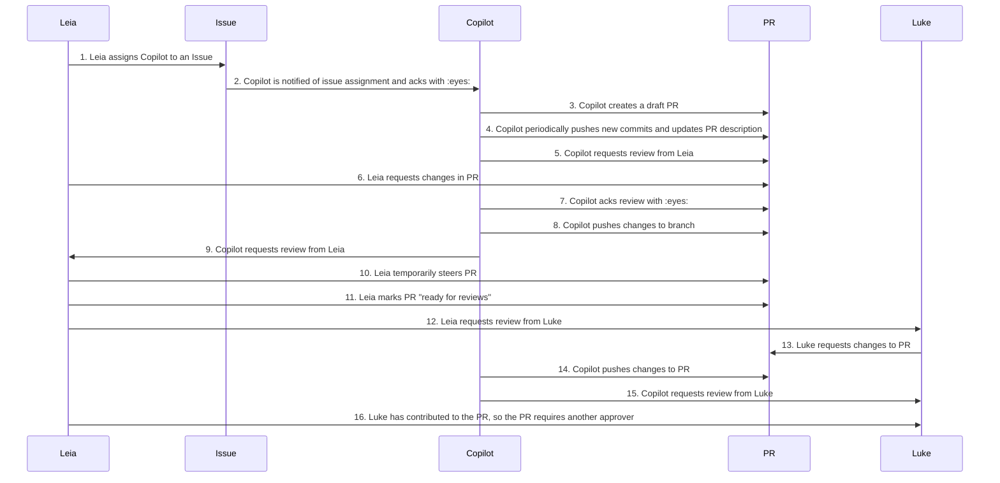

# Padawan Workflow

This file documents the Padawan workflow in order to have a source of truth on the intended workflow that a user engages with Copilot (Padawan). The intended workflow to capture is for Private Preview (End of April - really the third week of April).

> Note: In the below workflow, `Copilot` is intended to showcase the user facing workflow that may combine many of the actions differentiated between sweagentd and the runner that is executed in an Action.

In the following flow, the term "Copilot trigger" will be used to describe when Copilot takes an action as a result of a user's action (resulting in an action job being executed).

1. Leia lists and selects Copilot from Assignees in an Issue. Copilot is assignable when:
    1. Leia has a Copilot license
    1. Leia has write access to the repo
    1. Copilot is installed on the repo
    1. Copilot is feature flagged on the repo
    1. Copilot is not listed in the dropdown if user does not have access
    1. Note: Only users with write access can assign assignees (security requirement)
1. Copilot is notified on event `on_issue_assigned` and reacts to the Issue body with :eyes: to acknowledge assignment
1. Copilot opens a draft PR:
    1. Copilot verifies if the issue has a description
        1. Out of Scope: Do we want to verify if the description is strong eonugh?
    1. Copilot creates a branch
    1. Copilot pushes initial commit
        1. Commit author: Copilot
        1. User-to-Server Token: Leia
        1. User who triggers the Copilot action is associated with the commit via the token in order to enforce "Requires approval" rules/branch protections and allow for Copilot initiation auditing
    1. Copilot opens a draft PR with title/description when draft PRs are available
1. Copilot iterates on PR:
    1. Copilot updates PR description with status updates
1. Copilot requests review from Leia
    1. Requesting an explicit reviewer on a draft PR creates a notification
 . Leia requests changes from Copilot
    1. Leia submits a PR review (this can be requested changes, approval with comments, comment)
    1. Copilot only monitors PR if it is the PR author AND it is assigned to the PR
    1. Iterating with Copilot in a non-Copilot authored PR is out of scope
1. Copilot acks requested changes with :eyes:
    1. Copilot uses a LLM filter tool to determine _if_ it should respond to a comment. Otherwise it will silently ignore.
1. Copilot pushes a new commit with changes to the branch
    1. Commit author: Copilot
    1. User-to-Server Token: Leia
    1. Leia has the option to "[revert changes](https://github.com/github/sweagentd/issues/526)" that Copilot commits as needed
1. Copilot requests review from Leia
1. Leia temporarily takes over steering from Copilot
    1. Leia unassigns Copilot from PR
    1. Leia pushes changes to the branch
    1. Leia hands over steering back to Copilot by assigning Copilot to the PR
    1. Question: Do we see a scenario where it makes sense to only temporarily take over steering?
1. Leia marks PR as ready for review (opening the PR)
    1. Copilot remains at the PR author
    1. Reviews are also now requested from CODEOWNER teams
1. Leia requests review from teammate Luke
1. Luke requests changes to the PR
    1. The PR is assigned to Copilot
    1. Copilot will respond to requests with or without @copilot mentioned
1. Copilot pushes a new commit with changes to the branch
    1. Copilot uses an LLM filter tool to determine if it should respond to the suggestions
    1. Commit author: Copilot
    1. User-to-Server Token: Luke
    1. Copilot requests review from Luke
    1. Option to [revert the commit](https://github.com/github/sweagentd/issues/526)
1. Copilot requests review from Luke
    1. Copilot requests reviews from the Copilot initiator
1. Leia requests review from teammate Rey
    1. If Copilot commits using the u2s of the initiator, Luke may not be able to give a "final approval" since they pushed to the branch. This is dependent on what settings are in the branch protection.
    1. Rey, a third party who has not co-authored with Copilot OR contributed to the PR must give the final review

## Workflows that are not intended to trigger a Copilot iteration:

1. Issues that are closed
1. @copilot mentioned in an issue
1. Issues where Copilot is not assigned
1. PRs that are closed
1. PRs where Copilot is _not_ assigned to the PR
1. PRs where Copilot is assigned but is not the author of the PR
1. PRs where Copilot is assigned to a PR but not comments are on the PR 
1. Action failures
    1. This could be a setting that determines if Copilot should iterate on Action failures
1. If a user does not have access to Copilot
    1. Copilot should not be assignable
    1. Copilot should not be mentionable in a review comment
    1. Copilot should not respond to request reviews

## Workflows that are intended to trigger a Copilot iteration:

1. Anytime issues are assigned to Copilot, it will open a fresh PR
    1. Issues where Copilot is unassigned and re-assigned, Copilot will generate a new branch with new PR
1. PR review states
    - Request Changes (trigger)
    - Comment (trigger)
    - Approve (trigger)
1. Individual PR comment where @copilot is not mentioned (trigger)
    1. Copilot will use an LLM filter tool to determine whether it should respond to a comment regardless of if it was mentioned

## Open Questions:

1. If a reviewer invoked Copilot to iterate on the PR and Copilot co-commits the changes with the reviewer, then who is ultimately able to "approve the PR"? Or should who initially assigned Copilot to the PR be responsible for all commits?
    1. Luke reviews PR and requests reviews, Copilot co-commits with Luke
    1. Do we need Rey on the same reviewers team to _also_ review the PR?
    1. Question: Will this cause issues with solo-maintainer repos? Thread in [#repo-rules](https://github.slack.com/archives/C04M8NHLUTZ/p1742288619898859).
    1. Answer: Solo-maintainers likely don't have branch protection that prevent merging without a reviewer. As far as who would approve the PR, this may depend on the following settings `Ignore approving reviews from pull request contributors` and `Require approval of the most recent reviewable push` (see [slack convo](https://github.slack.com/archives/C0891ESUXGW/p1742963645266929)) 
1. There are several scenarios that are not supported where we need to determine how we want to respond either by silently ignoring or Copilot emoji reacting with :eyes: when it does intend to respond
    1. UX Note: Ignore requests that Copilot determines it does not need to respond to
    1. Question: What happens if Copilot isn't responding due to rate limits?
    1. Copilot is already assigned to an Issue, user attempts to iterate on PR by commenting on issue without mentioning Copilot
    1. Copilot is already assigned to an Issue, user attempts to iterate on PR by commenting on issue with `@copilot` mentioned (unsupported autocomplete)
    1. Copilot is not assigned to an Issue, user attempts to iterate on associated PRs by commenting on issue with `@copilot` mentioned (not sure we can filter autocomplete based on if it's assigned)
    1. Copilot is assigned to a PR and a user requests changes, but user does not Copilot access
    1. Copilot is assigned to a PR and a user mentions Copilot in a code review comment, but user does have Copilot access
    1. Copilot is not assigned to a PR and a user mentions Copilot in a code review comment, and user does have Copilot access
    1. Copilot is not assigned to a PR and a user mentions Copilot in a code review comment, and user does not have Copilot access
    1. User mentions Copilot in a code review comment and does not have repo write access
    1. User mentions Copilot in a PR comment and does not have repo write access

## Useful Links:

1. Security [notes](https://github.com/github/product-security-reviews/issues/1118#issuecomment-2711555065)
1. Conversation with [#ce-apps](https://github.slack.com/archives/CD9PT6ZDY/p1742238977450289)
1. Conversation with [#pull-requests](https://github.slack.com/archives/C08J4HX58NN/p1742237655643219)
1. Google doc with workflow meeting [notes](https://docs.google.com/document/d/16XR8e4cyCzZdj5-1AoOWcWGbqXbU32En3D96nz1Mgfc/edit?tab=t.0)