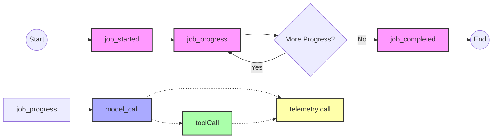

# Telemetry

Sweagent emits events that can be used to better understand the progress of a workflow.
Some data is logged to Splunk, and some to Kusto, with the ability to inspect PII-sensitive data.
We emit different kinds of data on Splunk and Kusto.

Related configuration:
- Hydro
  - [hydro protobuf definitions](https://github.com/github/hydro-schemas/tree/main/proto/hydro/schemas/sweagentd/v0)
  - [hydro topic configuration](https://github.com/github/hydro-schemas/blob/main/topic-configuration/production/potomac/sweagentd.yaml)
- Kusto [Warehouse configuration](https://github.com/github/warehouse-config/blob/main/bulkhead/hydro/sweagentd.yml)

## Splunk

Logs in Splunk:
  - [Splunk UI](https://splunk.githubapp.com/en-GB/app/search/search)
  - Use `index=sweagentd`

## Kusto

Tables in kusto:
- available tables can be seen here in the data-warehouse in gh-analytics.eastus cluster. Relevant config: [warehouse-config](https://github.com/github/warehouse-config/blob/main/bulkhead/hydro/sweagentd.yml)
- Go to Kusto
  - [Kusto UI](https://dataexplorer.azure.com/clusters/gh-analytics.eastus/databases/hydro)
  - make sure you are using `gh-analytics.eastus`
- Access restricted tables
  - Close all opened sessions with Azure Data Explorer
  - Request access to the role `Azure - Prod - Copilot - Hydro - Restricted Telemetry` via `Okta>Azure Portal (JIT Access)` - try with 6h duration
  - Refresh Kusto UI

## FAQ

- I cannot access the restricted tables even though I did my JIT Access
  - sometimes Kusto is slow in taking the session - hard reload for the Kusto UI might help

- I need more data on Kusto
  - Can that data be added to the events, then make changes on the [protobuf definitions](https://github.com/github/hydro-schemas/tree/main/proto/hydro/schemas/sweagentd/v0)
  - New protobuf events require additional configuration
    - Update [topic configuration](https://github.com/github/hydro-schemas/blob/main/topic-configuration/production/potomac/sweagentd.yaml)
    - Update [warehouse configuration](https://github.com/github/warehouse-config/blob/main/bulkhead/hydro/sweagentd.yml)
  - I need some props/metrics quickly, but do not want to go through the whole process of configuration
    - we have a flexible bag of props/metrics event here called [telemetry](https://github.com/github/hydro-schemas/blob/main/proto/hydro/schemas/sweagentd/v0/telemetry.proto)
      - add `string props` or `number metrics` without any configuration necessary outside https://github.com/github/sweagentd like [here](https://github.com/github/sweagentd/blob/main/runtime/src/model/event.ts#L218C1-L223C24)

      ## Warning

      > ⚠️ **Important:** When adding new telemetry events or modifying existing ones, make sure to review what data should be hidden behind the restricted tables. For example telemetry is very flexible but also dangerous to accidentally put PII sensitive data here, use [restricted props](https://github.com/github/sweagentd/blob/main/runtime/src/model/event.ts#L18) here.

