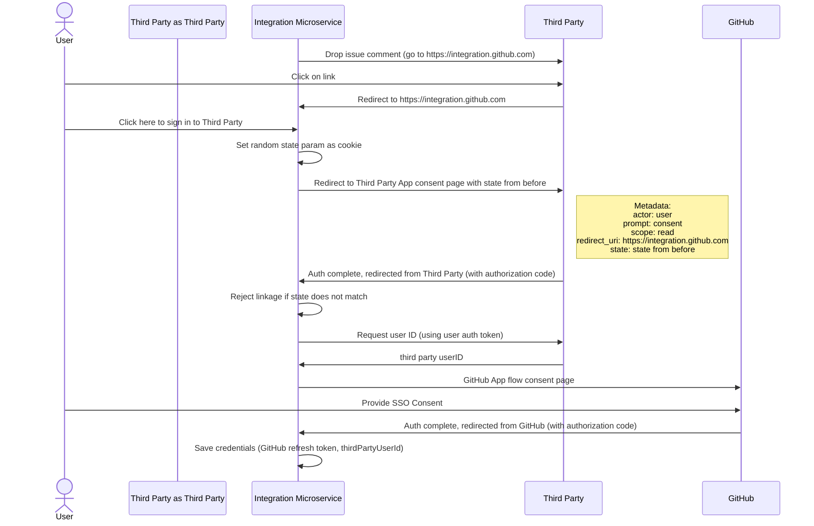

# Integrating Copilot Coding Agent with a Third Party

Looks like you're creating a new integration with the Copilot Coding Agent! This is great, but to ensure we're building a secure experience for all users, please ensure the following conditions are met:

* Only the main issue body and comments from users with verifiable write access to the underlying repository is passed to the Copilot Coding Agent. If there are issue comments in the issue timeline created by users without write access, these MUST NOT be passed as context, to prevent unauthorized users from prompt injecting the agent.
* The context passed to the Copilot Coding Agent MUST be formatted in either HTML, Markdown, or Plain Text. The format of the context MUST be passed to the Coding Agent, so it can perform any appropriate redactions as necessary.
* Ensure that only the version of the context that was visible at the time of assignment is passed to the agent, accounting for any race conditions. Any edits made to the context after assignment should NOT be passed to the agent, to prevent a malicious commenter from prompt injecting a maintainer.
* Any user tokens that are stored to map an external identity to a GitHub identity MUST be encrypted using either SimpleBox or Kredz.
* The assigning user MUST be correlated with a GitHub identity using OAuth, and the Copilot Coding Agent API call MUST be associated with this user.

### OAuth

The OAuth flow to integrate with a third party MUST be as follows:

