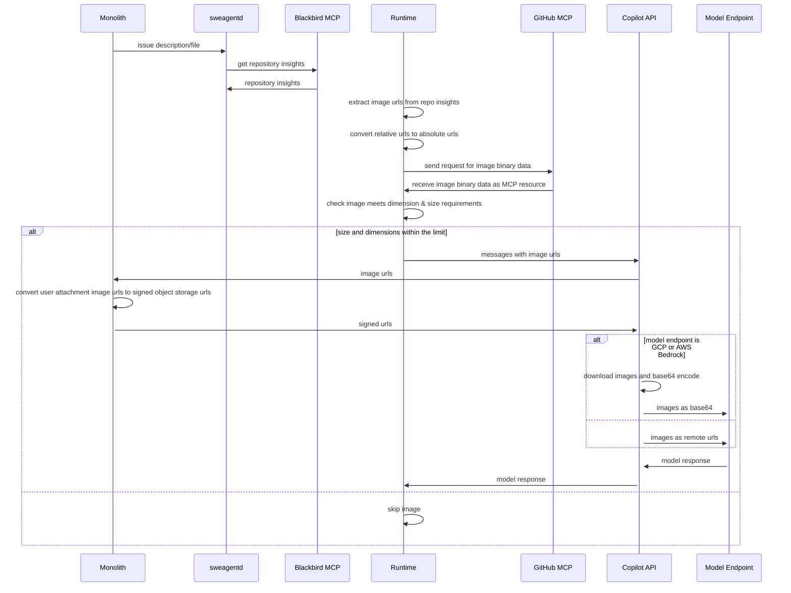
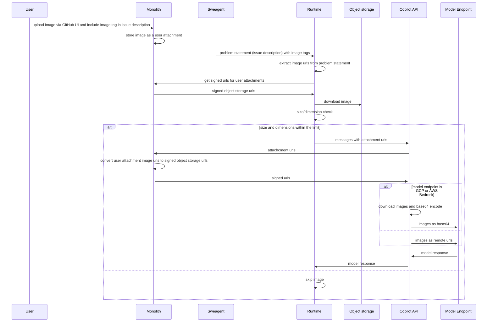
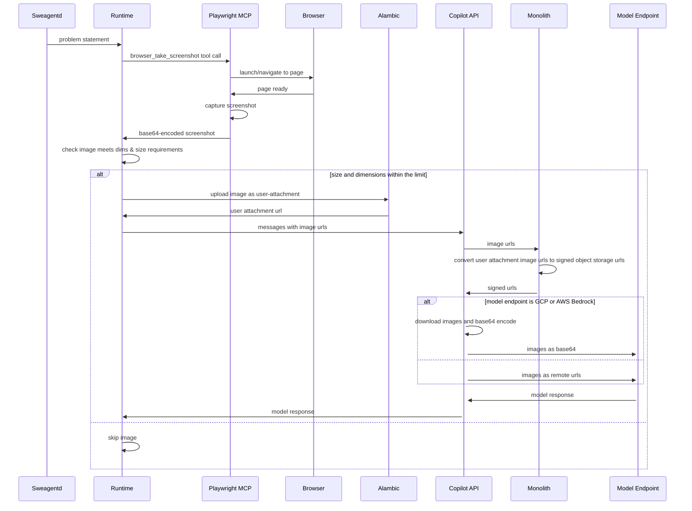

# Vision Support for Copilot Coding Agent

In order to allow for additional user flows around image understanding, there is support for vision in the Copilot Coding Agent. This allows for the agent to use images committed to the repo, uploaded by users and generated through tools such as Playwright MCP to provide additional context to the session.

The image is sent to the model as a remote url in MultiContent message:

```
 {
    "role": "user",
    "content": [
      {
        "type": "text",
        "text": "Here is the image url: https://github.com/user-attachments/assets/9300859f-46c9-4d16-80b0-c9fd0f38adb3"
      },
      {
        "type": "image_url",
        "image_url": {
          "url": "https://github.com/user-attachments/assets/9300859f-46c9-4d16-80b0-c9fd0f38adb3"
        }
      }
    ]
 }
```


There are three distinct flows with images we support:

1. Image tags which includes `` and markdown tags like `` in the problem statement body. Su
2. Image tags inside README files and docs in the repo (committed images). Image url can be relative `` or absolute ``
3. Images returned from MCP like playwright in form of base64-encoded binary content. In this case image is uploaded as user attachment and sent as image url.

We always send images as remote urls and we never send base64-encoded images because of request size limits on CAPI's side.


## Committed Images Flow

Images can be recognised by HTML or Markdown tag in either Issue descriptions or files within the repository. This flow ensures that the images are visible to the agent regardless of whether they are referenced by absolute path or relative path.

Images are sent to CAPI in order to retrieve a signed URL for the image, which is then used to process the image for use in the agent.

### Sequence Diagram



*Depending on the model chosen by CAPI, the images will either be downloaded and sent as base64 or sent as remote URLs

## User Attachments Flow

This allows users to upload images via the GitHub UI, which are then processed by the sweagentd Runtime.
We support urls like `https://github.com/user-attachments/assets/<guid>` or legacy urls like `https://github.com/owner/repo/assets/user_id/<guid>`





## Playwright MCP Screenshots Flow

The Playwright MCP is used to take screenshots if required by problem statement - for example, it is asked to make UI changes.

**IMPORTANT**: All the screenshots are uploaded as user attachments and sent to CAPI as urls, not base64.


