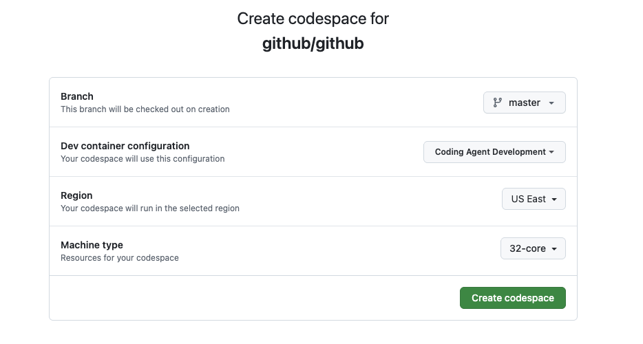

# Setting Up a Codespace for 3P Agent Development

This guide walks through the steps needed to create and configure a new Coding Agent Dev Codespace that enables a 3P agent. 

Currently, we're only able to run one agent at a time locally. This guide walks through setting up Codex but the steps would be similar for setting up Claude

1. Create a New Coding Agent Dev Codespace
 

2. Run the Setup Script

   ```bash
   cd /workspaces/github && script/setup-codespaces-copilot-swe-agent-v2 --capi
   ```
3. Stop the server `script/dx/server-stop`

4. Add the following folders to your workspace:

   - `sweagentd`
   - `copilot-api`
   - `github-ui`

5. Configure sweagentd Environment

   Update the `.env` file in the `sweagentd` folder with the following variables:

   ```env
   CODEX_GITHUB_APP_ID="840"
   CODEX_GITHUB_APP_BOT_ID="2214"
   CODEX_GITHUB_APP_LOGIN="openai-code-agent"
   CODEX_GITHUB_BOT_LOGIN="openai-code-agent[bot]"
   CODEX_GITHUB_APP_PRIVATE_KEY="..."
   CODEX_GITHUB_COMMIT_LOGIN="Codex"
   CODEX_GITHUB_COMMIT_EMAIL="2214+openai-code-agent[bot]@users.noreply.github.localhost"
   ```

   ### Generating the Private Key

   To generate the base64-encoded private key, run the following in a GitHub Rails console:
    `cd ../github && bin/rails c`
   ```ruby
   integration = Apps::Privileged.integration(:codex_agent)
   mona = User.find_by_login("monalisa")
   key = integration.generate_key(creator: mona).private_key.to_pem
   Base64.strict_encode64(key.strip)
   ```

   * Take the output from this command and update the `CODEX_GITHUB_APP_PRIVATE_KEY` value in your `.env` file.

   * Double check that the `CODEX_GITHUB_APP_ID` matches your local codex integration ID, which you can verify by looking at the result of `integration.id` in your rails console.

6. Update the [authnd configuration file](https://github.com/github/copilot-api/blob/main/pkg/authnd/authnd.go#L273) in CAPI to match your `CODEX_GITHUB_APP_ID`

7. Assign the GitHub organization an enterprise license
   
   Navigate to the Enterprise AI Controls:
   - URL: http://github.localhost/enterprises/github-inc/ai-controls/copilot
   - Path: AI Controls > Copilot > Access Management
   - Assign an enterprise license to the organization

8. Enable Policy for the GitHub Enterprise and Org

   You need to enable policies at both the enterprise and organization levels:
   
   **Enterprise Policy:**
   - Navigate to: http://github.localhost/enterprises/github-inc/ai-controls/agents
   - Path: AI Controls > Agents
   - Enable the policy for the enterprise
   
   **Organization Policy:**
   - Navigate to: http://github.localhost/organizations/github/settings/copilot/coding_agent
   - Path: Copilot > Coding Agents
   - Enable the policy for your organization

9. Start the servers
    * CAPI: `cd ../copilot-api && script/server`
    * Sweagentd: `cd ../sweagentd && script/server`
    * Github: `cd ../github && script/server --ui`