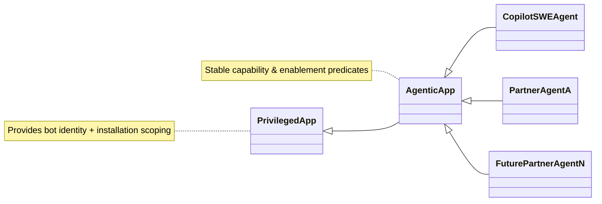

# ADR: Agentic App Identity & Authorization Abstraction

## Status

Approved

## Date

2025-10-20

## Intent (Why This ADR Exists)

We need a consistent, extensible way to represent AI coding agents (GitHub-owned and partner-owned) with clear identity, assignment, mention, and authorization semantics. Current logic is hardcoded to a single privileged and global app (`CopilotSWEAgent`), making partner expansion brittle and duplicative.

## Core Decision

Use a dedicated GitHub Privileged App per partner (rather than a single global privileged app) and introduce a thin agent abstraction so call sites interact with a stable capability contract, not individual app implementations.

Why:

* GitHub Apps already supply installation scoping, bot identity, and token minting; reusing them avoids reinventing auth and compliance primitives while enabling rapid v1 delivery.
* Global-only model (hardcoded Copilot SWE) blocks partner expansion — every new agent would require branching logic as special Authz treatment.
* A light abstraction ("Agentic App") centralizes enablement & capability checks so adding N partner apps does not require touching all invoking code paths.
* **Critical for evolution:** The abstraction provides a stable seam that allows implementation to evolve from hardcoded subclasses (v1) to data-driven capabilities (v2) without rewriting consumers.

Out of Scope:

* Precise Ruby mechanics (interface vs base class vs AR model) — these can evolve without changing the architectural decision.
* Presentation attributes (slug, display name, display description), UI ordering, telemetry specifics.
* Full v2 platform infrastructure (self-service onboarding, capability database schema, marketplace features).

In Scope:

* Per-partner Privileged App usage (Copilot SWE remains the only global-style agent today).
* Unified predicates for: assignability, mentionability, repo enablement, and token permission bundles.
* Consistent two-token issuance pattern (read user OAuth + write installation token).
* Abstraction design that bridges v1 (manual onboarding, hardcoded capabilities) to v2 (self-service, data-driven platform).

## Identity & Interaction

| Concern | Description | Mechanism |
|---------|-------------|-----------|
| Bot Identity | Distinct machine user used for write operations (branches, PRs) | `agent.bot` returns a bot user |
| User Identity | Requesting human initiating the action | Job secrets mint a user OAuth token |
| Assignment | Agents can be assigned to issues/PRs like users | `assignable?` predicate |
| Mentions | Agents appear in @ mention autocomplete for contextual invocation | `mentionable?` predicate |
| Global vs Installed | Copilot SWE Agent is global; partners require installation | `global?` + installation lookup |

### Short-Term Benefit (v1 Delivery)

Removes hardcoded privileged app logic, reducing branching and enabling rapid partner prototypes. Partners can be onboarded with minimal code changes (new subclass + configuration), validating product-market fit before committing to platform infrastructure investment.

### Long-Term Path (v2 Evolution)

This abstraction is a stable seam to later persist agent capabilities (e.g., allowed operations, resource limits) in storage. Future modeling can shift from subclass overrides to data-driven capability records without changing call sites. See "Evolution: Today vs. Future Platform" below for detailed v1→v2 transition strategy.

## Authorization Model

Two identities, two permission sets, issued per job:

| Token | Identity | Primary Use | Example Scopes |
|-------|----------|-------------|----------------|
| `GITHUB_COPILOT_API_TOKEN` | Triggering user | Read repository & contextual metadata; inference auth | `contents:read`, `issues:read`, `pull_requests:read` |
| `GITHUB_COPILOT_GIT_TOKEN` | Agent bot | Write repository content; create branches/PRs; workflow writes | `contents:write`, `workflows:write` |

Uniform permissions across agents ensure auditability and avoid per-agent drift. Tokens are repository-scoped and ephemeral.

## Token Provisioning

High-level textual sequence:

1. User (via API request) invokes an agent action on a repository.
2. Service checks `enabled_for_repository?(repo, user)` on the agent abstraction.
3. If enabled, a job secrets provider mints two ephemeral tokens:
   * User-scoped OAuth (read scopes only) for contextual metadata + inference auth.
   * Installation-scoped token (write scopes) tied to the agent's GitHub App installation.
4. Tokens are injected into the execution environment (e.g., workflow/job sandbox) as secrets.
5. Runtime uses the read token for API/context fetches and the write token for git & workflow writes.
6. On completion (success or failure) a cleanup path revokes both tokens (idempotent) and metrics record issuance vs. revocation.

No assumptions about specific infrastructure components (e.g., exact service names) are encoded here—only the contract that issuance occurs after enablement and is ephemeral.

### Service-to-Service (Control Plane) Token

In addition to the two runtime job tokens above, the control plane (e.g., `sweagentd` orchestration/service layer) requires a **service-to-service (s2s) token** to perform agent management operations (enqueue workflows, inspect installations, fetch repository metadata) before runtime secrets are minted.

| Aspect | Global Copilot SWE Agent | Partner / Installed Agents |
|--------|--------------------------|----------------------------|
| Endpoint Used | `POST /app/global/access_tokens` (privileged global path) | `POST /app/installations/:installation_id/access_tokens` |
| Installation Context | None (global) | Required (installation record) |
| Permission Model | Same canonical permission bundle; may omit write permissions if not needed for orchestration | Derived from installation; write permissions limited to required operations |
| Exposure | Never injected into job runtime | Never injected into job runtime |
| Lifetime | Standard GitHub App token TTL | Standard GitHub App token TTL |
| Rotation Strategy | Mint per control-plane operation or reuse short-lived cache; always expire naturally | Same; cache keyed by installation + access token permission set |

#### Rationale

* Separates orchestration privileges from ephemeral per-job privileges, reducing blast radius if a runtime secret leaks.
* Global agent has no installation, thus uses the global access token endpoint; partner agents leverage existing installation scoping for least privilege.
* Keeps runtime environment free of broader orchestration scopes (principle of least privilege).

#### Security & Handling

* s2s token is stored only in server memory/cache—never persisted and never exposed to user-facing logs.
* Cache duration must not exceed native expiry; stale tokens re-minted just-in-time.

## Abstraction Overview



## Minimal Implementation Sketch (Illustrative Only)

```ruby
class AgenticApp < Privileged::App
  def assignable?; true end
  def mentionable?; true end
  def enabled_for_repository?(repo, viewer)
    global? ? repo.copilot_swe_agent_enabled?(viewer) : installed_for_repo?(repo)
  end
  def user_token_permissions; %w[contents:read issues:read pull_requests:read] end
  def installation_token_permissions; %w[contents:write workflows:write] end
end

class CopilotSWEAgent < AgenticApp
  def global?; true end
end

# Future partner agents subclass or implement equivalent contract.
```

Call sites rely only on: `enabled_for_repository?`, `assignable?`, `mentionable?`, and the two permission lists — shielding them from whether the underlying implementation is subclass, concern, or record-backed.

### Usage Sketch

```ruby
enabled_for_repository?(repo, viewer).each do |agent|
  next unless agent.assignable?
  secrets = mint_job_secrets(agent: agent, repo: repo, user: viewer)
  enqueue_agent_job(agent: agent, repo: repo, user: viewer, secrets: secrets)
end
```

## Evolution: Today vs. Future Platform

This ADR deliberately balances pragmatic delivery today with an intentional path toward a full multi-tenant agentic platform.

### Today (v1): Privileged App with Installation Model

**What we're building now:**

* Each partner gets a dedicated **GitHub Privileged App** owned by the GitHub org
* Agents use the existing **installation model** to scope access per repository/organization
* Capabilities and permissions are **hardcoded in subclasses** (e.g., `CopilotSWEAgent`, `PartnerAgentA`)
* Onboarding a new partner requires code changes: create new subclass, define permissions, deploy

**Known limitations we're accepting:**

* Installation model doesn't scale cleanly to very large repository counts (see Risk section below)
* No self-service partner onboarding—GitHub engineers must create and configure each privileged app
* Capability changes require code deployment rather than configuration updates
* Limited to GitHub org ownership; partners can't own/manage their own agent apps

**Why this is the right starting point:**

* Leverages mature, battle-tested GitHub Apps infrastructure (identity, tokens, permissions, compliance)
* Enables rapid prototyping with 2-3 design partners in weeks, not months
* Avoids premature investment in complex multi-tenant platform infrastructure before validating product-market fit
* Provides production learnings to inform future platform architecture

### Future (v2): Self-Service Agentic Platform

**Where we're headed:**

* **Any integrator** can create their own `AgenticApp` through a self-service flow (similar to creating a GitHub App today)
* Capabilities (allowed operations, resource limits, permission bundles) are **stored as data** in the database, not code
* Platform infrastructure manages:
  * Agent registration & capability declaration
  * Dynamic permission resolution from stored capability records
  * Self-service partner management (create, update, rotate credentials)
  * Multi-tenant isolation & resource governance
* Enhanced identity and authorization model:
  * Richer capability vocabulary (e.g., "can modify workflows", "read-only issue access", "limited to org scope")
  * Runtime capability enforcement separate from GitHub App permissions
  * Audit trail of capability grants and usage

**Platform unlocks:**

* Partner velocity: New agents onboard in hours without GitHub engineering involvement
* Marketplace potential: Public agent directory, ratings, usage metrics
* Granular control: Organizations choose which agents to enable with which capabilities
* Innovation: Partners experiment with novel agent capabilities without platform changes

### The Bridge: Why This Abstraction Matters

The `AgenticApp` abstraction is the **critical seam** that makes v1→v2 evolution possible without rewriting consumers:

```ruby
# v1 implementation (today): subclass with hardcoded logic
class PartnerAgentA < AgenticApp
  def enabled_for_repository?(repo, viewer)
    installed_for_repo?(repo)
  end

  def user_token_permissions
    %w[contents:read issues:read pull_requests:read]
  end
end

# v2 implementation (future): capability-driven from DB
class PartnerAgentA < AgenticApp
  def enabled_for_repository?(repo, viewer)
    AgentCapability.enabled?(agent_id: id, repo: repo, viewer: viewer)
  end

  def user_token_permissions
    AgentCapability.find_by(agent_id: id).read_permissions
  end
end

# Call sites remain unchanged:
agent.enabled_for_repository?(repo, viewer) # works in both v1 and v2
agent.user_token_permissions # works in both v1 and v2
```

**Key architectural properties:**

* **Stable contract**: Consumers depend only on abstract predicates (`enabled_for_repository?`, `assignable?`, permission lists)
* **Swappable implementation**: Can transition from subclass overrides → database lookups without touching call sites
* **Incremental migration**: Can convert agents one at a time (e.g., keep Copilot SWE as subclass while partners become data-driven)
* **Risk mitigation**: Validates authorization patterns in production before committing to platform infrastructure

### Tradeoff Analysis

| Dimension | v1 (Today) | v2 (Future) | Why We Start at v1 |
|-----------|------------|-------------|-------------------|
| **Partner Onboarding** | Manual, requires code | Self-service, data-driven | Need design partner feedback before building platform |
| **Capability Model** | Hardcoded in classes | Stored in database | Simpler to iterate on capability vocabulary with few partners |
| **Scale** | Limited by installation model | Platform-native multi-tenancy | Current scale needs (2-5 partners) fit within v1 constraints |
| **Ownership** | GitHub org only | Partner-owned apps supported | Legal, compliance, marketplace dependencies not yet solved |
| **Time to Market** | Weeks | Quarters | Business needs validated solution in Q1 2026 |
| **Infrastructure Complexity** | Low (reuse GitHub Apps) | High (new platform components) | De-risks investment; validates demand first |

**The abstraction's value:**

Without `AgenticApp`, transitioning from v1→v2 would require rewriting every call site that checks enablement, mints tokens, or queries capabilities. With it, the transition becomes a backend implementation detail invisible to consuming code paths.

## Risk

The per‑repo installation model for partner agents does not scale well at very large repository counts (storage + enablement checks + permissions rollup). This is a known existing GitHub Apps limitation; Apps team is already exploring improvements.

**v1 mitigation strategy:**

* Attempt to install in all repositories within an organization (pending: explore org/enterprise-level permission model to avoid per-repo installations)
* Work with Apps team to monitor installation query latency and plan capacity improvements (indices, caching) within current model
* Accept that v1 may not support organizations with >10k repositories initially

**v2 evolution:**

Future platform design will include:

* Native multi-tenant agent scoping (not dependent on installation model)
* Capability-based access control evaluated at runtime, not installation time
* Potential migration path from installations → declarative agent enablement rules

## Alternatives

| Option | Drawbacks | Why Rejected |
|--------|-----------|--------------|
| Do not use GitHub Apps; invent new agent entity | Would duplicate bot identity, token issuance, install policies, API and git authorization | Reimplements mature primitives; higher security & compliance cost |
| Separate bespoke classes (no shared base) | Code duplication; inconsistent permission logic | Hard to maintain; error-prone authorization drift |
| Pure data model now (no subclasses) | Premature complexity; needs capability schema + migration | Subclass first keeps surface small; can evolve to data later |

GitHub Apps already provide: (1) Identity (bot users), (2) Authorization & token minting, (3) Installation scoping & policy. Reusing them reduces time-to-market and leverages existing governance.

## Summary

`Apps::AgenticApp` standardizes identity, assignment, mention presence, and token provisioning for all coding agents while preserving a clear path to future data-driven capability modeling. It decouples stable agent identifiers (slug) and UX-facing names from mutable bot account attributes, leverages existing GitHub Apps primitives for authz, and enables safe partner expansion with consistent permissions.

**Key outcomes:**

* **Today (v1):** Enables rapid design partner onboarding (weeks not months) by reusing GitHub Apps infrastructure and accepting installation model limitations for small-scale deployments.
* **Tomorrow (v2):** Provides the architectural seam to evolve toward a self-service multi-tenant platform where capabilities are data-driven, partners self-onboard, and scale constraints are addressed through platform-native design.
* **Bridge:** Call sites remain stable through both transitions because they depend on abstract predicates, not implementation details.

This decision optimizes for learning velocity now while building the foundation for platform scale later.

### Design Note: Stability vs. Implementation Flexibility

The decision is about architecture (Privileged App per partner + stable capability contract). Implementation form (class, module mixin, data-backed record) can change without altering consumers, provided the contract predicates and token lists stay constant. This flexibility is essential for v1→v2 evolution without disrupting existing integrations.
