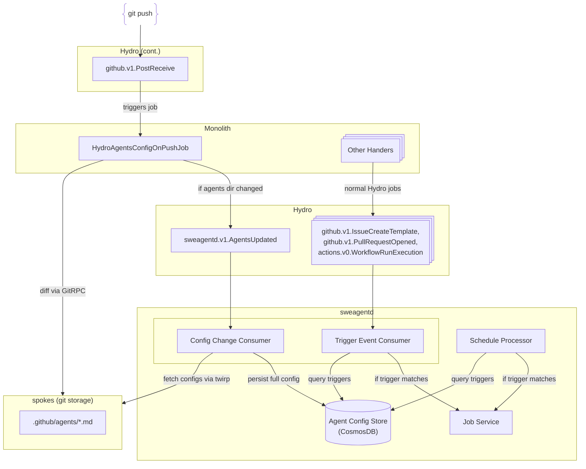

# ADR: Custom Agent Definition Detection

Date: 2026-01-20

Status: proposed

Deciders: @arthurnn @cschleiden @josebalius @colbylwilliams

Related issue: `TODO`

## Context

sweagentd needs to:

1. Persist custom agent configurations, including triggers (event-based and interval-based)
2. Schedule interval triggers for custom agents (daily, weekly)
3. Quickly decide if an incoming Hydro event (issue, PR, workflow run, etc.) should trigger an agent for a given repository

Both scheduled triggers and event-based triggers query the same persisted agent configuration store.

### Agent Definition Scopes

Custom agents can be defined at repository, organization, or enterprise scopes. See [ADR 0005](0005-custom-agents.md) for file locations and scope details.

**Key implication:** When an event arrives for a repository, we must check for matching triggers across **all three scopes**. This multiplies the lookup cost by up to 3x and makes fast indexed queries critical.

### Config File Format

Agent configs use markdown files with YAML frontmatter (see [ADR 0005](0005-custom-agents.md) for format details). Trigger definitions use Actions-like syntax with some differences (see [ADR 0007](0007-custom-agent-triggers.md)).

### Requirements (and Constraints)

- ~90% of repos will NOT have agent configs
- Latency budget: <1s for trigger decision
- Staleness tolerance: 1-60s acceptable
- Minimize gh/gh changes (hard to test/deploy)
- sweagentd has CosmosDB, limited spokes twirp access to git

---

## How Actions Does It (Reference)

Actions uses a **two-layer approach** that we can learn from:

1. **Push-time metadata sync**: `HydroActionsOnPushJob` runs on every push, diffs changed files, and updates `Actions::Workflow` records in MySQL. It does **not** store triggers in the DB.

2. **Event-time trigger check**: When any event fires, `repo.has_workflow_trigger_for?(event_type)` uses tree OID-based caching to check if the `.github/workflows/` directory contains matching triggers. The cache auto-invalidates when the directory changes.

**Key insight:** Actions doesn't track triggers at push-time—it only tracks "this repo has workflows" so it knows which repos to check at event-time.

<details>
<summary>Implementation details from gh/gh</summary>

### Layer 1: Push-time metadata sync

`HydroActionsOnPushJob` runs on every push:

- RPC call: `rpc.native_read_diff_toc(before, after)` to get changed files
- Regex match: `\.github\/workflows.*\.ya?ml`
- Updates `Actions::Workflow` records in MySQL (name, state, path)
- **Does NOT store triggers in DB**

### Layer 2: Event-time trigger check

When any event fires, `Hook::DeliverySystem` calls `repo.has_workflow_trigger_for?(event_type)`:

```ruby
def has_workflow_trigger_for?(event_name, lab: false)
  workflows_tree = tree(head, ".github/workflows")
  return false unless workflows_tree  # no directory = no workflows

  # Cache key uses tree OID - auto-invalidates when directory changes
  triggers = GitHub.cache.fetch("repo:#{id}:tree:#{workflows_tree.oid}:triggers") do
    parse_all_yamls_and_extract_triggers(workflows_tree)
  end

  triggers.include?(event_name)
end
```

**Why this works:**

- Tree OID only changes when `.github/workflows/` contents change
- Cache naturally invalidates on relevant pushes
- No explicit cache invalidation logic needed
- Parsing cost paid once per tree state, then cached

</details>


**Why this pattern fails for us:** Actions' tree OID trick only works when the directory EXISTS. For repos without `.github/agents/`, there's no tree OID to cache against, so every event would require an RPC to check if the directory exists.

---

## Alternatives Considered

### 1: Full config sync from gh/gh to sweagentd

gh/gh parses YAML, extracts triggers, sends full config to sweagentd via Hydro.

**Pros:**

- sweagentd decision is pure DB lookup
- Leverage gh/gh caching/infra

**Cons:**

- Two systems store same data
- Need Hydro schema for config sync
- More gh/gh code to maintain
- Config format changes require gh/gh deploys

### 2: sweagentd consumes PostReceive directly

sweagentd subscribes to `github.v1.PostReceive`, does its own git RPC + parsing.

**Pros:**

- Single system owns data
- No gh/gh changes

**Cons:**

- Processes EVERY push to EVERY repo
- Can't skip unknown repos (might be adding config)
- Limited spokesd twirp capabilities
- No memcache - repeated RPC/parsing

### 3: Filter at event source

Modify core event publishing to pre-filter.

**Rejected** - too risky to touch backbone infrastructure.

### 4: Lazy evaluation at event-time only

Like Actions' Layer 2, but without Layer 1. sweagentd does tree OID caching on every event.

**Pros:**

- Zero gh/gh changes
- Elegant cache invalidation

**Cons:**

- 90% of repos have no config = cache miss every time
- Can't cache "no config exists" without push awareness
- First event always pays full RPC + parse cost

> **Why this fails for us:** Actions' tree OID trick only works when the directory EXISTS. For repos without `.github/agents/`, there's no tree OID to cache against. Every event = RPC to check "does directory exist?" = No = repeat next event.

---

## Decision

Minimal gh/gh + sweagentd Config Persistence

gh/gh detects changes and notifies sweagentd; sweagentd fetches, parses, and persists the full agent configuration.

> [!NOTE]
> The Monolith uses GitRPC to communicate with spokes (via bertrpc/dgit protocols), while sweagentd uses the Spokes twirp API directly.

### Architecture Overview



---

### Current State

> [!NOTE]
> Currently, agent configs are fetched on-demand from GitHub repositories via Spokes RPC (`internal/customagent/repository.go`). There is **no config persistence** in CosmosDB and **no HydroAgentsConfigOnPushJob** in gh/gh. The implementation below describes what needs to be built.

### Layer 1: gh/gh detects changes only (TO BE BUILT)

A new `HydroAgentsConfigOnPushJob` needs to be created, following the pattern of `HydroActionsOnPushJob`:

```ruby
def perform
  return unless push_includes_default_branch?

  # Check if .github/agents/ directory changed
  changed_files = rpc.native_read_diff_toc(before, after)
  agents_changed = changed_files.any? { |f| f.path.match?(/\A\.github\/agents\//) }

  return unless agents_changed

  # Publish change notification to sweagentd (sweagentd will fetch the configs)
  publish_to_sweagentd(repo_id: repository.id, tree_oid: after)
end
```

**gh/gh only answers:** "Did `.github/agents/` change?" (notification with tree OID)

### Layer 2: sweagentd fetches and persists full config (TO BE BUILT)

When sweagentd receives a change notification:

1. RPC to fetch all files in `.github/agents/` at the given tree OID (this capability exists via `internal/customagent/repository.go`)
2. Parse markdown configs with YAML frontmatter to extract (parsing exists in `internal/customagent/config.go`):
   - Agent metadata (name, description, model, etc.)
   - Event triggers (`on: issues: types: [opened]`, `on: pull_request: types: [opened]`, etc.)
   - Interval triggers (`on: interval: types: [daily, weekly]`) - per [ADR 0007](0007-custom-agent-triggers.md)
3. Persist full agent config to CosmosDB (**new** - currently no persistence)
4. Update schedule processor with new/changed interval triggers

### Layer 3: Unified trigger evaluation (PARTIALLY EXISTS)

> [!NOTE]
> Currently, event triggers work by fetching all agents via `ListAgentsByRepoID` and filtering in-memory (see `internal/events/on_issue_created.go`). The proposed approach replaces this with indexed DB queries.

Both event-based and scheduled triggers query the same persisted config:

**Event-based (Hydro consumer):**

```
1. Receive Hydro event (github.v1.IssueCreateTemplate, github.v1.PullRequestOpened, actions.v0.WorkflowRunExecution)
2. Query CustomAgentsDB for ALL agents from the enterprise/org/repo that match
3. For each matching agent with matching trigger → Job Service
```

**Scheduled (Schedule processor):**

```
1. Scheduler fires based on registered interval types (daily, weekly per ADR 0007)
2. Query CustomAgentsDB: SELECT * FROM agents WHERE schedule_id = ?
3. For matching agent → Job Service
```

---

## Data Flow

### Custom Agent Update Flow (PROPOSED)

**Repository-scoped agents:**

```
1. User pushes changes to .github/agents/my-agent.md
2. GitHub emits github.v1.PostReceive event to Hydro
3. HydroAgentsConfigOnPushJob receives push event (TO BE BUILT)
4. Job checks: were any .github/agents/* files changed?
   - If NO: done (no further action)
   - If YES: continue
5. Job publishes sweagentd.v1.AgentsUpdated event with scope="repo" (schema TBD)
6. sweagentd Config Consumer receives event (TO BE BUILT)
7. sweagentd fetches .github/agents/*.md files via RPC from spokes
8. sweagentd parses markdown/YAML frontmatter and persists custom agent config to CosmosDB:
9. If interval triggers changed, update Schedule Processor registrations
```

**Organization-scoped agents:**

```
1. User pushes changes to agents/my-org-agent.md in <org>/.github repo
2. GitHub emits github.v1.PostReceive event to Hydro
3. HydroAgentsConfigOnPushJob receives push event
4. Job detects this is an org config repo (.github or .github-private)
5. Job checks: were any agents/* files changed?
   - If YES: publish sweagentd.v1.AgentsUpdated with scope="org" (schema TBD)
6. sweagentd Hydro Consumer receives event
7. sweagentd fetches agents/*.md files via RPC from spokes
8. sweagentd parses markdown/YAML frontmatter and persists custom agent config to CosmosDB
9. If interval triggers changed, update Schedule Processor registrations
```

**Enterprise-scoped agents:** Similar flow, but with enterprise config repo and `scope="enterprise"`.

### Event Trigger Evaluation Flow

**Current behavior (on-demand):**

```
1. User opens an issue in a repository
2. GitHub emits github.v1.IssueCreateTemplate event to Hydro
3. sweagentd Hydro Consumer receives event
4. Event handler fetches ALL agents from GitHub repo via Spokes RPC
   - Also fetches from org and enterprise repos (3 RPC calls)
5. Filter agents in-memory to find those with matching triggers
6. For each matching agent → Job Service creates assignment/job
```

**Proposed behavior (with persistence):**

```
1. User opens an issue in a repository
2. GitHub emits github.v1.IssueCreateTemplate event to Hydro
3. sweagentd Hydro Consumer receives event
4. Query CustomAgentsDB for ALL agents that apply to this repo with matching trigger:
   - If no matching agents: IGNORE
   - If matching agent(s): continue
5. For each matching agent → Job Service creates assignment/job
```

### Schedule Trigger Evaluation Flow (PROPOSED)

```
1. Schedule Processor maintains registered interval triggers from CustomAgentsDB
2. When interval fires (e.g., daily, weekly - see ADR 0007 for timing semantics):
   - Look up associated agent config from CustomAgentsDB
   - Forward to Job Service
   - Job Service creates assignment and initiates agent workflow
```

> _See [ADR 0008](0008-interval-trigger-scheduler.md) for detailed Schedule Processor and Sync Service implementation_

> [!IMPORTANT]
> Per [ADR 0007](0007-custom-agent-triggers.md), we use `interval` (daily/weekly) instead of `cron` to avoid the thundering herd problem Actions experiences at 12:00 UTC.

---

## Comparison to Actions

| Aspect | Actions | Agents (Current) | Agents (Proposed) |
| ------ | ------- | ---------------- | ----------------- |
| Push-time job | `HydroActionsOnPushJob` | None | `HydroAgentsConfigOnPushJob` |
| What gh/gh stores | Workflow records (name, path, state) | Nothing | Nothing - just emits change notification |
| What downstream stores | N/A (all in gh/gh) | Nothing (on-demand fetch) | Full agent config in CosmosDB |
| Event-time check | `has_workflow_trigger_for?` in gh/gh | ListAgentsByRepoID + filter | Query CustomAgentsDB in sweagentd |
| Schedule support | Separate scheduler queries gh/gh | Not implemented | Same CustomAgentsDB, Schedule Processor |
| gh/gh code footprint | ~500 lines across multiple files | 0 lines | ~20 lines in one job |

---

## Performance Considerations

### Why Persist Full Config in sweagentd?

The key insight is that **both event-based and scheduled triggers need access to the same agent configuration**:

- **Event triggers**: Need to quickly determine which agents match an incoming Hydro event
- **Interval triggers**: Need full config to register interval jobs (daily/weekly) and execute when they fire

By persisting the full config at push-time:

- ✅ Event trigger evaluation is a simple DB query (no RPC at event-time)
- ✅ Interval triggers can be registered/updated immediately
- ✅ Single source of truth for both trigger types
- ✅ 90% of Hydro events (repos without agents) return empty from indexed query

### Multi-Scope Lookup Performance

Since agents can be defined at repository, organization, and enterprise scopes, **every incoming event requires up to 3 lookups**:

1. Check for repo-scoped agents with matching triggers
2. Check for org-scoped agents with matching triggers
3. Check for enterprise-scoped agents with matching triggers
4. Plus potentially checking for installed 3p apps with agents (future)

This makes efficient database partitioning, indexing, and query design **critical**. Options to consider:

| Approach | Pros | Cons |
| -------- | ---- | ---- |
| **Single query with OR** | One round-trip | Complex query, may not use indexes efficiently |
| **Parallel queries** | Simple queries, good index usage | 3x connection overhead |
| **Denormalized lookup table** | Single indexed lookup | Write amplification on config changes |
| **Hierarchical cache** | Fast for repeat lookups | Cache invalidation complexity |

**Recommended:** Denormalized lookup table that maps `(repo_id, event_type)` → `[agent_configs]` including inherited org/enterprise agents. This trades write-time complexity for read-time performance.

### Consistency Model

- **Eventual consistency**: There may be a brief delay between custom agent push and sweagentd update _(note: this does not refer to CosmosDB consistency levels)_
- **Acceptable for triggers**: Missing one trigger invocation during propagation is acceptable
- **Custom agent changes are infrequent**: Most repositories rarely update custom agent definitions

---

## Implications

### What becomes easier

- **Event trigger evaluation** is a simple indexed DB query (no RPC at event-time)
- **Interval triggers** can be registered/updated immediately when configs are pushed
- **Single source of truth** for both event-based and scheduled triggers
- **90% of Hydro events** (repos without agents) return empty from indexed query

### What becomes more difficult

- Managing eventual consistency between git state and CosmosDB
- Handling multi-scope lookups efficiently (repo/org/enterprise)
- Schedule processor complexity for interval trigger registration/deregistration

### Risks and unknowns

- CosmosDB schema design for multi-scope agents needs careful consideration
- Actor/permissions model for interval-triggered sessions requires consent handling (see [ADR 0007](0007-custom-agent-triggers.md))
- Org/enterprise config change detection adds complexity to `HydroAgentsConfigOnPushJob`
- The database should likely have a TTL of 60 days to avoid unbounded growth from abandoned configs

---

## Open Questions

0. **Memory caching in sweagentd:** Should we add an in-memory cache layer in sweagentd for recently accessed agent configs to reduce CosmosDB load?

1. **Security implications of persisted configs:** Are there any concerns with storing custom agent configs in CosmosDB? Access controls, encryption, etc.

2. **CosmosDB schema design for multi-scope agents:**
   - How to partition? Should be read-optimized. Need to determine what data is available in the hydro event payloads that can be used to filter efficiently.
   - Separate containers for repo/org/enterprise agents, or single container with scope field?
   - How to efficiently query "all agents that apply to repo X" across all three scopes?

3. Hydro schema for the `sweagentd.v1.AgentsUpdated` event - what fields are on `PostReceive` vs. what do we need to add?

4. Schedule processor implementation - how to register/deregister interval triggers efficiently?

5. How to handle agent config deletion (all files removed from `.github/agents/`)? Sync should remove orphaned DB records.

6. Should we expand `CustomAgentTriggers` struct to include `Workflow`, `PullRequest`, and `Interval` fields before or during persistence work?

7. Actor/permissions model for interval-triggered sessions - how to handle consent? (see [ADR 0007](0007-custom-agent-triggers.md))

8. How to detect org/enterprise agent config changes? Need `HydroAgentsConfigOnPushJob` to also run for pushes to `.github` and `.github-private` repos (org scope) and enterprise config repos.

9. How to optimize for the common case of no agents defined? Should we maintain a "repos with agents" cache to short-circuit lookups?

10. How do be backfill existing agent configs in repositories before we started listening for changes and persisting them? Should we store a record indicating "no agents" for repos we have scanned, and scan repos on-demand when an event arrives for an unknown repo?

---

## Additional Details

### Future Considerations

- **Validation**: Validate custom agent schema before storing (parsing already validates - see `config.go`)
- **Audit logging**: Track custom agent changes for compliance
- **Rate limiting**: Protect against rapid custom agent changes
- **Trigger conditions**: Support complex trigger conditions (labels, paths, authors, branches - see ADR 0007)
- **Additional trigger types**: workflow_run, pull_request per ADR 0007

### Implementation Status

| Component | Status | Notes |
| --------- | ------ | ----- |
| Agent config parsing | ✅ Done | `internal/customagent/config.go` |
| Agent file fetching via Spokes | ✅ Done | `internal/customagent/repository.go` |
| `CustomAgentTriggers` struct | ⚠️ Partial | Only `Issues` field exists |
| `issues.opened` trigger handling | ✅ Done | `internal/events/on_issue_created.go` |
| `HydroAgentsConfigOnPushJob` | ❌ Not started | Needs gh/gh changes |
| `sweagentd.v1.AgentsUpdated` Hydro event | ❌ Not started | Needs Hydro schema |
| CosmosDB config persistence | ❌ Not started | Schema design needed |
| Schedule Processor (intervals) | ❌ Not started | See ADR 0007 for interval semantics |

### Related Documents

- [ADR 0005: Custom Agents Specification](0005-custom-agents.md) - Agent config file format and API
- [ADR 0007: Custom Agent Triggers](0007-custom-agent-triggers.md) - Trigger types and actor considerations
- [ADR 0008: Interval Trigger Scheduler](0008-interval-trigger-scheduler.md) - Sync Service and Scheduler Service implementation