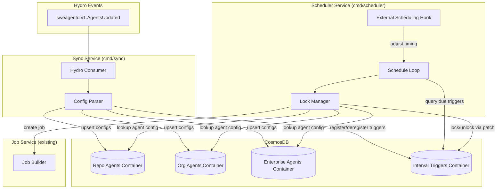

# ADR: Interval Trigger Scheduler and Agent Config Sync Services

Date: 2026-01-27

Status: proposed

Deciders: @arthurnn @cschleiden @josebalius @colbylwilliams

Related issues: [ADR 0006](0006-custom-agent-configs.md), [ADR 0007](0007-custom-agent-triggers.md)

## Context

This ADR defines two new services required to support custom agent triggers as outlined in [ADR 0006](0006-custom-agent-configs.md) and [ADR 0007](0007-custom-agent-triggers.md):

1. **Sync Service** (`cmd/sync`): Consumes `sweagentd.v1.AgentsUpdated` Hydro events and persists custom agent configurations to CosmosDB
2. **Scheduler Service** (`cmd/scheduler`): Periodically queries for interval triggers that are due and launches agent jobs

Both services share access to CosmosDB but have clearly separated concerns and container ownership to avoid write conflicts.

### Requirements

- Support all three agent scopes from launch: repository, organization, and enterprise
- Ensure interval triggers fire exactly once per interval (no duplicates, no misses)
- Handle horizontal scaling (multiple scheduler instances)
- Provide an extensibility hook for external scheduling optimization (off-peak execution)
- Minimize CosmosDB write conflicts between services
- Follow existing sweagentd service patterns for consistency

### Reference: Launch Service Scheduler

The [GitHub Launch service](https://github.com/github/launch) provides a production-proven scheduler pattern with:

- **Pessimistic locking** via `locked_by`/`locked_at` columns with `SELECT ... FOR UPDATE SKIP LOCKED`
- **Stale lock recovery** via periodic cleanup of locks older than 3 minutes
- **Scatter offset** for thundering herd prevention (random 0.0-1.0 value per schedule)
- **Tier-based priority** with weighted selection for fair scheduling under load
- **Adaptive throttling** based on downstream queue depth

We adapt these patterns for CosmosDB's eventually consistent model.

---

## Decision

### Architecture Overview



---

## Service 1: Sync Service (`cmd/sync`)

### Responsibilities

1. Consume `sweagentd.v1.AgentsUpdated` Hydro events
2. Fetch agent configuration files from Spokes via RPC
3. Parse markdown/YAML frontmatter to extract agent configs and triggers
4. Persist agent configurations to scope-specific CosmosDB containers
5. Register/deregister interval triggers in the Interval Triggers Container

### Data Flow

```
1. Receive sweagentd.v1.AgentsUpdated event with:
   - scope: "repo" | "org" | "enterprise"
   - scope_id: repository/org/enterprise ID
   - tree_oid: commit SHA for file fetching

2. Fetch .github/agents/*.md (repo) or agents/*.md (org/enterprise) via Spokes RPC

3. Parse each file using existing customagent.ParseConfig()

4. For each agent config:
   a. Query by path to find existing record (if any)
   b. Upsert to appropriate scope container (Repo/Org/Enterprise Agents)
      - If new: generate UUID, create record
      - If exists: update record, preserve UUID
   c. If agent has interval triggers:
      - Upsert to Interval Triggers Container with next_run_at calculated
   d. If agent had interval triggers but no longer does:
      - Delete from Interval Triggers Container

5. Delete orphaned configs (files removed from repository)
```

### Handling File Renames

Agent config files may be renamed in the repository. The sync service handles this through full reconciliation:

1. **On each sync event**, fetch all current agent files from Spokes
2. **Query stored records** by `scope_id` to get all known agents for this scope
3. **Match by path**:
   - Files with matching paths → update existing record (UUID preserved)
   - New paths → create new record with new UUID
   - Stored paths not in current files → delete record and associated interval triggers

**Why this works with UUIDs:**
- Renames appear as delete (old path) + create (new path)
- Each file path gets its own UUID
- Interval triggers referencing the old agent UUID are deleted with the old record
- New interval triggers are created with the new agent UUID

This is acceptable because:
- Agent renames are rare
- No state needs to be preserved across renames (triggers restart fresh)
- Simpler than tracking rename detection via content hashing

### Container Ownership

| Container | Sync Service | Scheduler Service |
|-----------|-------------|-------------------|
| Repo Agents | Read/Write | Read |
| Org Agents | Read/Write | Read |
| Enterprise Agents | Read/Write | Read |
| Interval Triggers | Write (create/delete/update config) | Write (lock/unlock, update next_run_at) |

### Interval Trigger Registration

When the sync service detects an interval trigger in an agent config:

```go
type IntervalTrigger struct {
    ID                string    `json:"id"`                 // UUID (generated on creation)
    Scope             string    `json:"scope"`              // "repo", "org", "enterprise"
    ScopeID           int64     `json:"scope_id"`           // repo/org/enterprise ID
    AgentID           string    `json:"agent_id"`           // Reference to agent config record (UUID)
    IntervalType      string    `json:"interval_type"`      // "daily", "weekly"
    NextRunAt         time.Time `json:"next_run_at"`        // Next scheduled execution
    ScatterOffset     float64   `json:"scatter_offset"`     // 0.0-1.0 for thundering herd prevention
    LockedBy          string    `json:"locked_by"`          // Worker ID holding lock (empty if unlocked)
    LockedAt          *time.Time `json:"locked_at"`         // Lock acquisition time
    LastRunAt         *time.Time `json:"last_run_at"`       // Last successful execution
    ActorID           int64     `json:"actor_id"`           // Actor ID for job creation
    ActorNodeID       string    `json:"actor_node_id"`      // Actor node ID for session (from config or last modifier)
    TreeOID           string    `json:"tree_oid"`           // Commit SHA of agent config
    CreatedAt         time.Time `json:"created_at"`
    UpdatedAt         time.Time `json:"updated_at"`
}
```

**Scatter Offset Calculation:**

Following the launch service pattern, assign a permanent random scatter offset (0.0-1.0) when creating the trigger. This spreads execution across the interval window to prevent thundering herd.

```go
// For daily triggers, scatter across a 4-hour window
scatterDuration := 4 * time.Hour
nextRunAt := computeIntervalStart(intervalType).Add(
    time.Duration(scatterOffset * float64(scatterDuration))
)
```

---

## Service 2: Scheduler Service (`cmd/scheduler`)

### Responsibilities

1. Periodically query for interval triggers that are due for execution
2. Acquire locks on due triggers using optimistic concurrency
3. Look up full agent configuration from scope containers
4. Create agent jobs via the existing Job Service
5. Update `next_run_at` and release locks
6. Recover stale locks from crashed workers

### Schedule Loop

```go
func (s *Scheduler) Run(ctx context.Context) error {
    ticker := time.NewTicker(s.tickInterval) // e.g., 30 seconds
    defer ticker.Stop()

    // Start stale lock recovery goroutine
    go s.runStaleLockRecovery(ctx)

    for {
        select {
        case <-ctx.Done():
            return ctx.Err()
        case <-ticker.C:
            s.processTick(ctx)
        }
    }
}

func (s *Scheduler) processTick(ctx context.Context) {
    // Hook: Allow external influence on batch size/timing
    batchSize := s.schedulingHook.GetBatchSize(ctx)

    // Find due triggers that are unlocked
    triggers, err := s.store.FindDueTriggers(ctx, time.Now(), batchSize)
    if err != nil {
        s.logger.Error("failed to find due triggers", "error", err)
        return
    }

    for _, trigger := range triggers {
        if err := s.processTrigger(ctx, trigger); err != nil {
            s.logger.Error("failed to process trigger",
                "trigger_id", trigger.ID, "error", err)
        }
    }
}
```

### Locking Strategy: CosmosDB Optimistic Concurrency

Since CosmosDB doesn't support `SELECT ... FOR UPDATE SKIP LOCKED`, we use optimistic concurrency with ETag-based compare-and-swap:

```go
func (s *Scheduler) tryAcquireLock(ctx context.Context, trigger *IntervalTrigger) (bool, error) {
    // Only attempt lock if trigger appears unlocked or stale
    if trigger.LockedBy != "" && !s.isLockStale(trigger.LockedAt) {
        return false, nil
    }

    // Build patch operation to acquire lock
    patch := &IntervalTriggerPatch{
        LockedBy: &s.workerID,
        LockedAt: ptr(time.Now()),
    }

    // Use ETag for optimistic concurrency
    err := s.store.PatchIntervalTrigger(ctx, trigger.ID, patch, trigger.ETag)
    if err != nil {
        if isConflictError(err) {
            // Another worker acquired the lock first - this is expected
            return false, nil
        }
        return false, err
    }
    return true, nil
}

func (s *Scheduler) releaseLock(ctx context.Context, trigger *IntervalTrigger, nextRunAt time.Time) error {
    patch := &IntervalTriggerPatch{
        LockedBy:  ptr(""),
        LockedAt:  nil,
        NextRunAt: &nextRunAt,
        LastRunAt: ptr(time.Now()),
    }
    return s.store.PatchIntervalTrigger(ctx, trigger.ID, patch, trigger.ETag)
}
```

### Stale Lock Recovery

Similar to the launch service, recover locks from crashed workers:

```go
func (s *Scheduler) runStaleLockRecovery(ctx context.Context) {
    ticker := time.NewTicker(3 * time.Minute)
    defer ticker.Stop()

    for {
        select {
        case <-ctx.Done():
            return
        case <-ticker.C:
            s.recoverStaleLocks(ctx)
        }
    }
}

func (s *Scheduler) recoverStaleLocks(ctx context.Context) {
    staleThreshold := time.Now().Add(-3 * time.Minute)

    staleTriggers, err := s.store.FindStaleLocks(ctx, staleThreshold, 100)
    if err != nil {
        s.logger.Error("failed to find stale locks", "error", err)
        return
    }

    for _, trigger := range staleTriggers {
        patch := &IntervalTriggerPatch{
            LockedBy: ptr(""),
            LockedAt: nil,
        }
        // Best effort - ignore conflicts (another worker may have recovered it)
        _ = s.store.PatchIntervalTrigger(ctx, trigger.ID, patch, trigger.ETag)
    }
}
```

### External Scheduling Hook

An abstract interface for external influence on scheduling behavior:

```go
// SchedulingHook allows external systems to influence scheduler behavior
type SchedulingHook interface {
    // GetBatchSize returns the number of triggers to process per tick.
    // Can be used for load-based throttling or off-peak optimization.
    GetBatchSize(ctx context.Context) int

    // ShouldProcess returns whether a specific trigger should be processed now.
    // Can be used for tier-based priority or feature flag gating.
    ShouldProcess(ctx context.Context, trigger *IntervalTrigger) bool

    // GetScatterDuration returns the scatter window duration for an interval type.
    // Larger windows allow more spreading of load.
    GetScatterDuration(intervalType string) time.Duration
}

// DefaultSchedulingHook provides reasonable defaults
type DefaultSchedulingHook struct {
    maxBatchSize int
}

func (h *DefaultSchedulingHook) GetBatchSize(ctx context.Context) int {
    return h.maxBatchSize
}

func (h *DefaultSchedulingHook) ShouldProcess(ctx context.Context, trigger *IntervalTrigger) bool {
    return true
}

func (h *DefaultSchedulingHook) GetScatterDuration(intervalType string) time.Duration {
    switch intervalType {
    case "daily":
        return 4 * time.Hour
    case "weekly":
        return 12 * time.Hour
    default:
        return 4 * time.Hour
    }
}
```

Future implementations can provide hooks that:
- Query a capacity service for available GPU/compute resources
- Read feature flags to enable/disable specific triggers
- Implement tier-based priority like the launch service
- Adjust batch size based on downstream queue depth

---

## CosmosDB Container Design

### Why Separate Containers Per Scope?

Agent configurations are stored in three separate containers (Repo, Org, Enterprise) rather than a single container for the following reasons:

1. **Different ID namespaces**: Repository IDs, Organization IDs, and Enterprise IDs are separate ID spaces. A `scope_id` of `12345` could exist in all three scopes with different meanings. Separate containers avoid partition key collisions without requiring a composite key.

2. **Query isolation**: Each incoming Hydro event may query all three scopes. Separate containers ensure a hot partition in one scope (e.g., a very active repository) doesn't affect query performance for other scopes.

3. **Independent scaling**: Each container can have its own throughput allocation based on actual usage patterns. Repository-scoped agents will likely have higher volume than enterprise-scoped agents.

4. **Operational clarity**: Clear boundaries for monitoring, alerting, and troubleshooting per scope.

The tradeoff is slightly higher RU consumption (3 container queries per event vs 1), but the benefits of never querying cross partition, and the caching layer offsets this.

### Container: Repo Agents

| Field | Type | Description |
|-------|------|-------------|
| `id` | string | UUID (generated on first sync) |
| `scope_id` | int64 | Repository ID (partition key) |
| `path` | string | Path to config file in repository (e.g., `.github/agents/my-agent.md`) |
| `config` | object | Full parsed agent configuration (includes `triggers` as nested field) |
| `tree_oid` | string | Commit SHA of source file |
| `created_at` | timestamp | First detection time |
| `updated_at` | timestamp | Last sync time |

**Partition Key:** `/scope_id`

### Container: Org Agents

| Field | Type | Description |
|-------|------|-------------|
| `id` | string | UUID (generated on first sync) |
| `scope_id` | int64 | Organization ID (partition key) |
| `path` | string | Path to config file in repository (e.g., `agents/my-agent.md`) |
| `config` | object | Full parsed agent configuration (includes `triggers` as nested field) |
| `tree_oid` | string | Commit SHA of source file |
| `created_at` | timestamp | First detection time |
| `updated_at` | timestamp | Last sync time |

**Partition Key:** `/scope_id`

### Container: Enterprise Agents

| Field | Type | Description |
|-------|------|-------------|
| `id` | string | UUID (generated on first sync) |
| `scope_id` | int64 | Enterprise ID (partition key) |
| `path` | string | Path to config file in repository (e.g., `agents/my-agent.md`) |
| `config` | object | Full parsed agent configuration (includes `triggers` as nested field) |
| `tree_oid` | string | Commit SHA of source file |
| `created_at` | timestamp | First detection time |
| `updated_at` | timestamp | Last sync time |

**Partition Key:** `/scope_id`

### Caching Layer

> [!NOTE]
> A caching layer should be implemented in front of the Repo, Org, and Enterprise Agents containers to improve performance for Hydro event consumers. This reduces CosmosDB network calls when evaluating event triggers, as the same agent configurations may be queried repeatedly for high-activity repositories. Cache invalidation should be triggered by the Sync Service when configurations are updated.
>
> This will be designed and implemented in a future ADR.

### Container: Interval Triggers

| Field | Type | Description |
|-------|------|-------------|
| `id` | string | UUID (generated on creation) |
| `scope` | string | "repo", "org", "enterprise" |
| `scope_id` | int64 | Repo/Org/Enterprise ID (partition key) |
| `agent_id` | string | Reference to agent config record (UUID) |
| `interval_type` | string | "daily", "weekly" |
| `next_run_at` | timestamp | Next scheduled execution |
| `scatter_offset` | float64 | 0.0-1.0 permanent offset |
| `locked_by` | string | Worker ID or empty |
| `locked_at` | timestamp | Lock time or null |
| `last_run_at` | timestamp | Last execution or null |
| `actor_id` | int64 | Actor ID for job creation |
| `actor_node_id` | string | Actor node ID for job creation |
| `tree_oid` | string | Config commit SHA |
| `created_at` | timestamp | First registration |
| `updated_at` | timestamp | Last modification |

**Partition Key:** `/scope_id`

**Indexes:**
- Composite index on `(next_run_at, locked_by)` for efficient due trigger queries
- Index on `locked_at` for stale lock recovery
- Index on `agent_id` for cascading deletes when agent config is removed

---

## Write Conflict Resolution

### Sync Service ↔ Scheduler Service Conflicts

Both services write to the Interval Triggers Container, but at different fields:

| Field | Sync Service | Scheduler Service |
|-------|-------------|-------------------|
| `id` | Create/Delete | Read |
| `scope`, `scope_id`, `agent_id` | Create | Read |
| `interval_type` | Create/Update | Read |
| `next_run_at` | Initial value | Update after execution |
| `scatter_offset` | Create (immutable) | Read |
| `locked_by`, `locked_at` | Clear on delete | Read/Write |
| `last_run_at` | - | Update |
| `actor_id`, `actor_node_id`, `tree_oid` | Update | Read |

**Conflict Scenarios:**

1. **Sync updates config while scheduler processes trigger:**
   - Scheduler holds lock, sync updates other fields
   - Resolution: Use `PatchItem` for field-level updates; both can succeed

2. **Sync deletes trigger while scheduler holds lock:**
   - Resolution: Scheduler checks if trigger still exists before job creation
   - On delete, sync sets a soft-delete flag or scheduler handles 404

3. **Multiple sync events for same agent:**
   - Resolution: Use ETag on sync updates; last writer wins (acceptable for config)

### Recommended Patch Pattern

Use CosmosDB's `PatchItem` API for all updates to enable concurrent field-level writes:

```go
// Sync service: Update config-related fields only
func (s *SyncStore) UpdateTriggerConfig(ctx context.Context, id string,
    intervalType string, actorNodeID string, treeOID string, etag string) error {

    patch := azcosmos.PatchOperations{}
    patch.AppendSet("/interval_type", intervalType)
    patch.AppendSet("/actor_node_id", actorNodeID)
    patch.AppendSet("/tree_oid", treeOID)
    patch.AppendSet("/updated_at", time.Now().Unix())

    _, err := s.container.PatchItem(ctx, partitionKey, id, patch,
        &azcosmos.ItemOptions{IfMatchEtag: &etag})
    return err
}

// Scheduler service: Update scheduling-related fields only
func (s *SchedulerStore) UpdateTriggerSchedule(ctx context.Context, id string,
    lockedBy string, lockedAt *time.Time, nextRunAt time.Time, etag string) error {

    patch := azcosmos.PatchOperations{}
    patch.AppendSet("/locked_by", lockedBy)
    if lockedAt != nil {
        patch.AppendSet("/locked_at", lockedAt.Unix())
    } else {
        patch.AppendSet("/locked_at", nil)
    }
    patch.AppendSet("/next_run_at", nextRunAt.Unix())
    patch.AppendSet("/updated_at", time.Now().Unix())

    _, err := s.container.PatchItem(ctx, partitionKey, id, patch,
        &azcosmos.ItemOptions{IfMatchEtag: &etag})
    return err
}
```

---

## Service Implementation Structure

### cmd/sync/main.go

```go
func main() {
    if err := mainWithLogging(); err != nil {
        os.Exit(1)
    }
}

func mainWithLogging() error {
    cfg, err := config.Load()
    if err != nil {
        return err
    }

    obsv, err := cfg.NewObservabilityExporters("sweagentd-sync")
    if err != nil {
        return err
    }
    defer obsv.Close()

    return realMain(cfg, obsv)
}

func realMain(cfg *config.Config, obsv *observability.Exporters) error {
    ctx, stop := signal.NotifyContext(context.Background(), os.Interrupt, syscall.SIGTERM)
    defer stop()

    // Initialize dependencies (following existing patterns)
    // - CosmosDB clients for all 4 containers
    // - Spokes client for file fetching
    // - Feature flags client

    // Create sync handler
    syncHandler := sync.NewHandler(agentStore, triggerStore, spokesClient)

    // Create Hydro dispatcher
    dispatcher := hydroevt.NewDispatcher(obsv.Logger)
    dispatcher.Register("sweagentd.v1.AgentsUpdated", syncHandler.HandleAgentsUpdated)

    // Run Hydro consumer
    wg, ctx := errgroup.WithContext(ctx)
    wg.Go(runHydroConsumer(ctx, cfg, obsv, dispatcher.Dispatch))

    return wg.Wait()
}
```

### cmd/scheduler/main.go

```go
func main() {
    if err := mainWithLogging(); err != nil {
        os.Exit(1)
    }
}

func mainWithLogging() error {
    cfg, err := config.Load()
    if err != nil {
        return err
    }

    obsv, err := cfg.NewObservabilityExporters("sweagentd-scheduler")
    if err != nil {
        return err
    }
    defer obsv.Close()

    return realMain(cfg, obsv)
}

func realMain(cfg *config.Config, obsv *observability.Exporters) error {
    ctx, stop := signal.NotifyContext(context.Background(), os.Interrupt, syscall.SIGTERM)
    defer stop()

    // Initialize dependencies
    // - CosmosDB clients for interval triggers + agent config containers
    // - Job service client
    // - Feature flags client

    // Create scheduling hook (can be swapped for capacity-aware implementation)
    schedulingHook := scheduler.NewDefaultSchedulingHook(cfg.SchedulerMaxBatchSize)

    // Create scheduler
    sched := scheduler.New(
        triggerStore,
        agentStore,
        jobService,
        schedulingHook,
        cfg.SchedulerWorkerID,
        cfg.SchedulerTickInterval,
        obsv.Logger,
    )

    // Run scheduler loop
    wg, ctx := errgroup.WithContext(ctx)
    wg.Go(func() error {
        return sched.Run(ctx)
    })

    return wg.Wait()
}
```

---

## Implications

### What becomes easier

- **Clear service boundaries**: Sync owns config persistence, scheduler owns execution
- **Independent scaling**: Services can scale independently based on load
- **Testability**: Each service has focused responsibilities
- **Lock management**: Optimistic concurrency with field-level patches reduces conflicts

### What becomes more difficult

- **Eventual consistency**: Brief delay between config sync and scheduler awareness
- **Cross-service coordination**: Must handle deleted triggers gracefully
- **CosmosDB costs**: Separate containers increase RU consumption
- **Debugging**: Issues may span two services

### Risks and mitigations

| Risk | Mitigation |
|------|------------|
| Lock starvation under high contention | Stale lock recovery + exponential backoff on conflicts |
| Missed triggers during service restart | Triggers persist in DB; next tick picks them up |
| Duplicate job creation | Job service should be idempotent (check for existing active job) |
| Sync/scheduler version skew | Schema versioning + backward compatible patches |
| No backfill needed for existing configs | Services launch before trigger support is enabled; all new trigger additions will be captured via config file change events |

---

## Open Questions

1. **TTL Policy**: Should interval triggers have a TTL, or only be deleted when the agent config is removed?

2. **Metrics and Alerting**: What SLOs should we track for trigger latency (time from due to execution)?

3. **Actor Resolution**: For interval triggers, how do we resolve the actor if the config doesn't specify one? Options:
   - Last modifier of the agent config file
   - Repository owner
   - Org-configured service account

4. **Rate Limiting**: Should we rate limit job creation per repository/org to prevent runaway triggers?

---

## Related Documents

- [ADR 0005: Custom Agents Specification](0005-custom-agents.md) - Agent config file format
- [ADR 0006: Custom Agent Definition Detection](0006-custom-agent-configs.md) - Config sync architecture
- [ADR 0007: Custom Agent Triggers](0007-custom-agent-triggers.md) - Trigger types and semantics
- [GitHub Launch Scheduler](https://github.com/github/launch) - Reference implementation for scheduling patterns