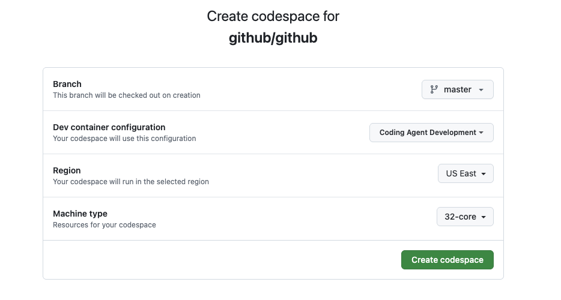

# Setting Up a Codespace for 3P Agent Development

This guide walks through the steps needed to create and configure a new Coding Agent Dev Codespace that enables a 3P agent. 

Currently, we're only able to run one agent at a time locally. This guide walks through setting up Codex but the steps would be similar for setting up Claude

1. Create a New Coding Agent Dev Codespace
 

2. Run the Setup Script

   ```bash
   cd /workspaces/github && script/setup-codespaces-copilot-swe-agent-v2 --capi
   ```
3. Stop the server `script/dx/server-stop`

4. Add the following folders to your workspace:

   - `sweagentd`
   - `copilot-api`
   - `github-ui`

5. Assign the GitHub organization an enterprise license
   
   Navigate to the Enterprise AI Controls:
   - URL: http://github.localhost/enterprises/github-inc/ai-controls/copilot
   - Path: AI Controls > Copilot > Access Management
   - Assign an enterprise license to the organization

6. Enable Policy for the GitHub Enterprise and Org

   You need to enable policies at both the enterprise and organization levels:
   
   **Enterprise Policy:**
   - Navigate to: http://github.localhost/enterprises/github-inc/ai-controls/agents
   - Path: AI Controls > Agents
   - Enable the policy for the enterprise
   
   **Organization Policy:**
   - Navigate to: http://github.localhost/organizations/github/settings/copilot/coding_agent
   - Path: Copilot > Coding Agents
   - Enable the policy for your organization

7. Start the servers
    * CAPI: `cd ../copilot-api && script/server`
    * Sweagentd: `cd ../sweagentd && script/server`
    * Github: `cd ../github && script/server --ui`