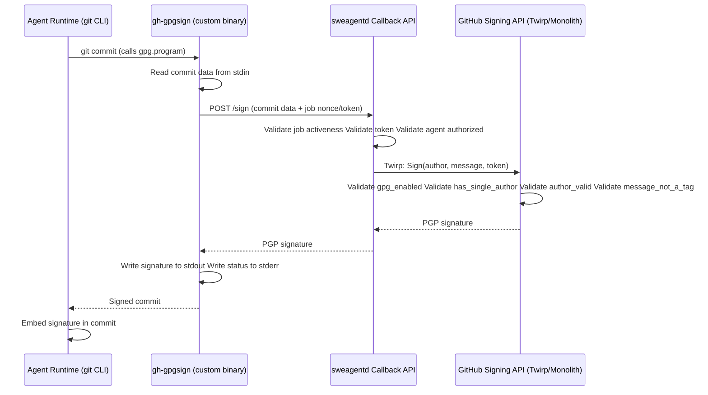

# Commit Signing for Copilot Coding Agent

Status: Proposed

Deciders: Copilot Coding Agent Team

Date: 2026-02-05

Related: [[Epic] Copilot should sign its commits](https://github.com/github/sweagentd/issues/1428)

## Context and Problem Statement

The Copilot coding agent needs to sign commits automatically when making changes on behalf of users. For reference, Codespaces uses `gh-gpgsign`, a GPG signing proxy that delegates signing to GitHub's internal API (`/vscs_internal/commit/sign`). We need a similar solution for the Copilot coding agent running in sweagentd, ensuring:

1. Commits are properly signed without requiring users to have local GPG keys on the Actions runners
2. The signing process is secure and validates proper authorization
3. The solution integrates seamlessly with the existing git workflow used by the agent to submit changes
4. Multi-author commits (with co-authored-by) are properly handled

## Considered Options

### Use the GitHub API to push and commit: undermines agent flexibility by stopping the agent using Git directly, plus file size limitations ❌

The [supported flow](https://docs.github.com/en/authentication/managing-commit-signature-verification/about-commit-signature-verification#signature-verification-for-bots) for commit signing for GitHub Apps is to create commits via the GitHub API. GitHub signs commits made via the API with its own (verified) key, attesting that the app has authenticated correctly.

Wise developers on the GitHub platform have also identified a [clever variation](https://github.com/orgs/community/discussions/50055#discussioncomment-13460641) where you push blobs with Git and then create a new commit using the API, which is automatically signed.

**Pros:**
* Fully supported, documented flow
* Leverages existing supported approach for creating signed commits as a GitHub App
* Blob approach has no limitation on file sizes (beyond GitHub standard 100MB file size limit)

**Cons:**
* Direct API approach: [Only files up to 40MB can be uploaded](https://github.com/orgs/community/discussions/50055#discussioncomment-13460641)
* Agent can no longer use Git directly to perform operations, as it won't include signing
* This isn't a huge problem today, as we ask the agent to use report_progress to commit - but at least sometimes it chooses not to, and it is likely we will want to allow direct Git operations for more complex workflows (e.g. handling merge conflicts, rewriting history)
* Need to sync the local on-disk Git state with the server state after committing via the API

### Native GPG Key Distribution

Distribute actual GPG keys to agents and sign locally without proxying.

**Pros:**
* No API dependencies
* Faster (local signing)

**Cons:**
* Complex key management and distribution
* Security risks with key storage in agent environment
* Key rotation challenges
* Deviates from the battle-tested Codespaces model

## Decision Outcome

**Chosen option: sweagentd API Proxy with gh-gpgsign**

Create a signing API endpoint in sweagentd that acts as a proxy to GitHub's signing API. Agent uses customized gh-gpgsign that calls sweagentd, which then validates and forwards to GitHub.

This approach provides the best balance of security, auditability, and reusability:

**Pros:**
* sweagentd can validate job authorization (nonce validation)
* Centralized control point for policy enforcement
* Better auditability - all signing requests go through sweagentd
* Can enforce agent-specific validations
* Maintains security boundary
* Third-party agents can reuse this approach almost transparently

**Cons:**
* Additional API endpoint to maintain
* More complex architecture
* Additional network hop

### Fallback

The "Require signed commits" rule can be applied to either target the default branch or all branches (assumed less often), the difference being that in former configuration, git pushes are allowed, but PR merging is not.

Codespaces experience tells us that the signing API may be solid. **So should it become unhealthy in the unlikely circumstances, we will fail the agent loop (after retries built in gh-gpgsign).** See "Agent Runtime Changes" section below for detailed implementation.

### Support for 3rd-party Agents

With the signing capability embedded in the custom signing program, we should be able to easily extend the commit signing feature to 3rd-party agents. The fact that code submission being wrapped in a tool today may just result in the capability being available to all agents on day one.

### Architecture Components

1. **gh-gpgsign (customized for sweagentd)**
   - Reuse existing gh-gpgsign codebase
   - Configure to call sweagentd signing API instead of direct GitHub API
   - Need to add Windows release support
   - Embed as binary in agent binaries

2. **sweagentd Signing API Endpoint**
   - New API endpoint in sweagentd that validates signing requests and forwards them to the GitHub Signing Twirp API running in the monolith
   - Validates job activeness (ensures the job is currently active)
   - Proxies validated requests to the monolith GitHub Signing API (Twirp)

3. **GitHub Signing API (Twirp API in monolith)**
   - Need to implement this API in the monolith as a Twirp service that provides functionality similar to the existing `/vscs_internal/commit/sign` endpoint
   - Validates:
     - `gpg_enabled`: User must have GPG signing enabled (all/selected repos)
     - `author_valid`: Author should be Copilot (or 3rd-party agents), co-author is job initiator
     - `has_single_co_author`: Blocks multi-co-author commits (prevents spoofing)
         - Commits by Copilot should have, and only have the job-initiating human as co-author
     - `message_not_a_tag`: Refuses to sign git tags (commits only)

4. **Agent Runtime Changes**
   - Before the job starts, sweagentd checks the repository's branch protection rules to determine whether signed commits are required
   - The "Require signed commits" rule value is passed down to the agent runtime as part of the job configuration
   - The runtime conditionally configures `git config gpg.program` to point to the embedded gh-gpgsign binary based on this rule setting
   - We may want to always sign commits (like Codespaces does) rather than only when the branch rule requires it
      - This decision can be deferred as a follow-up after we have data on the latency and availability characteristics of the signing API

5. **Security Review**
   - Conduct security review of the entire signing flow
   - Validate authorization model
   - Review token/nonce security
   - Assess spoofing prevention measures
   - All signing requests must pass these validations:

| Validation | Purpose | Enforced By |
|---|---|---|
| `gpg_enabled` | User must have GPG signing enabled (all/selected repos) | GitHub API |
| `author_valid` | Author should be Copilot and co-author job initiator | GitHub API |
| `has_single_co_author` | Blocks multi-co-author commits (prevents spoofing) | GitHub API |
| `message_not_a_tag` | Refuses to sign git tags (commits only) | GitHub API |
| Job active | Job must be currently active | sweagentd |
| Token valid | Token must be valid for this specific job | sweagentd |
| Agent authorized | Request must come from authorized agent | sweagentd |

### Component Interaction Diagram

### Security Model

- Agent uses gh-gpgsign as `gpg.program` with git CLI
- gh-gpgsign calls sweagentd API with job nonce/token
- sweagentd validates:
  - Job is active
  - Token is valid for this job
  - Request is from authorized agent
  - The co-author is the user who started the job
- sweagentd forwards to GitHub signing API
- GitHub validates GPG authorization and commit metadata
- Signature returned through the chain: GitHub → sweagentd → gh-gpgsign → git

## Consequences

### Positive

* **Enhanced Security:** Multi-layered validation prevents unauthorized signing
* **Reusability:** Leverages proven gh-gpgsign approach from Codespaces
* **User Experience:** Transparent signing - no user GPG key management needed
* **Consistency:** Aligns with existing Codespaces signing model

### Negative

* **Complexity:** Additional API layer adds architectural complexity
* **Latency:** Extra network hop through sweagentd may add slight delay
* **Dependencies:** Relies on GitHub signing API availability

## Open Questions

1. Is job nonce sufficient for authorization, or do we need additional token types?
2. Should we use user GPG keys or GitHub-managed keys for signing?
    i. We need to use GitHub-managed keys. It allows us to rotate them at controlled cadence, in case the keys are ever compromised. ([Ref](https://github.com/github/sweagentd/pull/9812#discussion_r2800221081))

## Links

* [GitHub gh-gpgsign implementation](https://github.com/github/gh-gpgsign) - Codespaces signing tool
* [Codespaces Private API](https://github.com/github/github/blob/master/app/api/codespaces/private.rb) - Signing API implementation
* [GPG Signature Request](https://github.com/github/github/blob/master/packages/codespaces/app/public/codespaces/gpg_signature_request.rb) - Signature implementation
* @timrogers' scoping design document: https://docs.google.com/document/d/1qEjiNXyprcbe2EuannPM5loQrSGfWShCjvO2iyi9Chs/edit?tab=t.0
