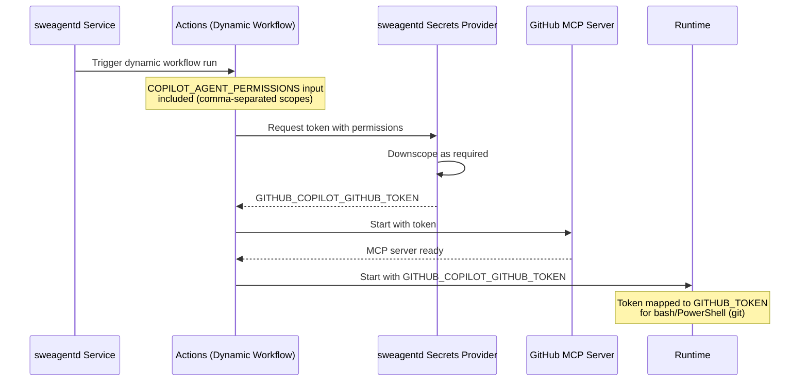
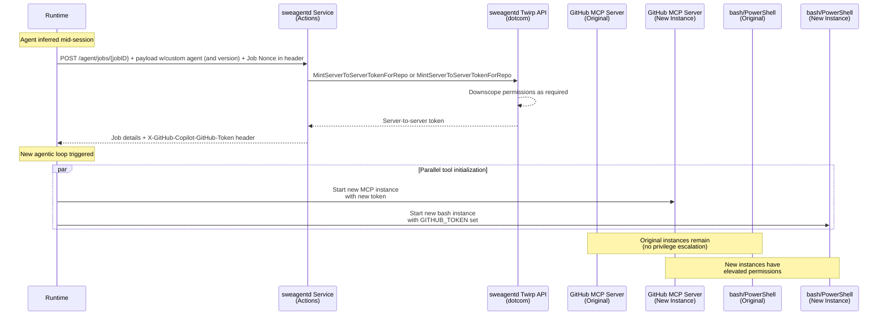

# ADR: Custom Agent-Specific GitHub Permissions

**Status:** Accepted
**Deciders:** @chuxel @josebalius @arthurnn @colbylwilliams @belaltaher8 @rzhade3
**Last Updated:** 2026-02-12

## Context

As we enable non-repo and code-based scenarios in the Copilot CLI and Copilot Coding Agent (CCA), we need a way to expand the permissions that the GitHub MCP server has for specific custom agents. This document describes the approach for implementing this functionality. Additionally, models are highly trained to use git commands, and we want to enable scenarios like merge conflict resolution. Providing a token to `bash` / PowerShell with `contents:read` is sufficient to make these scenarios work.

Custom agents may require elevated GitHub permissions beyond the default read-only access. For example, an agent that should be able to comment on issues needs `issues:write`. Currently, there is no mechanism to grant these permissions on a per-agent basis - so what people have to globally allow CCA and all custom agents to have these permissions via a PAT and MCP config. This is not ideal from a security perspective, as it increases the blast radius of a problem. Any design that resolves this problem should have significant security benifits.

Note that this would **not** change our current default firewall rule that restricts access to only a subset of `api.github.com` (specifically URLs required to ensure the runtime works) for `bash`. That would need to be evaluated separately and the GitHub MCP server enables more discrete control over what endpoints can be accessed than arbitrary `curl` commands for those needs.

### Current Status

We plan to roll out these improvements as follows:
1. Add support for repo-level permissions configuration and up-front selected custom agents in the YAML frontmatter first.
1. Understand how much this capability is used in practice and gather feedback.
1. Assess use and demand for inferred / LLM invoked custom agents with elevated permissions based feedback.
1. Build out implementation of inferred / LLM invoked custom agents path based on feedback and demand.
1. Estimate token generation increase based on the factors above, implement appropriate controls/limiters or increase existing limits as appropriate.
1. Roll out inferred / LLM invoked custom agents once org / enterprise level controls are in place.

If we find that there is not enough demand for inferred / LLM invoked custom agents with elevated permissions, we may choose to not implement that path at all. However, it is included in this design to make sure we do not box ourselves in.

## Decision

We will add a `permissions` field to the custom agent YAML frontmatter that allows specifying variable GitHub Apps permissions for the custom agent. Only a subset of permissions will be supported. By default, these privileges would be read-only like today:
- `metadata`
- `contents`
- `issues`
- `pull_requests`
- `actions`

Outside of these defaults we will also support:
- `checks:read`
- `discussions` (read and write)
- `security-events:read`
- `workflows:write`

We can evaluate adding more permissions in the future as needed. But critically, we would not add permissions like admin or anything beyond what Actions already allows for its similar property.

### Custom Agent Permissions Configuration

Since we want to be able to set permissions for `bash` in addition to the GitHub MCP server, we will define the permissions in the custom agent YAML frontmatter. This allows both the MCP server and `bash` / PowerShell to read the same configuration.

When combined with MCP config, you can expand what the GitHub MCP server can do beyond read tools. In a future enhancement, we can then move towards a more streamlined configuration that would auto-configure the GitHub MCP Server.

```yaml
---
name: issue-manager
description: An agent that can manage GitHub issues

# 👇 New in this ADR
github:
  permissions:
    # metadata: read is always included
    issues: write
    pull-requests: read
    contents: write
    workflows: write
    actions: read

# 👇 Existing support
tools: ["read", "github/*"]
mcp-servers:
  github-mcp-server:
    type: http
    url: "https://api.githubcopilot.com/mcp/"
    tools: ["*"]
    headers:
      X-MCP-Toolsets: context,issues,web_search
---
```

For the yaml, we will use `-` instead of `_` for permission names to be consistent with GitHub Action's permissions property since cut-and-paste here is highly likely.

#### Default repo-level permissions
It can be useful to set default permissions for all custom agents in a repository. This will be supported through namespaced properties in our existing mcp config JSON content. While in concept this enables more permissions, it can also be used to reduce default permissions for more security-conscious repositories or organizations. 

For example, this would reduce default permissions to only `contents:read` and `issues:read` (with `metadata:read` always being included) :

```jsonc
{
  "mcpServers": {
    // ... existing content
  },
  "github": {
    "permissions": {
      "contents": "read",
      "issues": "read",
    }
  }
}
```

Since camel case is common in json circles, we should support those variations here for consistency. For example, both `pullRequest` and `pull-request` can be read to aid copy-paste problems.

#### Opt-Out for Inferred / LLM Invoked Custom Agents
Agents (including the default one for CCA) can dynamically invoke other custom agents as a "subagent" (i.e., not explicitly selected by the user). Control for whether an agent can be invoked by the LLM is controlled by the new `disable-llm-invocation` frontmatter property (and the `infer:false` property we will be deprecating). As the property name implies, the default is to allow LLM invocation.

However, some enterprises will likely want to change this default in general, and the permissions feature adds to the considerations. Therefore, before shipping support for permissions in a LLM invoked, we need to add a **policy controls** that can set the default to opt-in at the repo, org, or enterprise level. 

The specifics of the policy implementation is beyond the scope of this ADR, but is important to call out.

### Token Architecture

We will introduce a new `GITHUB_COPILOT_GITHUB_TOKEN` environment variable containing a **GitHub App token** with agent-specific permissions. This token is used by the GitHub MCP server and `bash` / PowerShell tools.

This results in four distinct GitHub tokens in the runtime environment, each with a specific purpose:

| Token | Identity | Primary Use | Default Permissions |
|-------|----------|-------------|----------------|
| `GITHUB_COPILOT_API_TOKEN` | Triggering user (u2s) or agent bot (s2s) when not user triggered | Interacting with CAPI, billing, and sweagentd callback endpoints. | `copilot_requests`, The following can then be removed: `contents:read`, `issues:read`, `pull_requests:read`, `actions:read` |
| `GITHUB_COPILOT_GIT_TOKEN` | Agent bot (s2s) | Writing repository content. Currently u2s since this was required to get the current block on automatic Actions workflow execution to function. Could re-evaluate in a separate design. | `contents:write`, `workflows:write` |
| `GITHUB_COPILOT_GITHUB_TOKEN` | Triggering user (u2s) or agent bot (s2s) when not user triggered | New token with variable permissions for operations via GitHub MCP server or CLIs like `git` CLI via a cred manager. Mapped to `GITHUB_TOKEN` in the `bash` / PowerShell tool. | `contents:read`, `issues:read`, `pull_requests:read`, `actions:read`, `metadata:read` |
| `GITHUB_TOKEN` | GitHub Actions (s2s) | Default Actions token. Used for Copilot setup steps only. | None |

Where possible we will use user (u2s) tokens since these are constrained by what the users themselves are privileged to do. For automation scenarios where there either is no user (e.g. scheduled runs) or the user is sufficiently ambiguous, we will use server-to-server (s2s) tokens minted using the agent's GitHub App installation. These are always repo scoped.

#### Automatic permissions down-scoping
Because we want to minimize the risk of privilege escalation, we will implement automatic down-scoping of tokens. Given where this token minting occurs, there is no great way to provide a failure message that users can act on. These scenarios become more likely as we start to think about products like Copilot Code Review or the Issue Triage agent that will build on-top of CCA's infrastructure but with bespoke user experiences. While we should do some up-front checking in UX flows to minimize the chances of this happening where possible, we should not rely on that alone or fail in a way that is unclear to users.

There are two main scenarios where down-scoping will occur:

1. For user and server-to-server tokens, its important to note that 3p apps will have different permissions available from our global Copilot SWE Agent App. These are permissions that the app owner has explicitly granted during installation and they have to install again any time additional permissions are requested. We should not assume they will all update at the same time. To avoid failing outright due to these differences, we will automatically down-scope the requested permissions to the intersection of what the app has and what the agent requests.

1. For user tokens, we currently only provide permissions that someone with "write" access to a repo would have. This feature will necessitate expanding this list, and could result in a scenario where an agent requests permissions the user themselves do not have. In these cases we will down-scope to the intersection of what the user has and what the agent requests (in addition to the app as mentioned above).

Furthermore, we should not increase default permissions too far beyond what we already have in place for this very reason.

### Initial Token Minting

The `GITHUB_COPILOT_GITHUB_TOKEN` must be available at the start of the dynamic workflow run because the GitHub MCP server initializes before the runtime starts. The token minting flow works as follows:



**Step-by-step flow:**

1. When a custom agent is selected for a job, a `COPILOT_AGENT_PERMISSIONS` input is included in the dynamic workflow run with a comma-separated list of permissions.
2. The Actions secrets provider then receives a request from Actions, automatically downscopes the permissions as required, and mints a user or server-to-server token as appropriate.
3. The secrets provider then returns this as a `GITHUB_COPILOT_GITHUB_TOKEN` secret (along with other existing ones) with the appropriate permissions by the sweagentd Actions secrets provider and made available to the dynamic workflow.
3. This token is passed to the GitHub MCP server when it starts in the dynamic workflow.
4. The token is provided to the runtime via the `GITHUB_COPILOT_GITHUB_TOKEN` environment variable, which is then translated into `GITHUB_TOKEN` for `bash`/PowerShell, allowing the `git` to use it (due to our existing injected cred manager).

### Inferred / LLM Invoked Custom Agents

When a custom agent's use is inferred (i.e., not explicitly selected by the user), we need to generate the token after the GitHub MCP server has already started. This requires spinning up new instances with the updated credentials.



**Step-by-step flow:**

1. When a custom agent is inferred, the runtime then does a `POST` to `/agent/jobs/{jobID}` with a payload referencing the requested custom agent (and version) and Job Nonce in the header.
2. The sweagentd service connects to the sweagentd Twirp API on dotcom, calling `MintServerToServerTokenForRepo` or `MintUserToServerTokenForRepo` with the repository and required permissions (based on whether a user triggered the job or not)
3. These APIs then automatically downscope the permissions based on the Agentic App and user's permissions (if applicable).
3. The dotcom API returns the appropriate token and adjusted privileges.
4. This endpoint returns job details including the custom agent configuration, along with a `X-GitHub-Copilot-GitHub-Token` header containing the newly minted token (and others as appopriate).
5. A new agentic loop is triggered in the runtime.
6. Due to parallel tool calling, new instances are created:
   - A new GitHub MCP server instance is started with the newly minted token (this is a new token, not a privilege escalation on the existing token).
   - A separate bash/PowerShell instance is started that includes this new token as `GITHUB_TOKEN`.

### Future Considerations

#### Multi-Repository Access

Currently, the token in this context is scoped to a single repository. While we can extend it to multiple repositories, we need additional safeguards to ensure privileges are only granted to intended repositories.

**Challenges:**

- **s2s tokens**: Since the server-to-server token can be minted using CCA's globally installed app, it could theoretically mint tokens for any repository. Since enterprises will want to put limits on just how far this can go, additional work will be needed to enforce these rules.
- **u2s tokens**: User-to-server tokens would be limited to content the user can access, but automation scenarios (no user present) require s2s tokens.

From a security perspective, there's major advantages in minting server-to-server tokens scoped to a set of repositories since the blast radius of an exfiltrated token is reduced and any write access is not user impersonating.

Adding to the complexity is that users likely want the ability to limit to just read permissions for certain repositories while others get write. Today that means managing multiple tokens which is impractical in an AI-based world.

With this in mind, we should align our approach with what GitHub Actions implements for similar multi-repo access patterns to ensure that only the appropriate repos can be referenced in the config ([Draft doc](https://docs.google.com/document/d/18-08xVNg8dtXLqSpbLZVpugvp5l_o9W73oYPs13cbSc/edit?usp=sharing)).

#### Third-Party App Tokens for MCP

This document covers GitHub token permissions for internal use cases. Support for third-party app tokens generated via OIDC is planned but out of scope for this document.
