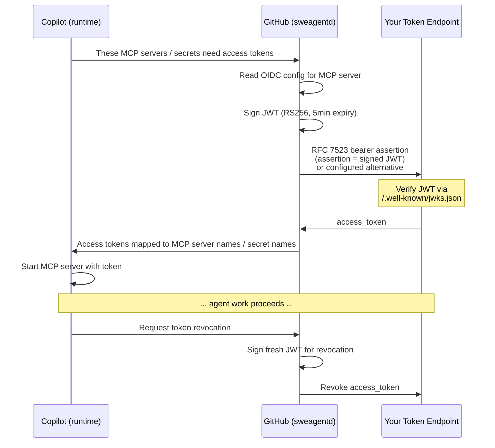

# OIDC Workload Identity Federation for MCP Servers

**Status:** Accepted

**Last Updated:** 2026-05-15

**Related ADRs:**
- [ADR 0014: OIDC Token Exchange for User On-Behalf-Of Flows](0014-oidc-token-exchange-obo.md) — user-level authentication layered on workload identity
- [ADR 0015: OIDC Architecture & Token Signing](0015-oidc-architecture-and-token-signing.md) — token signing infrastructure and system architecture

## Context

MCP servers used by Copilot coding agent often need to authenticate with 3rd party services. Traditional OAuth flows require an interactive browser session, but agentic workloads run in the background without a user present. GitHub solves this with **workload identity federation** — the same pattern used by [GitHub Actions OIDC](https://docs.github.com/en/actions/deployment/security-hardening/using-openid-connect-with-github-actions) — where GitHub issues short-lived OIDC tokens that are exchanged for 3rd party access tokens, with no long-lived secrets stored anywhere.

This approach has two key security benefits: tokens are fresh and short-lived, and they are automatically revoked when the agent's work completes, minimizing the window for token exfiltration in an environment that executes user-authored code.

### Design considerations

There are a few notable considerations that have affected the design:

* We are trying to reduce the number of dependencies that are involved in a given interaction, and we have found the existing Actions secret provider in `github/github` to be difficult and risky to update and maintain. We want to avoid changes there for this design as a result and instead get these tokens via callbacks.
* MCP configuration is used by an **out-of-process** client that connects to the actual MCP servers. This uses a separate TypeScript process that manages MCP server lifecycles, tool invocations, and configuration resolution. This means that this process rather than the main runtime process needs to do any callbacks into sweagentd for exchanging tokens.
* Given these are 3rd party tokens, we need to take extra care in managing them. We do not want these to be in the general environment, and ideally config for generating them is applied centrally in sweagentd so that updates in the Actions environment cannot result in the tokens being routed somewhere unexpected. Similarly, Actions pre-processes workflow config and does not allow it to be changed from what exists centrally. However, we also need to consider dynamic MCP spin-up.

### A note on rollout plans

This design is closely related to the Agentic Apps concept along with "engines" for the GitHub agentic platform. Priority wise we therefore want to:
1. **Enable OIDC for agentic app scenarios:** We know we can reliably access config information based on an App ID.
2. **Enable user configured OIDC**: Specifically, general MCP and custom agent config tied to a repository / job. This also enables a dev loop, so the core likely would be built out at the same time as the agentic app scenario.

This ADR will focus on (2) since (1) is not fleshed out enough to be shippable yet. The current plan is for agentic apps to point to a plugin, so any config described for (1) would directly apply.

Future: **Consider how to enable OIDC for arbitrary plugins** - Arbitrary plugins are complicated by the fact that they can come from anywhere, so this is a future consideration. Likely we'll have to make this flow aware of the plugin on the service side in some form.

## Decision

Use workload identity federation to enable 3rd party tokens for MCP servers. GitHub acts as an identity provider, signs a JWT asserting facts about the current workload, and exchanges it for an access token at the integrator's token endpoint.

## Workload identity federation (s2s)

### How it works

At its core, the flow is a standard [RFC 7523](https://datatracker.ietf.org/doc/html/rfc7523) bearer assertion per the [MCP spec proposal](https://github.com/modelcontextprotocol/modelcontextprotocol/pull/1933). GitHub acts as an identity provider: it signs a JWT asserting facts about the current workload (which agent, which repo, which org), and sends that JWT to your token endpoint using a `urn:ietf:params:oauth:grant-type:jwt-bearer` grant type. Your endpoint verifies the JWT using GitHub's public keys and returns an access token that the MCP server can use.

For system-to-system interactions, workload identity federation typically works through manual trust configuration with the secondary identity provider. While the MCP spec does not directly call out support, the standard flow uses the existing `/token` endpoint that is in the MCP spec that can then be extended to support this protocol.

However, support for this pattern is inconsistent, so we will support two variations of other exchange protocols that leverage the same JWT.
1.  Entra ID's workload identity federation uses the `client_credentials` grant type where the JWT is passed as a `client_assertion`. See [Entra ID and the `client_credentials` grant type](#entra-id-and-the-client_credentials-grant-type) for details.
1. We will also support using a straightforward [RFC 8693](https://datatracker.ietf.org/doc/html/rfc8693) ID token exchange flow where the JWT is passed as the `subject_token` and the `subject_token_type` is `urn:ietf:params:oauth:token-type:id_token`. 

> You can learn more about Entra ID's support for workload identity [here](https://learn.microsoft.com/en-us/entra/workload-id/workload-identities-overview). However, note that when selecting the "Federated credential scenario" you should select "Other issuer," not "GitHub Actions". We'll be using the authnd issuer and the Actions scenario UX has fewer options than our use case.

We will also support a variation of this flow that includes a user's identity in the JWT, allowing the integrator's token endpoint to issue access tokens on behalf of the user. In fact, by default the `user_id` will be included in the subject claim (which is actually enabled by default). **See [0014-oidc-token-exchange-obo](0014-oidc-token-exchange-obo.md) for details.**

### High level flow

The flow is as follows:



### Configuring OIDC on an MCP server

The primary way to set up OIDC is with the **`auth` property** (or its `oidc` compatibility alias) directly on your MCP server definition. This keeps the authentication configuration co-located with the server it applies to. For example, in repository configuration or a `.mcp.json` file:

```json
{
    "mcpServers": {
        "my-server": {
            "type": "http",
            "url": "https://integrator.com/mcp",
            "tools": ["*"],
            "auth": true
        }
    }
}
```

This same format then works in custom agent yaml content:

```yaml
---
name: Integrator custom agent
description: An integrator custom agent
disable-model-invocation: true
mcp-servers:
  my-server:
    type: http
    url: https://integrator.com/mcp
    tools: ["*"]
    auth: true
---
...
```

> **Note:** The `oidc` key is accepted as a compatibility alias for `auth` in both JSON and YAML. Both keys are emitted in the serialized MCP config for backward compatibility with older runtimes. The `auth` key takes precedence when both are present.

We can keep it this simple for **remote** MCP servers because we may be able to auto-discover everything required by interacting with the MCP server. When the runtime starts this MCP server, GitHub will:

1. Use the server URL to discover the OIDC/OAuth configuration. Discovery probes multiple well-known endpoints in sequence (see [ADR 0015: Discovery endpoint cascade](0015-oidc-architecture-and-token-signing.md#discovery-endpoint-cascade) for the full sequence).
1. Generate a signed OIDC JWT with `aud` set to the "issuer" specified in the OIDC configuration of the AS (authorization server).
2. POST it to the AS token exchange endpoint based on this same configuration (inferred as `{base}/token` from the AS metadata if not found).
3. Inject the returned access token as a `Bearer` Authorization header on all requests to the MCP server.

In this remote case, these access tokens do not actually end up in the MCP host's process environment. Instead, the MCP host (in the runtime) calls the token exchange endpoint on the fly as needed and directly applies it to the MCP server's authorization header. 

Passing an access token into the Authorization header is dictated by the MCP Authorization spec, but this spec has no support for local MCP servers at all, and we can't assume auto-configuration will always work. So, more configuration options will be required.

#### Full `auth` configuration

The `auth` property supports several optional fields for more advanced scenarios:

```json
{
    "mcpServers": {
        "my-server": {
            "type": "http",
            "url": "https://integrator.com/mcp",
            "tools": ["*"],
            "auth": {
                "audience": "api://AzureADTokenExchange",
                "endpoints": {
                    "base": "https://integrator.com/auth/v0.1",
                    "exchange": "https://integrator.com/auth/v0.1/token",
                    "revoke": "https://integrator.com/auth/v0.1/revoke",
                    "failure": "https://integrator.com/auth/v0.1/auth-failure"
                },
                "agentOnlySubject": true,
                "grantType": "urn:ietf:params:oauth:grant-type:jwt-bearer",
                "scope": "scope1 scope2",
                "resource": "https://some-api.com",
                "client": "some-client-id"
            }
        }
    }
}
```

Or in custom agent yaml (using kebab-case args):

```yaml
---
name: Integrator custom agent
description: An integrator custom agent
disable-model-invocation: true
mcpServers:
  my-server:
    type: http
    url: https://integrator.com/mcp
    tools: ["*"]
    auth:
      audience: api://AzureADTokenExchange
      endpoints:
        base: "https://integrator.com/auth/v0.1"
        exchange: "https://integrator.com/auth/v0.1/token"
        revoke: "https://integrator.com/auth/v0.1/revoke"
        failure: "https://integrator.com/auth/v0.1/auth-failure"
      agent-only-subject: true
      grant-type: "urn:ietf:params:oauth:grant-type:jwt-bearer"
      scope: "scope1 scope2"
      client: "some-client-id"
      resource: "https://some-api.com"
---
...
```

These values can be used to **override** sensible defaults and automated discovery of OIDC configuration (more information below).

But, part of the reason to allow this level of configurability is for **local server** support. Currently the MCP spec provides no OAuth support for local servers. By allowing a secret name to be specified we can enable token generation into a variable that lands in a configured `env` location. This is important to our use case since these MCP servers can come with tools that need to operate on the local filesystem. In this case, the token generation endpoints are external to the MCP server but can still ultimately get an access token that is more secure than a personal access token (PAT).

To achieve this `GITHUB_COPILOT_OIDC_MCP_TOKEN` can then be safely referenced in local env (or remote headers) configuration, and used to populate the appropriate environment variable / header for the MCP server process. But its value is not shared beyond the scope of that MCP server.

```json
{
    "mcpServers": {
        "my-server": {
            "type": "stdio",
            "command": "npx",
            "args" :["some-mcp-package"],
            "tools": ["*"],
            "env": {
                "YOUR_CLI_TOKEN_ENV_VAR": "$GITHUB_COPILOT_OIDC_MCP_TOKEN"
            },
            "auth": {
                "audience": "api://AzureADTokenExchange",
                "endpoints": {
                    "base": "https://login.microsoftonline.com/{tenant_id}/v2.0",
                    "failure": "http://some-location.com/auth-failed"
                },
                "client": "{client_id}",
                "scope": "{client_id}/.default offline_access",
                "agentOnlySubject": true
            }
        }
    }
}
```

> **Variable references:** Config values such as `{tenant_id}` and `{client_id}` above can reference `COPILOT_MCP_`-prefixed variables that are resolved via the GitHub agent variables in Actions (or a local `.env.mcp-dev` file in development). Variables are fetched once and cached for the duration of the request.

| Field | Required for Local MCPs | Description |
|-------|----------|-------------|
| `endpoints.base` | Yes* | This URL is used to try to discover the OIDC provider's configuration and automatically detect the exchange and revoke endpoints along with the `grantType`. Discovery probes multiple well-known endpoints in sequence — see [ADR 0015: Discovery endpoint cascade](0015-oidc-architecture-and-token-signing.md#discovery-endpoint-cascade) for the full probe sequence. For remote servers, this defaults to the MCP server's URL. **Either this property or `endpoints.exchange` is required for local (stdio) servers** since there is no URL to infer from. |
| `endpoints.exchange` | No* | The token exchange URL. If omitted for remote servers, the logic described for `endpoints.base` is used to discover the endpoint with a final fallback of `{base}/token`. **Either `endpoints.base` or this property is required for local (stdio) servers** since there is no URL to infer from. |
| `endpoints.revoke` | No | The [RFC 7009](https://datatracker.ietf.org/doc/html/rfc7009) revocation URL. Called when the job completes to explicitly invalidate the token. If omitted, the logic described for `endpoints.base` is used to discover the endpoint. Unlike the exchange endpoint, **there is no constructed fallback** — if discovery does not find a revocation endpoint, revocation is skipped. |
| `endpoints.failure` | No | The URL to redirect to on authentication failure. If not set, no URL will be provided when a final failure occurs. |
| `audience` | No | The `aud` claim in the JWT and part of the exchange request in some protocols. If not specified, the service will attempt to auto-discover it from the **first** issuer in the exchange endpoint's metadata (see `endpoints.base`). |
| `agentOnlySubject` (json) / `agent-only-subject` (yaml) | No | Controls whether user information appears in `sub` claim when available (see [Subject configuration](#subject-configuration)). |
| `repoOnlySubject` (json) / `repo-only-subject` (yaml) | No | When `true`, sets the `sub` claim to the repository identity rather than a user or agent identity. Format: `client_id:{platform_client_id}:repository_id:{repo_id}` or `installation_id:{installation_id}:repository_id:{repo_id}` for agentic app entries with an installation. |
| `client` | No | The client identifier sent in the exchange request. For RFC 8693, this is sent as `client_id`. For the `client_credentials` grant type (e.g. Entra ID), this is sent as `client_id` alongside the JWT `client_assertion`. Also included in revocation requests when set. Defaults to the client ID of the related GitHub App (e.g. `Iv23ctzlsVrAf9UtZ48B`). |
| `scope` | No | Used as the `scope` claim in the OIDC JWT and part of the exchange request. Space separated as per [RFC 6749](https://datatracker.ietf.org/doc/html/rfc6749#section-3.3). |
| `grantType` (json) / `grant-type` (yaml) | No | The OAuth grant type to use for the token exchange request. Defaults to `urn:ietf:params:oauth:grant-type:jwt-bearer` to use the JWT bearer flow ([RFC 7523](https://datatracker.ietf.org/doc/html/rfc7523)). Set to `urn:ietf:params:oauth:grant-type:token-exchange` to use the token exchange flow ([RFC 8693](https://datatracker.ietf.org/doc/html/rfc8693)). Set to `client_credentials` for identity providers like Entra ID that use the client credentials flow ([RFC 7521](https://datatracker.ietf.org/doc/html/rfc7521)). When not specified, the grant type is auto-detected from the authorization server metadata with priority: JWT Bearer > Client Credentials > Token Exchange. If auto-detection fails, JWT Bearer is used with a fallback to Client Credentials if the server returns `unsupported_grant_type` and `client` is configured.|
| `resource` | No | Used as the `resource` claim in the JWT and part of the exchange request (except for `client_credentials` where it is not sent as a form parameter). See [OAuth resource indicators](https://datatracker.ietf.org/doc/html/draft-ietf-oauth-resource-indicators-08). Defaults to attempting to auto-discover as [described in the MCP spec](https://modelcontextprotocol.io/specification/2025-11-25/basic/authorization#protected-resource-metadata-discovery-requirements). |
| `publicClient` (json) / `public-client` (yaml) | No | Whether this is a public client (no client secret). Defaults to `true` when not explicitly set. |
| `redirectPort` (json) / `redirect-port` (yaml) | No | The port to use for the redirect URI in OAuth flows. Must be between 0 and 65535 if set. |

#### Alternative config: `.github/copilot/settings.json`

***Note:** This configuration is useful for testing auth functionality independent of MCP servers and could enable broader use of the configuration beyond just MCP servers (e.g. for an engine that needs to make non-MCP calls). However, to start we may not make this available to customers.

For testing and scenarios where you need to configure OIDC entries separately from MCP server definitions (e.g. shared tokens across multiple servers, or potentially OIDC for "engines" that need to make non-MCP calls), you can use a `.github/copilot/settings.json` file:

```json
{
    "oidcConfig": [
        {
            "secretSuffix": "SHARED_API_TOKEN",
            "audience": "your-audience",
            "endpoints": {
                "exchange": "https://integrator.com/token",
                "revoke": "https://integrator.com/revoke",
                "failure": "https://integrator.com/auth-failure"
            },
            "agentOnlySubject": true
        }
    ]
}
```

The resulting token is available as `GITHUB_COPILOT_OIDC_SHARED_API_TOKEN` (or `GITHUB_AGENTIC_APP_OIDC_SHARED_API_TOKEN` for Agentic Apps) and can be referenced in your MCP server configuration like any other secret.

A suffix of `MCP_TOKEN` is **disallowed** since this is reserved for MCP configuration scenarios where no secret suffix can be specified.  `GITHUB_COPILOT_OIDC_MCP_TOKEN` can then be safely referenced in local env or remote headers configuration and kept local to that MCP server setup.

#### How tokens are injected

**Common logic:** The backend (sweagentd) generates an index of OIDC configuration from MCP server config or a set of potential shared secrets named `GITHUB_COPILOT_OIDC_{secretSuffix}` (or `GITHUB_AGENTIC_APP_OIDC_{secretSuffix}` for Agentic Apps as this functionality lands). The runtime asks for the tokens for a set of MCP servers or named secret for a job, the token exchange occurs, and the result is returned to the runtime.

The token delivery mechanism depends on the server type:

- **Local servers** (`stdio`):  Because local servers have no URL to infer from, `endpoints.base` or `endpoints.exchange` must be provided explicitly and explicitly reference `$GITHUB_COPILOT_OIDC_MCP_TOKEN` or one of the shared secret tokens in the `env` section. The server is then initialized with this value. 
- **Remote servers** (`http`, `sse`): Since much of the configuration can be inferred from the server URL, by default the runtime injects it as a `Bearer` Authorization header.
    - However, if the config already includes an explicit `Authorization` header, this OIDC injection is skipped.
    - Like local, OIDC secret references (`$GITHUB_COPILOT_OIDC_MCP_TOKEN`) in custom headers or the server URL can still be used to map to different places than the default.
    - As in the local case, the auth config can either come from MCP config or shared settings.json configuration.

In general, we'd recommend people use remote servers with default config as much as possible since it provides the best security posture.

> **Open question for separate ADR:** How do we get the config centrally for plugins?  In the Agentic App case (which does not exist yet), we can add in support for getting config directly from the related app repo. Do we need to do the same for plugins too?  Which files will respect? (.mcp.json, agent markdown, settings.json?)

### Protocol detail

By default, if the user subject contents are not included, or there is no user that triggered the workflow, the token exchange uses the protocol described in the [proposed Workflow Identity Federation update to the MCP specification](https://github.com/modelcontextprotocol/modelcontextprotocol/pull/1933) which is based on an OAuth assertion in [RFC 7523](https://datatracker.ietf.org/doc/html/rfc7523). GitHub POSTs to the exchange endpoint with:

```
grant_type=urn:ietf:params:oauth:grant-type:jwt-bearer
assertion=<signed OIDC JWT>
requested_token_type=urn:ietf:params:oauth:token-type:access_token
audience=<configured audience>
resource=<configured resource>
scope=<configured scope>
```

### The client credentials flow (e.g for Entra ID)

Entra ID's workload identity federation uses the `client_credentials` grant type rather than the standard bearer assertion or token exchange. When `grantType` is set to `client_credentials` (or auto-detected via `endpoints.base` discovery), the request format changes to:

```
grant_type=client_credentials
client_id=<configured client>
client_assertion=<signed OIDC JWT>
client_assertion_type=urn:ietf:params:oauth:client-assertion-type:jwt-bearer
scope=<configured scope>
```

A key difference is the JWT is sent as a `client_assertion` instead of an `assertion`. The `audience` and `resource` are not sent as form parameters — they are only used as claims in the JWT itself. A specific `client` field will be required that should contain the Entra ID application (client) ID. For example:

```json
{
    "auth": {
        "audience": "api://AzureADTokenExchange",
        "endpoints": {
            "base": "https://login.microsoftonline.com/{tenant_id}/v2.0"
        },
        "client": "{client_id}",
        "scope": "{client_id}/.default offline_access",
        "agentOnlySubject": true
    }
}
```

### Token exchange alternative
As mentioned in the introduction, we can also support the token exchange flow in [RFC 8693](https://datatracker.ietf.org/doc/html/rfc8693) with a `subject_token_type` of `urn:ietf:params:oauth:token-type:id_token` can be selected as an alternative. GitHub POSTs to the exchange endpoint with:

```
grant_type=urn:ietf:params:oauth:grant-type:token-exchange
subject_token=<signed OIDC JWT>
subject_token_type=urn:ietf:params:oauth:token-type:id_token
requested_token_type=urn:ietf:params:oauth:token-type:access_token
audience=<configured audience>
client_id=<configured client> (optional)
resource=<configured resource>
scope=<configured scope>
```

### Verifying the JWT

The integrator's endpoint should:

1. Fetch the public keys from `{issuer}/.well-known/openid-configuration` → `jwks_uri` to verify the JWT signature.
2. Validate standard claims (`iss`, `aud`, `exp`, etc.).
3. Use the `sub`, `agent`, and other claims to authorize the request and determine what access to grant.
4. Return a JSON response with `access_token`, `token_type`, and optionally `expires_in`.

### JWT token claims

The JWT uses RS256 signing with a 5-minute expiry. It always includes:

| Claim | Description | Example |
|-------|-------------|---------|
| `iss` | Issuer URL (GitHub's OIDC endpoint) | `https://github.com/auth/login` |
| `sub` | Subject contents - see below. | `user_id:213455` or `installation_id:76586` or `client_id:Iv23ctzlsVrAf9UtZ48:owner_id:org_id:123456` |
| `aud` | Audience — from your config / auto-discovered | `api://AzureADTokenExchange` |
| `exp` | Expiration (5 minutes from issuance) | |
| `iat` | Issued-at timestamp | |
| `nbf` | Not-before timestamp | |
| `jti` | Unique token ID (UUID) | |
| `act.sub` | Acting subject — always identifies the agent (see below). | `client_id:Iv23ctzlsVrAf9UtZ48B:owner_id:org_id:123456:custom_agent:789:my-agent@v1.0` |
| `client_id` | Platform client ID (CCA's App client ID, immutable) | `Iv23ctzlsVrAf9UtZ48B` |
| `agent_client_id` | Agentic App client ID — only present when it differs from `client_id`. | `Iv23xyzAppClientID` |
| `agent_id` | Agentic App ID — only present when `agent_client_id` is present. | `123124125` |
| `installation_id` | Installation ID for the agentic app (if applicable) | `76586` |
| `preferred_username`| GitHub user login — only included for human user actors (not bots/agents). | `octocat` |
| `user_id` | GitHub user ID — only included for human user actors (not bots/agents). | `12345` |
| `repository_owner_id` | Repository owner (org/user) ID | `67890` |
| `repository_owner` | Repository owner name | `github` |
| `repository_id` | Repository ID | `11111` |
| `repository` | Repository full name | `github/example` |
| `resource` | The resource the token is intended for (if configured) | `api://AzureADTokenExchange` |
| `scope` | The scope of the token (if configured) | `api://AzureADTokenExchange/.default offline_access` |
| `session_id` | The session ID for the current agent job | `abc123-def456` |

Once we enable multi-repo access, we can add a `repositories` claim that includes more than just the primary repository.

The JWT header includes a `kid` (key ID) for looking up the correct verification key in the JWKS endpoint.

### Subject configuration

The `sub` claim is built as follows:

- If `repoOnlySubject` is **true**:
    - **For agentic app entries with an installation ID:** `installation_id:{installation_id}:repository_id:{repo_id}`
    - **Otherwise:** `client_id:{platform_client_id}:repository_id:{repo_id}`
- If `agentOnlySubject` is **false**, and there **is** a human user actor (not a bot/agent), then the sub is `user_id:{user_id}`
- If `agentOnlySubject` is **true**, or there **is not** a human user actor:
    - **For agentic app entries with an installation ID:** `installation_id:{installation_id}`
    - **For agentic app entries without an installation ID:** `client_id:{agent_client_id}:owner_id:{owner_type}:{owner_id}` where `{owner_type}` is `org_id` or `user_id`
    - **For platform (CCA) entries:** `client_id:{platform_client_id}:owner_id:{owner_type}:{owner_id}`

The `act.sub` claim always identifies the **agent** (not the user). It is built from the agent identity and includes custom agent information when applicable:
- Base identity follows the same installation/client_id logic as `sub` above
- When a custom agent is active: `{base}:custom_agent:{repo_id}:{agent_name}@{version}` (version defaults to `latest` if not specified)

Examples:
- `sub`: `user_id:213455` (user-driven flow with `agentOnlySubject: false`)
- `sub`: `installation_id:76586` (agentic app with installation)
- `sub`: `client_id:Iv23ctzlsVrAf9UtZ48B:owner_id:org_id:123456` (CCA platform identity)
- `sub`: `client_id:Iv23ctzlsVrAf9UtZ48B:repository_id:789` (repo-only subject)
- `act.sub`: `client_id:Iv23ctzlsVrAf9UtZ48B:owner_id:org_id:123456:custom_agent:789:my-agent@3948cba421f6704aa3468b69c11ba922d83107ed`

This allows anyone that's created an engine or custom agentic app to uniquely identify and authorize requests based on the specific installation and user context depending on their needs.

### Token revocation

When a job completes, GitHub calls each integrator's `endpoints.revoke` (if configured or discovered) with a **freshly signed** OIDC JWT and the access token, following [RFC 7009](https://datatracker.ietf.org/doc/html/rfc7009). This lets your system explicitly invalidate the token rather than waiting for it to expire. The `client_id` is also included in the revocation request when set in the config.

Revocation is best-effort: errors are logged but do not block job cleanup. Entries without an `endpoints.revoke` are skipped. Unlike the exchange endpoint, there is no constructed fallback for the revocation endpoint — it must be explicitly configured or discovered from metadata.

### GitHub token access

If your MCP server needs access to call GitHub APIs, you can reference a secret called `GITHUB_TOKEN` in your MCP configuration. By default this has a set of read-only permissions, but you can update these by setting the `github.permissions` property in your entry point `agent.md` file.


## Open questions

- What should the default subject configuration be for multi-repo access scenarios?
