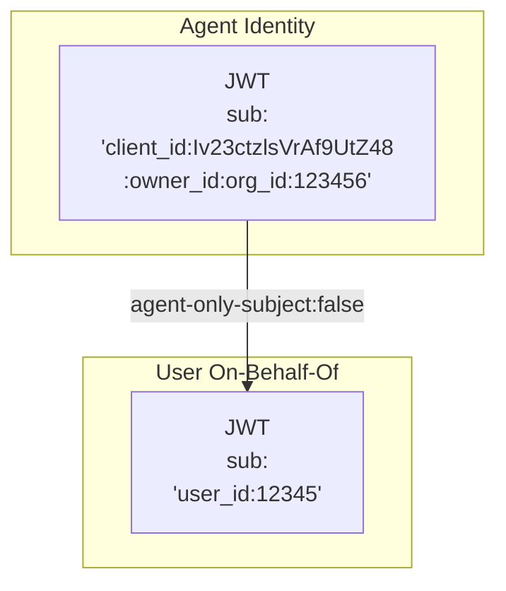

# OIDC Token Exchange for User On-Behalf-Of Flows

**Status:** Accepted

**Last Updated:** 2026-05-15

**Related ADRs:**
- [ADR 0013: OIDC Workload Identity Federation for MCP Servers](0013-oidc-workload-identity-federation.md) — the core OIDC token exchange flow this builds on
- [ADR 0015: OIDC Architecture & Token Signing](0015-oidc-architecture-and-token-signing.md) — token signing infrastructure and system architecture

## Context

The workload identity federation flow described in [ADR 0013](0013-oidc-workload-identity-federation.md) identifies the *workload* (agent + optionally org and/or repo), but some integrators (and many existing MCPs) operate at a user level rather than a workload one where possible. These systems sometimes favor an on-behalf-of flow (similar to using a u2s token in GitHub). Supporting an OBO flow is not something that can be generalized across identity providers, but we can provide additional subject metadata so the token exchange logic can distinguish between a user-less workload execution and a user triggered one. Identity systems can then include this information in matching. In either case, the OIDC token is a signed, verifiable token that indicates that the user has been authenticated into GitHub, and authorized to use the MCP server.

For how this would work on the integrator side, integrators typically have a way to link accounts from different systems into their own internal representations (e.g. via a web interface or an OAuth flow). This process establishes a trust relationship that the integrator's representation of a given user equates to the GitHub one from an authentication standpoint.

Products that support multiple IdPs like GitHub also may have ways to issue user tokens without a direct user OAuth flow. In the event that an integrator is not able to do that (e.g. if you're using Entra ID directly), this flow will still work, but the integrator will need to cache refresh tokens from an previous user OAuth flow at the time this linking occurred (or was refreshed).

## Decision

While we may get driven to persist user-level tokens ourselves through a traditional OAuth flow in the future, this would necessitate a full end-to-end OAuth flow and persistent storage of 3rd party credentials and refresh tokens. We will avoid this to start and cover this in a separate ADR if needed.

Instead, we will layer user identity on top of the workflow described in [ADR 0013](0013-oidc-workload-identity-federation.md) rather than introducing a separate authentication mechanism for user-level access. Differing `sub` contents can allow for a separation between agent and user-driven flows where needed, and the protocol options in this ADR should give the needed flexibility.

## How user identity works

Once user mapping is established, the token flow works exactly as described in [ADR 0013](0013-oidc-workload-identity-federation.md) — but now the `sub` claim and context claims carry the user's identity:

- Setting `agent-only-subject:false` and `repo-only-subject:false` (the default) will include the user ID in the `sub` claim if a human user actor is available (not a bot/agent).
- The `preferred_username` and `user_id` claims are always present **if it was a human user triggered flow** (not a bot/agent), so your exchange endpoint can use them to look up the mapped user even without `agent-only-subject:false`/ `repo-only-subject:false`. The subject setting goes a step farther to prevent an accidental mapping of a user flow to a system one and vice versa.
- The integrator's exchange endpoint can then opt to returns an access token scoped to that user's permissions in the system - or even a user access token.

For example:

## Optional: Chaining in account linking for agentic GitHub Apps

GitHub Apps constitute the core of GitHub's fine-grained integration, authentication, and authorization system for integrators, and this is still the case for Agentic GitHub Apps. When an App is installed for a repository or organization and/or initially accessed by a user, the integrator's system can map GitHub its view of the user by chaining in an authorization flow to the integrator service.

Specifically, by checking the "Request user authentication (OAuth) during installation" option in te integrator's GitHub App, an OAuth flow will be automatically triggered whenever they consent to allow the GitHub App to access their information for the first time.

The interaction between GitHub and the integrator system is as follows:

1. Upon first use of the Agentic GitHub App, the user is redirected to consent to allow the App to access their GitHub information.
2. Upon acceptance, GitHub performs its own OAuth flow to generate a GitHub access token.
3. Once successful, the user is then redirected to the callback URL you specify in your App config with the token.
4. On redirect to this callback URL, the integrator can:
   1. **[Optional]** Uses the GitHub token to get any needed information using GitHub APIs.
   2. Check to see if GitHub's representation of the user ID (`user_id`) is already "linked" (mapped) to its representation of a user. Note integrators should specifically check the ID, not rely on the login or emails since these are not immutable (and in the case of email can map to more than one account).
   3. If not, the integrator redirects the user a second time to its login flow with a second callback (which may be a no-op if the user is already signed in).
   4. Once the user has logged in and redirected to the integrator's callback, they can use the information from both systems to link the GitHub and integrator account.

If other account linking is needed, the integrator can do that as a part of this same interaction.

## Token expiration and re-authorization

Certain identity systems like Entra ID do not have a true user-to-user token flow without a token expiration. Note that Entra ID also uses a different grant type (`client_credentials` with a JWT client assertion) rather than the standard RFC 8693 token exchange — see [ADR 0013](0013-oidc-workload-identity-federation.md#the-client-credentials-flow-eg-for-entra-id) for details on how this affects the exchange request format. Refresh tokens are often set to something like 90 days. The MCP server's OAuth support can return an error signalling a re-authorization is required. For example, the access token that was returned by the integrator may have been short lived and has since expired.

To accommodate the OIDC aspect of this design, the MCP host / runtime should first try to run through the token exchange flow again to get an refreshed token. In the workflow identity federation scenario, this should work automatically. But integrator configuration may have changed or the refresh token has expired as described previously.

In the event that this second OIDC flow fails, CCA needs to provide information to the user (e.g. in the session logs or a job failure notification) that the user needs to take additional steps. The `endpoints.failure` in the OIDC configuration allows this to be configured.

However, the details of this message and the related interaction are beyond the scope of this document.