# OIDC Architecture & Token Signing

**Status:** Accepted

**Last Updated:** 2026-05-15

**Related ADRs:**
- [ADR 0013: OIDC Workload Identity Federation for MCP Servers](0013-oidc-workload-identity-federation.md) — the core OIDC token exchange flow and configuration
- [ADR 0014: OIDC Token Exchange for User On-Behalf-Of Flows](0014-oidc-token-exchange-obo.md) — user-level authentication layered on workload identity

## Context

The OIDC workload identity federation flow described in [ADR 0013](0013-oidc-workload-identity-federation.md) requires signed JWTs and a multi-component architecture spanning sweagentd, the runtime, and integrator endpoints. This ADR covers the token signing infrastructure and the system architecture that implements the OIDC flow.

## Decision

Use authnd for JWT signing in production/staging, with a local signing fallback for development. The runtime discovers OIDC requirements and injects tokens, while sweagentd independently reads configuration, signs JWTs, and performs token exchange.

## Discovery endpoints & token signing

### Primary configuration discovery endpoints

As described in the MCP spec, the following are endpoints that should be considered when trying to automatically discover OIDC configuration. sweagentd probes these in a specific order with both path-insertion and path-appending variants — see the [Discovery endpoint cascade](#discovery-endpoint-cascade) for the full sequence:
- `/.well-known/oauth-authorization-server` (with path insertion and root variants)
- `/.well-known/openid-configuration` (with path insertion, path appending, and root variants)
- `/.well-known/oauth-protected-resource` (RFC 9728 fallback, with path-scoped and root variants)

### Signing endpoints

For signing to function, two standard OIDC discovery endpoints need to be served (publicly accessible, no authentication required):

- **`GET /.well-known/openid-configuration`** — Returns the issuer and `jwks_uri`.
- **`GET /.well-known/jwks.json`** — Returns the RSA public signing key in JWK format (RFC 7517).

Since this has to be a public URL and authnd only works in an Actions environment (more later), there are two variations of signing we'll support: the prod/staging path, and an optional one for e2e DX in development only.

### Production / staging: authnd

In production and staging, sweagentd delegates OIDC token issuance to **authnd** rather than signing JWTs locally. authnd is a shared, centrally managed signing service within GitHub's infrastructure that handles OIDC token issuance. This has major advantages:

- **Does not add yet another issuer** - Using authnd means that the issuer of the JWTs remains consistent with other GitHub OIDC tokens, avoiding the complexity of integrators having to manage multiple issuers.
- **No key management:** Signing keys are managed entirely by authnd. sweagentd does not hold or configure any RSA private keys in production.
- **No need to ship new discovery endpoints:** Because authnd hosts its own JWKS and OpenID configuration endpoints, sweagentd does not register `/.well-known/jwks.json` or `/.well-known/openid-configuration` routes when authnd is enabled. Integrators verify JWT signatures against the authnd-hosted JWKS endpoint.
- **Centralized key rotation:** Key rotation is handled by authnd without requiring any changes to sweagentd configuration or deployments.

Connecting to authnd to make calls only requires the **existing HMAC** sweagentd uses for its Twirp requests for end user authentication. 

These steps then allow sweagentd to call the existing authnd endpoint.

#### Updates to authnd

To support this new use case, authnd simply needs to be updated to accept a map of additional claims, which is a simple change to the IssueIdentityToken RPC. This allows sweagentd to pass the necessary OIDC claims (e.g. `aud`, `sub`, and any custom claims needed for the integrator's token exchange) when requesting a signed JWT from authnd.

### Development: local signing option

The authnd service is automatically spun up as a part of `start-actions`, so it is available when using the Actions launcher. However, its issuer URL will not be available publicly. To address this gap in critical end-to-end testing, a simple signer can be turned on that will generate its own signing key on startup and expose OIDC discovery endpoints via simple HTTP routes (in development only):

- `GET /.well-known/openid-configuration` — Returns the issuer and `jwks_uri`.
- `GET /.well-known/jwks.json` — Returns the RSA public signing key in JWK format.
- `GET /.well-known/oauth-protected-resource` — Returns RFC 9728 protected resource metadata pointing to the dev signer as its authorization server.
- `GET /.well-known/oauth-protected-resource/public/mcp` — Same as above, for path-scoped resource discovery.

The issuer URL resolution follows this priority:
1. Explicit override via `OIDC_DEV_SIGNER_ISSUER_URL` environment variable.
2. Codespaces environment (`CODESPACE_NAME` + port forwarding domain) — makes the sweagentd port accessible publicly for end-to-end testing with external IdPs like Entra ID.
3. `COPILOT_API_URL` — derived as `{copilot_api_url}/agents/swe`.
4. `http://localhost:{port}` fallback for local development.

## Architecture

### System overview

The OIDC flow spans three components: **sweagentd** (Go backend), the **runtime** (TypeScript agent runtime), and the **integrator** (3rd party token endpoint). The runtime and backend have complementary responsibilities: the runtime discovers OIDC requirements from MCP configs and injects resolved tokens, while the backend independently reads the full OIDC configuration from the repository (including `endpoints.exchange`, `endpoints.revoke`, and other configuration), signs JWTs, and performs the actual token exchange.

The token exchange API (`POST /agent/jobs/{jobID}/tokens`) supports two request modes that can be used together:

- **`mcp_server_names`** — for inline `auth` entries on MCP servers. The runtime sends raw server names; the backend matches them to config entries by server name. Tokens are returned in a `mcp_tokens` map keyed by server name. This is used for both remote and local servers with inline `auth` blocks.  (The secret name `$GITHUB_COPILOT_OIDC_MCP_TOKEN` can be used to reference this resulting access token in the MCP config.)
- **`secret_names`** — for `settings.json` or the proposed OIDC "Connector" design - neither of which directly tie to MCP config. In these cases a `$GITHUB_COPILOT_OIDC_*` (or `$GITHUB_AGENTIC_APP_OIDC_*`) reference can be included in the configuration. The runtime sends full secret names with the appropriate prefix; the backend matches by suffix. Tokens are returned in a `tokens` map keyed by full secret name. These can then be passed to the MCP server like other secrets.

**Security note:** The resulting secrets should **not** be added to the actual process environment for the MCP host or other runtime processes. Instead they should be passed directly to the MCP servers to minimize where they are available as much as possible.

When a custom agent is dynamically selected, the MCP host uses the same token exchange endpoint (`POST /agent/jobs/{jobID}/tokens`) and sweagentd resolves that agent's MCP config by name and merges it into the OIDC configuration.

In production, token signing is delegated to authnd (see [Token signing](#token-signing)), which manages its own keys centrally. In development, sweagentd signs tokens locally and hosts OIDC discovery endpoints directly.

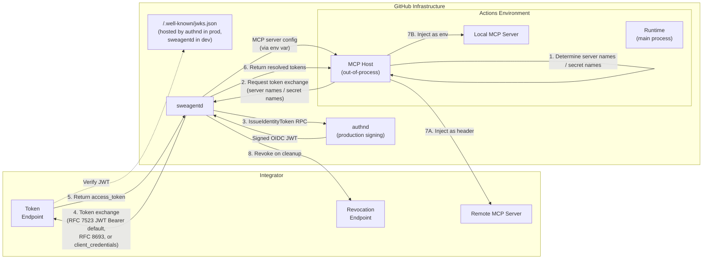

### Internal flow

1. The **MCP Host (Out-of-Process)** processes the MCP server configuration from sweagentd and discovers `auth` blocks or `GITHUB_COPILOT_OIDC_*` / `GITHUB_AGENTIC_APP_OIDC_*` secret references. References can appear in environment variables, command arguments, headers, URLs, and the working directory.
2. The MCP Host builds a token exchange request (`POST /agent/jobs/{jobID}/tokens`) with two categories of identifiers:
   - **`mcp_server_names`**: raw server names for MCP servers with inline `auth` blocks (both remote and local). The MCP Host does not derive a secret name — it sends the server name directly.
   - **`secret_names`**: full `GITHUB_COPILOT_OIDC_*` / `GITHUB_AGENTIC_APP_OIDC_*` variable names for `settings.json` or the proposed OIDC "Connectors" design.
   When a custom agent is active, the request includes `agent_name` so the backend resolves the correct agent-specific OIDC configuration.
3. **sweagentd** independently loads the OIDC configuration from the repository (`.github/copilot/settings.json` and inline MCP configs) and processes both request categories. Config is merged in precedence order: `settings.json` < repo MCP config < repo `.mcp.json` < additional MCP configs (e.g. from repo plugins) < app MCP configs < agent MCP config. Later sources overwrite earlier ones for entries with the same server name.
   - For `mcp_server_names`: matches each server name to a config entry by `serverName`, signs a JWT (via authnd in production, or locally in development — see [Token signing](#token-signing)), performs the token exchange (see [ADR 0013](0013-oidc-workload-identity-federation.md#protocol-detail) for details), and returns the access token keyed by server name in `mcp_tokens`.
   - For `secret_names`: parses the suffix, matches it to a config entry, signs and exchanges, and returns the access token keyed by full secret name in `tokens`.
   All exchanges run in parallel.
4. The resolved access tokens are returned to the runtime, which **caches** them (by server name for `mcp_tokens`, by secret name for `tokens`) and injects them:
   - **Local (stdio) servers:** For inline `auth` entries, the runtime maps the server-name-keyed token to the `GITHUB_COPILOT_OIDC_{suffix}` env var (deriving the suffix locally). For `settings.json` entries, the secret-name-keyed token is injected directly. Tokens are also expanded in command arguments and working directory.
   - **Remote (http/sse) servers:** For inline `auth` entries, the server-name-keyed token is injected as a `Bearer` Authorization header. OIDC references in other headers or URLs are also expanded.
5. When the job completes, sweagentd calls each configured revocation endpoint to invalidate the tokens.

### Token caching and renewal

The runtime caches resolved access tokens in memory so that the token exchange only happens once — during initial server setup. Tokens from `mcp_tokens` are cached by server name; tokens from `tokens` are cached by full secret name. All subsequent MCP tool invocations reuse the cached token without calling the backend again. This means the integrator's token exchange endpoint is called once per OIDC entry per server lifecycle, not once per tool call.

If a cached token expires or is revoked while the agent is working, the MCP server will reject the request with an authentication error. When this happens during a tool invocation on a remote server, the runtime automatically:

1. Closes the existing MCP client connection.
2. Evicts **all** related cached OIDC tokens (since multiple servers may share tokens).
3. Re-processes the server configuration from scratch — triggering a fresh token exchange with the backend.
4. Retries the failed tool call with the new client and fresh token.

Concurrent reconnection attempts for the same server are deduplicated, so multiple simultaneous tool failures don't trigger redundant reconnections.

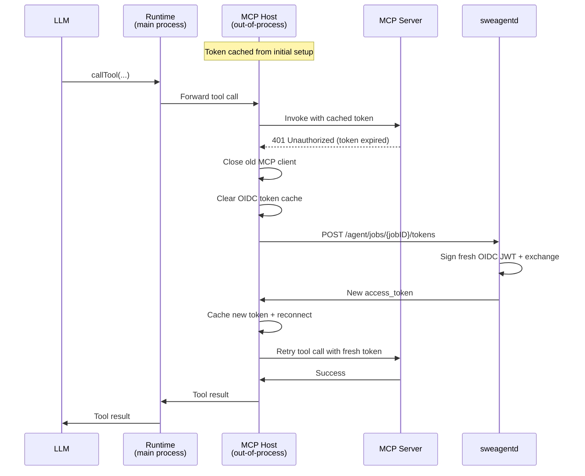

This approach balances security (short-lived tokens) with efficiency (no per-call exchange overhead), and ensures the agent can self-heal from token expiry without user intervention.

**Open issue:** Can we allow local MCP servers to return some message that causes this to happen? How do we deal with very short lived tokens otherwise?

### OIDC with dynamically-selected custom agents

Custom agents can declare their own MCP servers with inline `auth` configurations in their `agent.md` front matter. When a custom agent is selected dynamically by the runtime — after the job has already been created — the OIDC flow needs to resolve that agent's MCP config rather than the one stored on the job.

This works through the `agent_name` parameter:

1. The runtime starts a server for the custom agent and passes its name to the server config processor.
2. When OIDC tokens are needed, the runtime includes `agent_name` and `agent_version` in the `POST /agent/jobs/{jobID}/tokens` request to the backend.
3. The backend uses `agent_name` and `agent_version` to resolve the custom agent by name (via `ResolveByNameAndRepoID`) instead of falling back to the job's stored agent record.
4. The resolved agent's MCP config is merged with the repository's MCP config — **agent servers override repo servers with the same name**.
5. Inline `auth` entries are extracted from the merged MCP config and combined with any entries from `.github/copilot/settings.json` (settings.json takes precedence for duplicate suffixes).
6. The backend signs JWTs and performs token exchange using this merged configuration.

This means an integrator's custom agent can ship with auth-enabled MCP servers that "just work" when selected — the agent's `auth` config carries everything needed for token exchange, and the backend resolves it automatically based on the agent name.

When `agent_name` is not provided (e.g. during batch server initialization at job startup), the backend falls back to the job's stored custom agent record.

## Detailed sequence diagrams

The auth flow has seven phases. Each is detailed in its own diagram below.

```mermaid
flowchart LR
    P1["1. MCP Host receives<br/>MCP server config"]
    P2["2. MCP Host discovers<br/>OIDC requirements"]
    P3["3. MCP Host requests<br/>token exchange"]
    P4["4. sweagentd resolves<br/>OIDC configuration"]
    P5["5. JWT signing"]
    P6["6. Token exchange<br/>with integrator"]
    P7["7. Token delivery<br/>to MCP Host"]

    P1 --> P2 --> P3 --> P4 --> P5 --> P6 --> P7

    style P1 fill:#fdf6e8,stroke:#d4a017
    style P2 fill:#e8f4fd,stroke:#4a90d9
    style P3 fill:#fff3e0,stroke:#f5a623
    style P4 fill:#e8fde8,stroke:#4ad94a
    style P5 fill:#f0e8fd,stroke:#9b59b6
    style P6 fill:#fde8e8,stroke:#d94a4a
    style P7 fill:#e8fdf4,stroke:#2ecc71
```

---

### Phase 1 — MCP Host receives MCP server config

Before the MCP host can discover OIDC requirements, it needs the MCP server definitions themselves. These arrive through two paths depending on timing: up-front at job start (directly to the MCP host via environment), or dynamically when a custom agent is selected later (via the main runtime). In both cases, the MCP host starts servers that don't require OIDC immediately and reports their available tools back to the runtime.

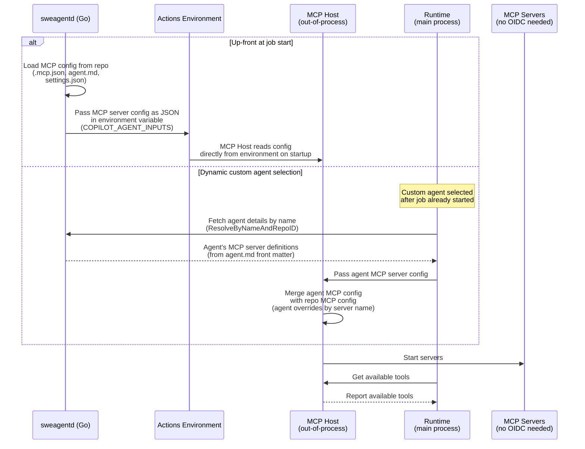

---

### Phase 2 — MCP Host discovers OIDC requirements

The MCP host (out-of-process from the main runtime) reads the resolved MCP server definitions and identifies which servers need OIDC tokens.

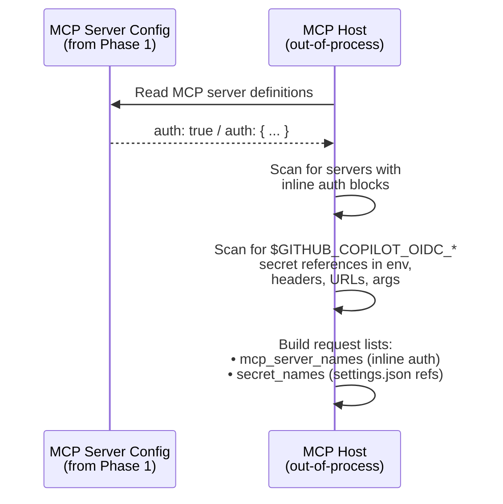

---

### Phase 3 — Token exchange request

The MCP host sends the collected identifiers to sweagentd. When a custom agent was dynamically selected, `agent_name` and `agent_version` are included so sweagentd resolves the correct config.

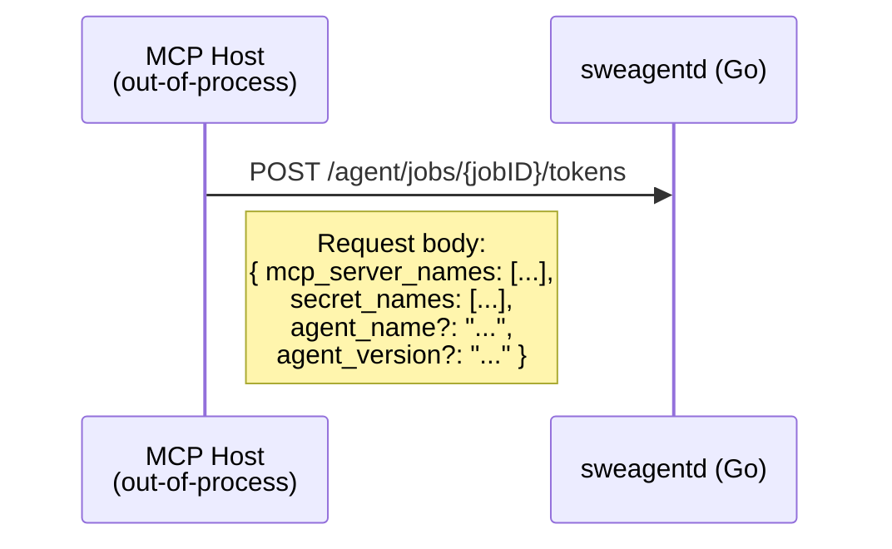

---

### Phase 4 — sweagentd resolves OIDC configuration

sweagentd independently loads config from the repository and discovers endpoints via well-known URLs. When `agent_name` is provided, sweagentd resolves that agent's MCP config and merges it with the repo config.

#### 4a — Config resolution and matching

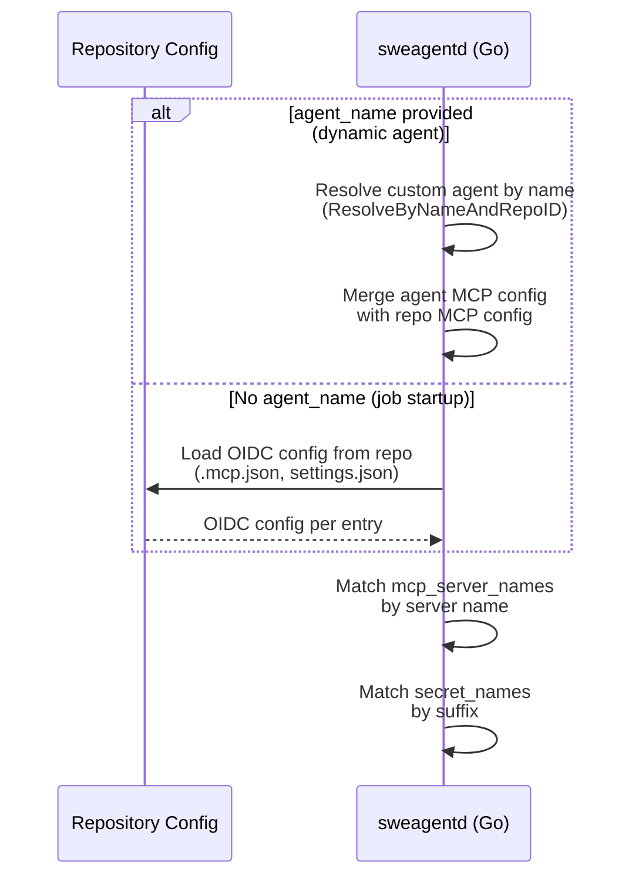

#### 4b — Endpoint discovery

For each matched OIDC entry, sweagentd discovers the token exchange and revocation endpoints. See the [discovery endpoint cascade](#discovery-endpoint-cascade) for the full probe sequence.

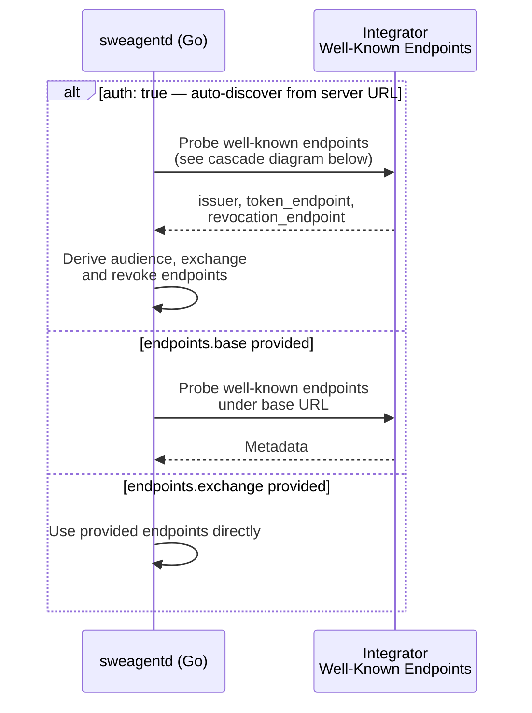

---

### Phase 5 — JWT signing

sweagentd obtains a signed OIDC JWT. The signing path differs between production and development.

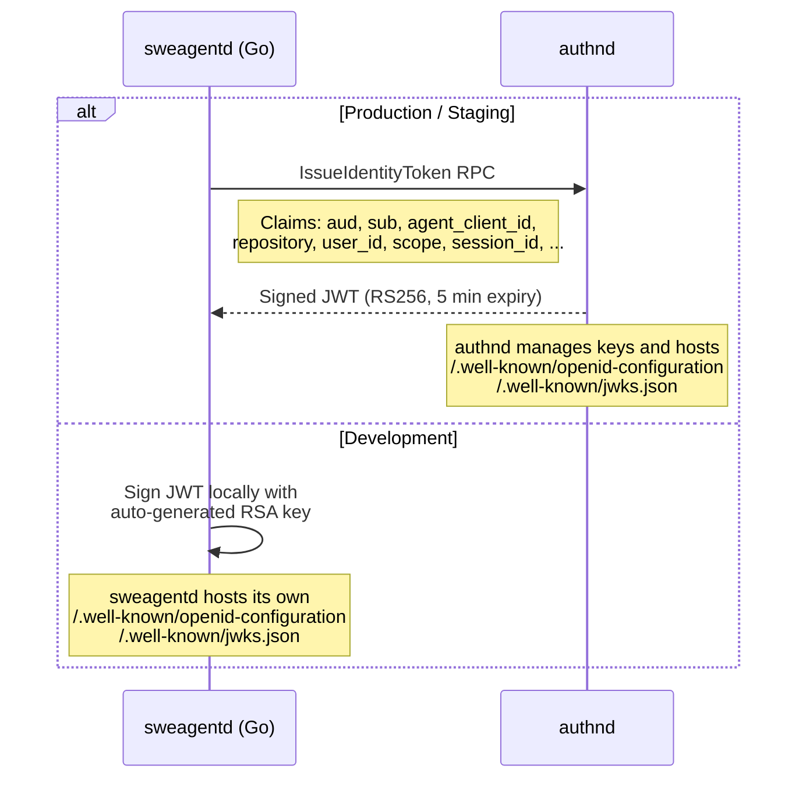

---

### Phase 6 — Token exchange with integrator

sweagentd sends the signed JWT to the integrator's token endpoint using one of three grant types. The integrator verifies the JWT against GitHub's public JWKS.

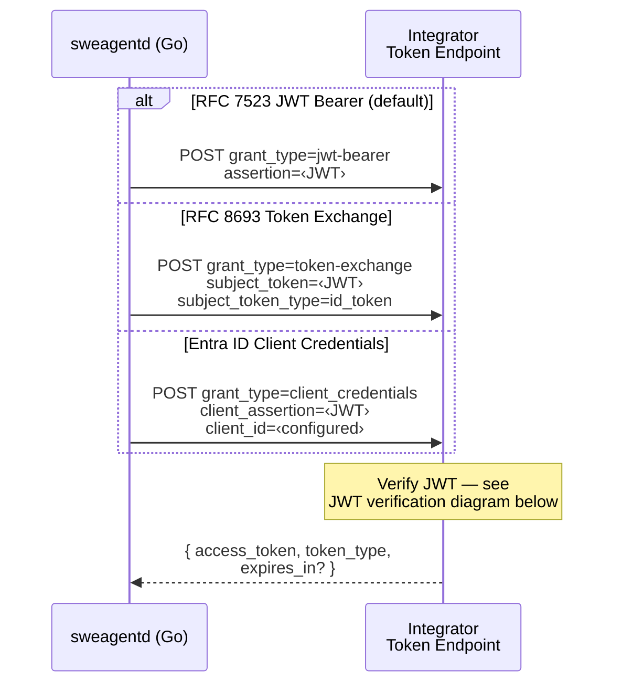

---

### Phase 7 — Token delivery and injection

sweagentd returns the resolved tokens to the MCP host, which caches and injects them into the MCP servers it manages. Once servers are running, the MCP host reports available tools back to the main runtime for use in LLM interactions.

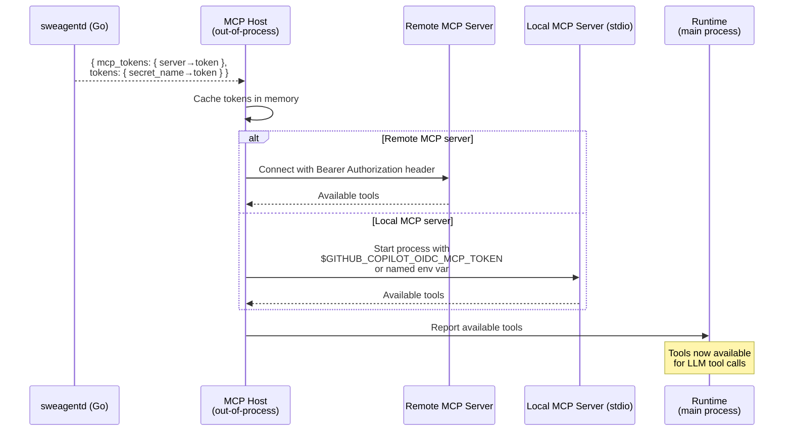

---

### Discovery endpoint cascade

When `auth: true` is set or `endpoints.base` is provided, sweagentd probes standard well-known endpoints to auto-discover the authorization server metadata. The discovery follows a 5-candidate URL strategy for authorization server metadata, then falls back to RFC 9728 protected resource metadata:

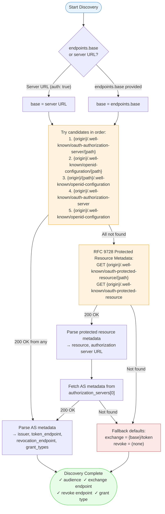

**Grant type auto-detection:** When the grant type is not explicitly configured, it is determined from the discovered authorization server metadata's `grant_types_supported` field with the following priority:
1. **JWT Bearer** (`urn:ietf:params:oauth:grant-type:jwt-bearer`) — preferred when supported
2. **Client Credentials** (`client_credentials`) — used by providers like Entra ID
3. **Token Exchange** (`urn:ietf:params:oauth:grant-type:token-exchange`) — RFC 8693

If no grant type is configured or auto-detected, JWT Bearer is used by default, with an automatic fallback to Client Credentials if the server returns `unsupported_grant_type` and a `client` is configured.

---

### JWT verification by integrator

When the integrator receives the signed JWT, it verifies it against GitHub's public keys:

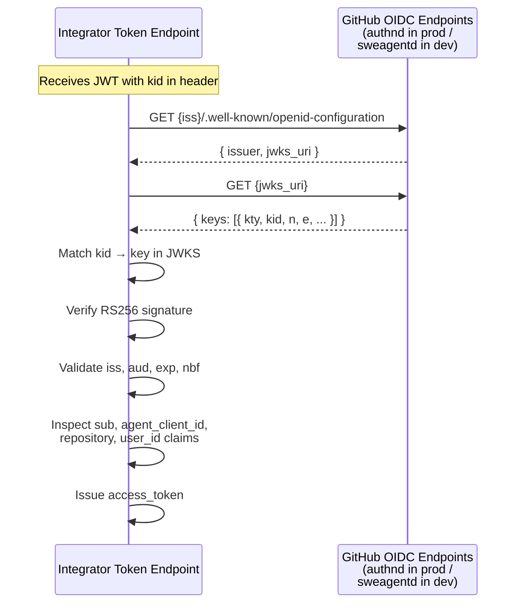

## Future considerations

- Right now we are relying on a token exchange process via a few different protocols, but not supporting classic user sign-in based OAuth because this would require us to persist tokens and refresh them rather than delegating that responsibility to the integrator. We likely will get asked to change this, but that should be covered in a separate ADR when the time comes.
