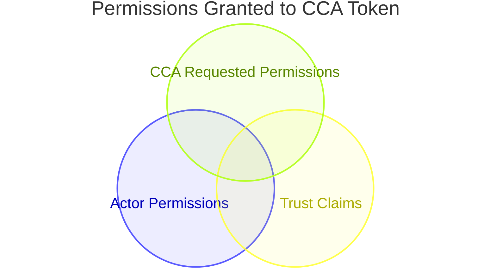

# Multi-Repo Trust

Status: accepted

Deciders: @timrogers @rzhade3
Stakeholders: @steve-glass @hpsin

Related issue: https://github.com/github/sweagentd/issues/11331

## Context

We want to extend Copilot Cloud Agent (CCA) to work across multiple repositories in a single session. This will unlock better workflows for developers when they work on features that cross repository boundaries, for example, implementing a client and server relationship. This feature is found in our competitor products and is something Copilot needs to remain competitive in this market.

However, the Product Security and GRC teams have raised significant concerns about information leakage and authorization model integrity. The feature is intended to bring data across repository lines by design. This means that a user who performs a multi-repository run may expose information about the additional context repositories to other users who don't have access through commits, pull requests, and logs.

This document defines guardrails that can be set by repository admins to "opt-in" to allowing other repositories access to their data, using the concept of "trust policies".

This document is _heavily_ inspired by similar work the Actions team is doing:
- [Cross Repository GITHUB_TOKEN Access](https://github.com/github/c2c-actions/pull/9988), defining trust policies that can be used to provide the GITHUB_TOKEN in Actions runs access to multiple repositories
- [Keyless GitHub App tokens in Actions](https://github.com/github/c2c-actions/pull/10068), defining trust policies where an action may act as a GitHub App.

### Current status

Currently, CCA cannot work on multiple repositories at a time.

## Decision

### Trust Policy Settings

<<<<<<< Updated upstream
Add a new section in Repo Settings -> Actions -> General on the target repository.  The shape of the trust policy settings is similar to those defined in the above two Actions ADRs, hopefully leading to a consistent experience for repository admins across our product base.
=======
Add a new section in Repo Settings -> Copilot -> Copilot Coding Agent on the target repository.  The shape of the trust policy settings is similar to those defined in the above two Actions ADRs, hopefully leading to a consistant experience for repository admins across our product base.
>>>>>>> Stashed changes

```
+-----------------------------------------------------------------+
| Multi Repository Access                                         |
|                                                                 |
| Allow Copilot access to multiple repositories via               |
| cross-permissions.                                              |
|                                                                 |
| [ *==o ] Enabled                                                |
|                                                                 |
| +-------------------------------------------------------------+ |
| | Grants                                                [Add] | |
| |                                                             | |
| | Grant                                           [Edit] [x]  | |
| |   repository        contoso/repo-b                          | |
| |   ref               refs/heads/main                         | |
| |   permissions       contents: write                         | |
| |                                                             | |
| | Grant                                           [Edit] [x]  | |
| |   repository        contoso/orchestrator                    | |
| |   ref               refs/heads/release-*                    | |
| |   permissions       contents: write, deployments: write     | |
| |                                                             | |
| | Grant                                           [Edit] [x]  | |
| |   repository        contoso/*                               | |
| |   ref               refs/heads/main                         | |
| |   permissions       contents: write, issues: write          | |
| |                                                             | |
| +-------------------------------------------------------------+ |
+-----------------------------------------------------------------+
```

#### Allowed Claims

Allowed claims are:
 - repository
 - repository_id
 - repository_owner
 - ref
 - ref_protected
 - ref_type
 - actor
 - actor_id
 - custom_properties

This list can be expanded as use cases come up.

#### Actions congruity

The following requirements match Actions Trust Claims

<<<<<<< Updated upstream
**Required Claims.** Every grant must include matchers for both repository and ref. Wildcards are allowed (e.g., repository: contoso/*, ref: refs/heads/*) but the matcher cannot be omitted. repository values are fully qualified `<org>/<repo>` or `<org>/*`, matching the workflow YAML rule. This keeps every grant explicit about which caller repos and which refs it covers, and rules out accidental org-wide grants ("anyone on main" without naming a repo).
=======
**Required Claims.** Every grant must include matchers to match one or more repositories (repository, repository_id, repository_owner, custom_properties). Wildcards are allowed (e.g., repository: contoso/*, ref: refs/heads/*) but the matcher cannot be omitted. repository values are fully qualified <org>/<repo> or <org>/*, matching the workflow YAML rule. This keeps every grant explicit about which caller repos it covers.
>>>>>>> Stashed changes

**Pattern matching.** Claim matchers support *, **, and ?, aligned with repository rulesets (* matches any characters except /, ** matches any characters including /, ? matches a single character). Exact match is the common case; patterns are available for supported claims such as repository and ref, and anywhere else an admin wants them.

**Claim name validation.** Claim names are validated against the fixed list above at grant-creation time. Unknown names are rejected. The UI surfaces claim names as a dropdown on the "Add claim" action so admins do not have to memorize them.

**Ref safety.** When a grant includes a ref matcher, the pattern must begin with the literal refs/heads/. Tags (refs/tags/...) are a footgun because tag creation is not gated by branch protection by default; anyone with write access can push a new tag pointing at any commit. PR merge refs (refs/pull/.../merge) carry the same risk: anyone with write access can open a PR that runs code under that ref. Blocking both at the grant level means the only refs an admin can authorize are real branches.

**Same-org only.** Tokens are issued against the org that owns the source repo. Cross-org cross-permissions is not supported. When a source repo is forked into a different org, cross-permissions is silently stripped for the forked workflow run rather than hard-erroring — the fork's workflow simply runs without cross-repo access, matching how secrets and fork-PR permissions already degrade.

#### Allowed permissions

The permissions allowed under cross-permissions are identical to those proposed by Actions

Permissions under cross-permissions must be listed explicitly per repo. No shorthand values (read-all, write-all). This enforces least privilege and bounds the number of permission rows written per token.

**Read permissions:** contents, actions, checks, deployments, discussions, issues, pull-requests, repository-projects, security-events, statuses

**Write permissions (subset):** contents, issues, pull-requests, discussions

Write is not allowed for checks and statuses (could satisfy required status checks on the target repo), actions (could trigger workflows on the target repo), security-events (could manipulate security alerts), deployments (niche), and repository-projects (low demand). These can be added later if concrete scenarios justify them.

metadata: read is implicitly added on any repo that passed grant resolution (required for API authentication on that repo). It is not a blanket grant to arbitrary repos. packages (org-scoped), id-token, pages, models, copilot-requests, attestations, and artifact-metadata are not allowed under cross-permissions.

### Permissions Granted

The actual permissions granted to CCA will be the intersection of the permissions granted by the trust policy, the permissions available to the actor, and the permissions required by CCA.



If the permissions required by CCA are not available to both the user and the trust policy, the run will not commence.

Examples:
  - If a trust policy grants `contents:read`, but the user does not have read permissions on that repository, then the run will not commence.
  - If a user can read a repository, but the repository does not grant `contents:read` then the run will not commence.

### Token Granting

When creating a new job, sweagentd will create a new token for the runtime from dotcom via twirp.  This token will be passed into the runtime and used instead of the actions provided `GITHUB_TOKEN` for server-to-server purposes.

### Agent / Session Log

We are not making any changes to the visibility of sessions or actions logs, meaning these are additional surfaces in which cross-repository information may leak.

## Alternatives considered

### Why not simply use the GITHUB_TOKEN, following the trust policies the Actions team is defining in [Cross Repository GITHUB_TOKEN Access](https://github.com/github/c2c-actions/pull/9988)?

Given that the Actions team is currently planning on building out similar trust policies, why not simply reuse the trust policies the Actions team is building?  While today CCA runs exclusively on top of GitHub Actions, there is currently a desire to run CCA on additional compute platforms:
 - For development, we run CCA on a docker-based non-actions runner.
 - [We are currently developing CCA support for GitHub Sandbox](https://github.com/github/sweagentd/issues/11019). 

In these environments, our Actions infrastructure won't be available, including a GITHUB_TOKEN modified with Actions Trust Policies.  In order to maintain a consistant CCA experience across different compute platforms, we define copilot-specific Trust Policies instead.

Additionally, while multi-repository read is currently scoped for v1, multi-repository writes won't be far behind.  The GITHUB_TOKEN provided by Actions trust policies is designed to check sharing against the repo associated with the actions run...however multi-repository write CCA may want to check trust against _all_ repositories with writable access.

### Why not reuse the trust policies, even if you provide your own token

Actions trust policies, as designed, have a lot of action-isms built in:  For example, an Actions trust policy can restrict trust to a specific workflow file, and other claims that may have no bearing on a CCA run.  Similarly, CCA may want to introduce additional claims not applicable to Actions.  Because of this incongruity, it makes sense to have separate trust policies for Actions and CCA.

