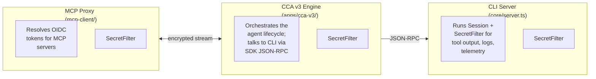
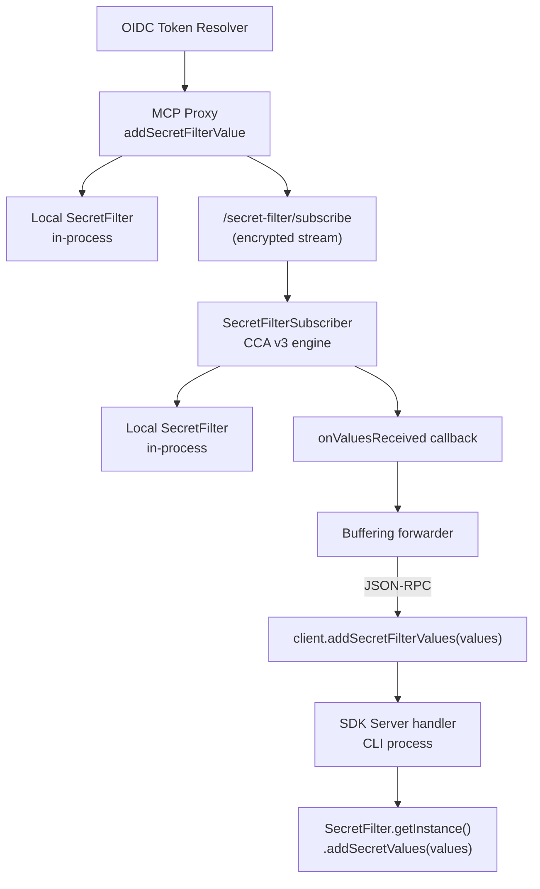

# Cross-Process Secret Filtering in CCA v3

**Status:** Accepted

**Last Updated:** 2026-05-15

**Related ADRs:**
- [ADR 0013: OIDC Workload Identity Federation](0013-oidc-workload-identity-federation.md) — the primary source of dynamically generated secrets
- [ADR 0015: OIDC Architecture & Token Signing](0015-oidc-architecture-and-token-signing.md) — overall architecture

## Context

The Copilot cloud agent runtime redacts sensitive values from all output paths — logs, telemetry, trajectory exports, tool output, and session progress events — using a centralized `SecretFilter` singleton (`src/helpers/SecretFilter.ts`). This filter maintains a set of known secret values (both raw and base64-encoded) and a list of regex patterns that match common credential formats (JWTs, Bearer tokens, Azure keys, GitHub tokens, npm tokens, etc.).

### Current status

Statically known secrets (environment variables, runner sensitive keys, settings) are available at process startup and are handled well. However, **dynamically generated secrets** — primarily OIDC tokens fetched at runtime for use in MCP scenarios today — present a challenge because they are created after the process starts and may originate in a different process than the one that needs to redact them.

### The multi-process problem

In the CCA v3 architecture, three processes cooperate:



When the MCP proxy resolves an OIDC token, that token value must reach the `SecretFilter` in **all three processes** to ensure consistent redaction. Without cross-process propagation, a token fetched by the proxy could appear unredacted in CLI logs or engine telemetry.

### Requirements

1. **No secret in plaintext over the wire** — values transmitted between processes must be encrypted.
2. **Real-time propagation** — tokens must be registered before they can appear in output; polling introduces a redaction gap.
3. **Best-effort forwarding** — a failure to forward to one process must not break redaction in others or crash the system.
4. **Startup ordering** — the MCP proxy starts before the CCA engine and CLI; secrets fetched during setup must not be lost.

## Alternatives considered

### 1. Shared filesystem

Write secrets to an encrypted file that all processes watch. Rejected because filesystem watching adds latency, complexity, and platform-specific behavior. Race conditions between write and read are hard to eliminate.

### 2. Polling endpoint

Each process polls the MCP proxy on an interval. Rejected because polling introduces a redaction gap (tokens can appear in output between poll intervals) and adds unnecessary load.

### 3. Streaming push + SDK RPC (chosen)

Combine a streaming push channel from the MCP proxy with an SDK JSON-RPC method for engine→CLI propagation. This provides real-time delivery with no polling gaps.

## Decision

We use a two-hop propagation design:

### Hop 1: MCP Host → CCA v3 Engine (streaming)

The MCP host in CCA v3 (`src/mcp-client/mcp-server.ts`) accumulates secret values as OIDC tokens are resolved. It exposes a streaming HTTP endpoint:

```
GET /secret-filter/subscribe
```

- **Authentication**: HMAC derived from `COPILOT_JOB_NONCE`, verified by `verifySecretFilterAuthToken()` and sent in an `x-secret-filter-auth` header value.
- **On connect**: sends a `"snapshot"` message containing all accumulated values (encrypted).
- **On new token**: pushes an `"update"` message in real-time.
- **Encryption**: values are encrypted with `encryptSecretFilterValues()` using the job nonce as key material.

The CCA v3 engine creates a `SecretFilterSubscriber` that connects to this endpoint, decrypts messages, and registers values with the local `SecretFilter`. The subscriber auto-reconnects on disconnect and accepts an optional `onValuesReceived` callback for downstream forwarding.

### Hop 2: CCA v3 Engine → CLI Server via SDK RPC

The SDK server (`src/core/server.ts`) registers a `secrets.addFilterValues` JSON-RPC method:

```
→ Request:  { "method": "secrets.addFilterValues", "params": { "values": ["token..."] } }
← Response: { "ok": true }
```

The `CopilotClient` in `@github/copilot-sdk` exposes this as `client.addSecretFilterValues(values)`.

In CCA v3, the `SecretFilterSubscriber`'s `onValuesReceived` callback feeds a **buffering forwarder**:

1. Before `client.start()`: values are buffered in an array.
2. After `client.start()` and before `createSession()`: buffered values are flushed via `client.addSecretFilterValues()`.
3. Ongoing: new values are forwarded directly via the same method.

This ensures no values are lost due to startup ordering, and the CLI-side `SecretFilter` is populated before any session activity begins.

### Full data flow



### The interactive "Copilot CLI" does not use this mechanism

The Copilot CLI runs MCP servers in-process, so OIDC tokens are resolved in the same process and registered with `SecretFilter` directly. The cross-process streaming and RPC paths are only active in the Actions runtime (CCA v3). However, that option would still be available in the future.

## Implications

### What becomes easier

- **Consistent redaction across processes** — all three processes redact the same set of secrets, eliminating a class of accidental secret exposure.
- **Extensibility** — the `secrets.addFilterValues` RPC is a general-purpose API. Any SDK client (not just CCA v3) can inject secrets for redaction, enabling future use cases (e.g., user-provided secrets, plugin-generated tokens).
- **Testability** — each hop can be tested independently: subscriber unit tests, SDK client RPC tests, server handler tests.

### Risks and trade-offs

- **Best-effort forwarding** — if the JSON-RPC call fails (e.g., CLI crashes), the CLI process won't redact the token. Engine-side and proxy-side redaction still work, and the CLI process is unlikely to produce output after crashing.
- **Encryption in transit** — the streaming endpoint encrypts values, but the JSON-RPC hop between engine and CLI runs over a local socket (stdio/TCP) without additional encryption. This is acceptable because both processes run on the same host with the same trust boundary.
- **`secrets.addFilterValues` is not in the shared API schema** — the method is registered as a raw RPC handler, not through the `sharedApi/` layer. This means it does not appear in `generated/api.schema.json` and is not subject to schema compatibility checks. This is intentional: the method is infrastructure plumbing, not a user-facing API.
