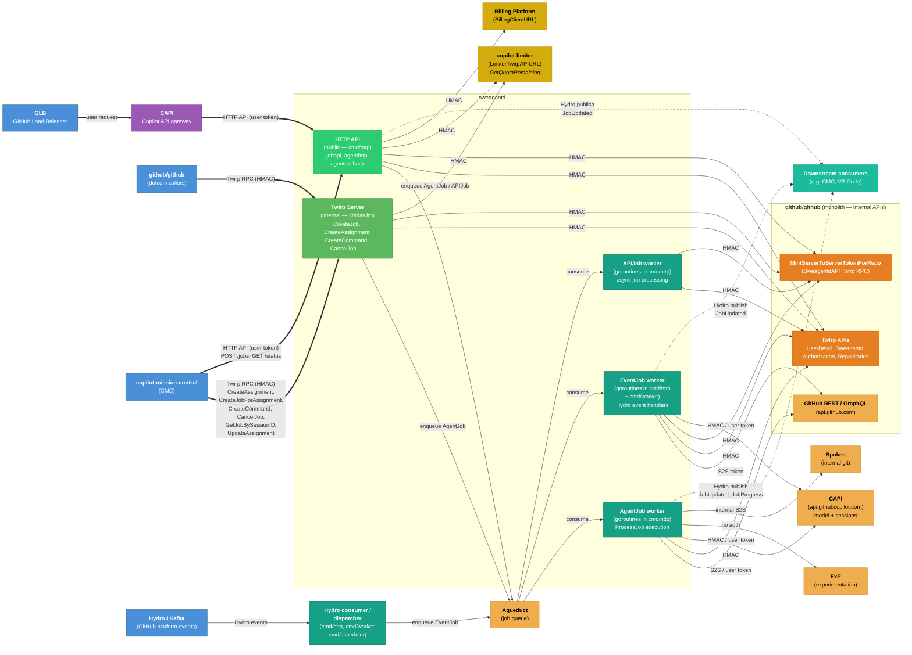
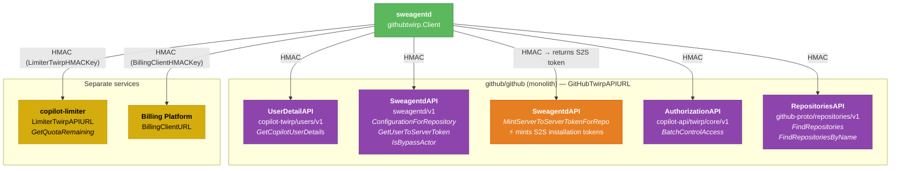
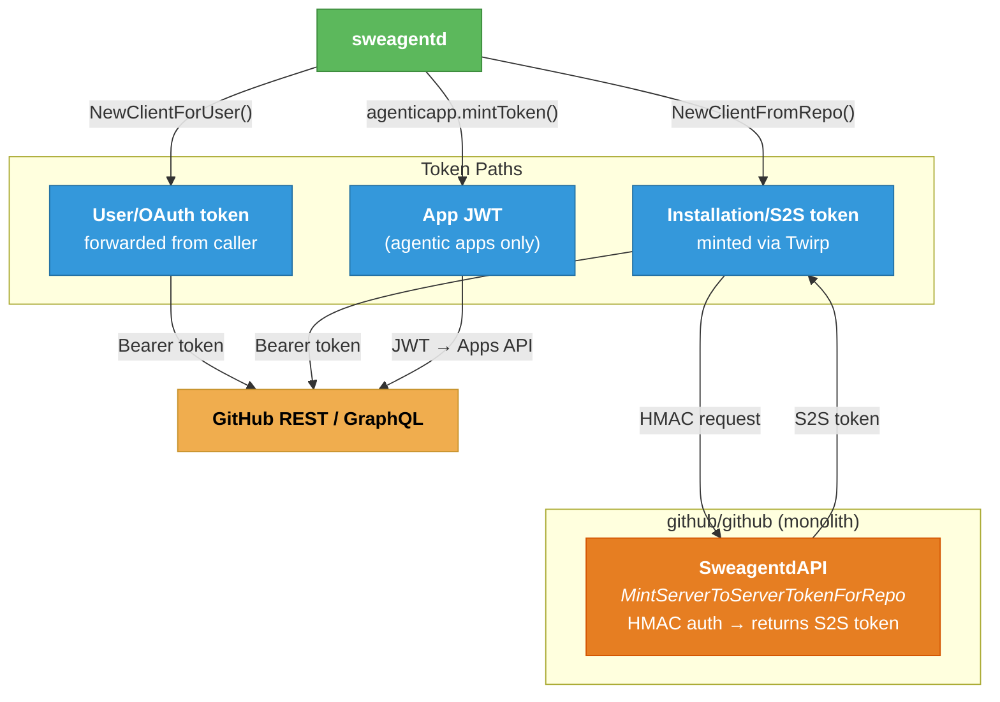
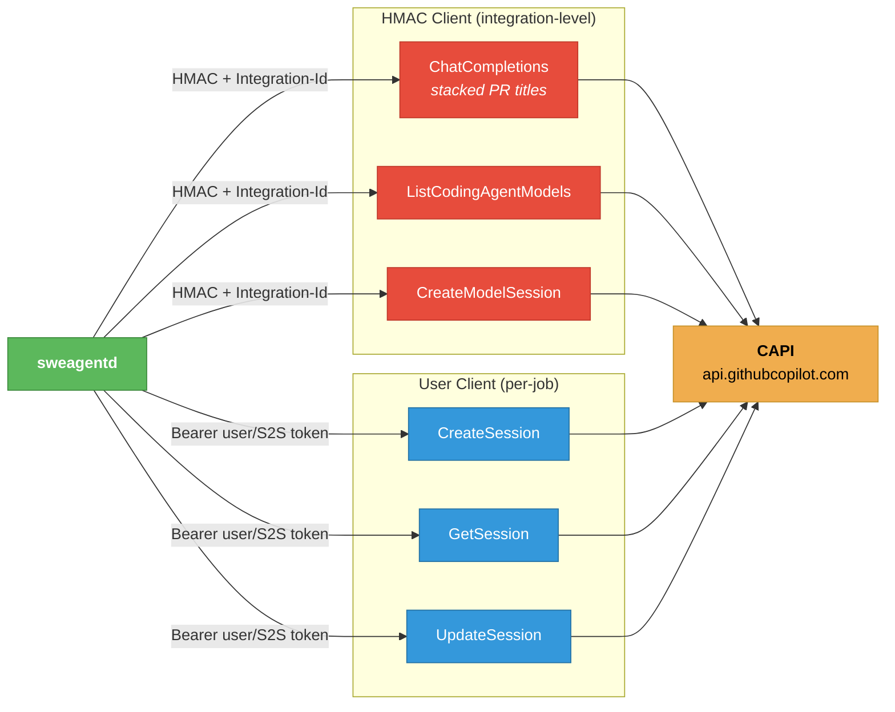
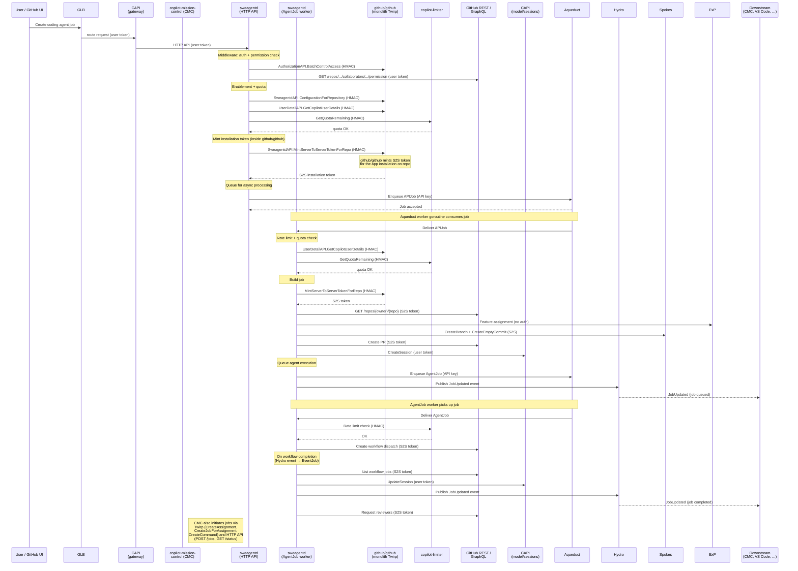
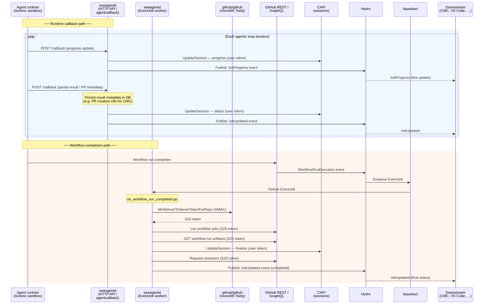

# sweagentd — Data Flow & Dependency Diagram

Visual companion to [`api-dependency-map.md`](./api-dependency-map.md).

---

## High-Level Request Flow

How a request enters the system and which external services are touched.

The primary external request path is **GLB → CAPI → sweagentd HTTP API**: user requests hit the GitHub Load Balancer, route through CAPI (the Copilot API gateway), which calls sweagentd's HTTP endpoints with user tokens. Internal services — **github/github (dotcom)** and **copilot-mission-control (CMC)** — call sweagentd's **Twirp RPC** server directly with HMAC auth, bypassing CAPI. GitHub-originated **Hydro events** (delivered via Kafka) are consumed by sweagentd's Hydro consumer/dispatcher goroutines, which filter and enqueue them as **Aqueduct EventJob** messages for asynchronous processing. Note: sweagentd does **not** receive HTTP webhooks directly — all GitHub platform events arrive through Hydro.

---

## Twirp Sub-API Breakdown

All use HMAC auth — most target protobuf services inside the github/github monolith, but **copilot-limiter** and **Billing Platform** are separate services.

---

## Token Minting & Auth Flow

How sweagentd obtains tokens to call the GitHub REST/GraphQL API.

---

## CAPI Dual-Mode Auth

CAPI is called two different ways depending on the operation.

---

## Job Lifecycle: End-to-End

How a typical coding-agent job flows through the system.

---

## Running Job: Agentic Loop with Progress Updates

Once an agent job has been launched (via `CreateDynamicWorkflowRun`), the agent runtime executes inside a GitHub Actions sandbox. This diagram shows a single iteration of the agentic loop — the agent calls back to sweagentd with progress/results, and sweagentd finalizes the job when the workflow completes.

There are two distinct inbound paths:
1. **Runtime callback path** — the agent in the sandbox posts progress and partial results to sweagentd's `agentcallback` HTTP endpoint during execution.
2. **Workflow completion path** — when the Actions workflow finishes, a `WorkflowRunExecution` Hydro event is consumed by sweagentd's EventJob handler, which finalizes the job.

> **Note:** This is a simplified view of a single job iteration. In practice, the agent may run multiple loop iterations within one workflow run, and the workflow may be re-dispatched for follow-up work (e.g., responding to PR review comments). For the full end-to-end lifecycle including job creation, see [Job Lifecycle: End-to-End](#job-lifecycle-end-to-end) above.
