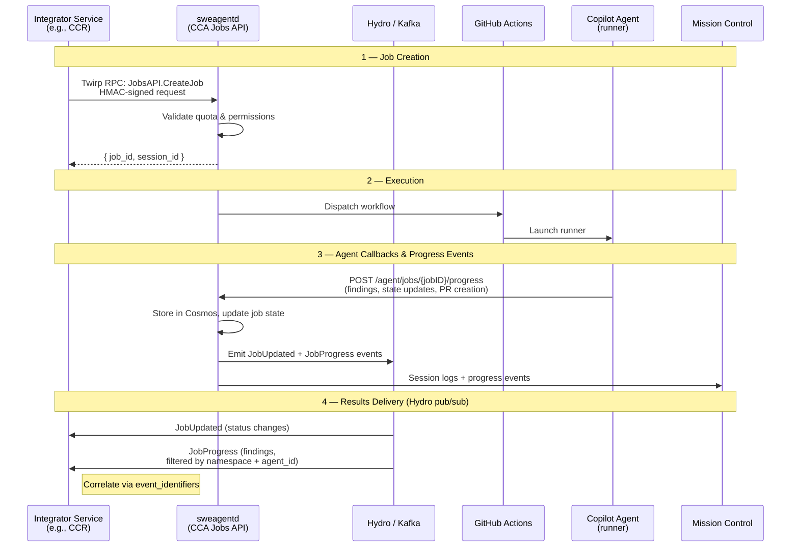
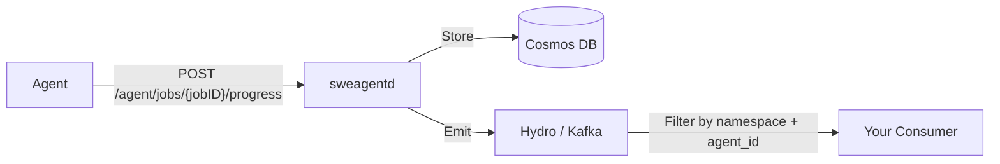
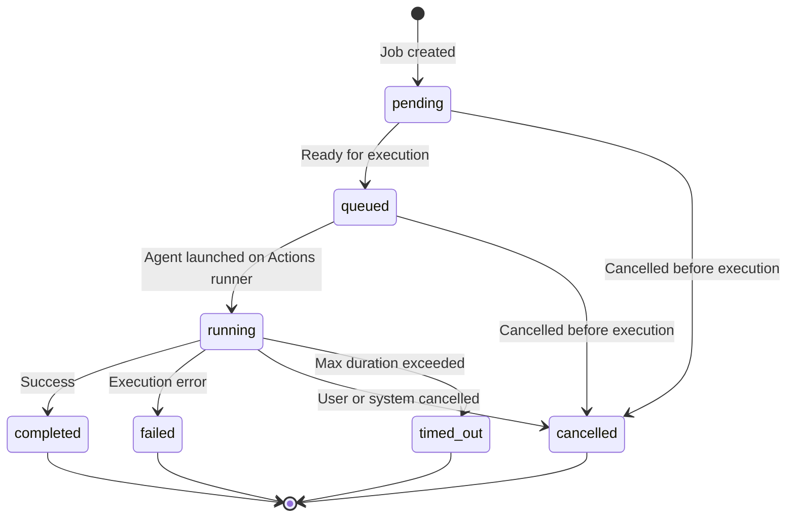

# Integrator Guide: Using the CCA Jobs API

This guide explains how to integrate with the Copilot Coding Agent (CCA / sweagentd) Jobs API. It covers the end-to-end lifecycle, authentication, job states, and security requirements. The Copilot Code Review agent (CCR / `copilot-code-review-agent`) is used throughout as a reference implementation.

> **Audience:** Engineers building a new service that dispatches agentic coding jobs via sweagentd.
>
> **Caller-only integrations:** If your service only schedules jobs for an existing AgenticApp and does not introduce a new agent identity, you usually do not need the AgenticApp registration checklist below. Coordinate the approved auth/token shape with the sweagentd and CAPI owners instead.

## Key Identity Concepts

Before diving in, understand these identity terms used throughout the guide:

| Term | What it is | Example |
|------|-----------|---------|
| `agent_id` | Numeric GitHub App ID passed in `CreateJob` and used to filter Hydro events. Maps to an AgenticApp, but is not the same as `integration_id`. IDs are environment/stamp-specific, including on Proxima. | `946600` (CCR production) |
| `app_login` | The GitHub App's login slug. Used as the registry key in both the monolith and sweagentd to select app-specific behavior. | `copilot-pull-request-reviewer` |
| `bot_login` | The `[bot]` user associated with the GitHub App. Used for commit attribution and write operations. | `copilot-pull-request-reviewer[bot]` |
| `capi_integration_id` | String identifier in app metadata for CAPI routing. Only needed if your agent calls CAPI for model inference. | `copilot-pr-reviews` |

## Architecture



### Key components

| Component | Role |
|-----------|------|
| **Integrator** | Your service. Creates jobs via Twirp RPC, subscribes to Hydro for results, acts on findings. |
| **sweagentd** | Job orchestrator. Manages lifecycle, quota, queueing, token generation, and Hydro event emission. |
| **Hydro / Kafka** | GitHub's internal publish/subscribe event pipeline, backed by Kafka. sweagentd publishes `JobUpdated` and `JobProgress` events there; subscribers consume them asynchronously. |
| **GitHub Actions** | Execution environment. Runs the agent on a hosted runner. |
| **Copilot Agent** | The agentic process. Reads code, makes changes, creates PRs, reports results via callbacks to sweagentd. |
| **[Mission Control](https://github.com/github/copilot-mission-control)** | User-facing UI for monitoring agent sessions, progress events, and debugging. Receives session logs via the `sessions-v2` namespace. |

## API Surfaces

sweagentd exposes two API surfaces:

| | Internal Twirp RPC (preferred) | Versioned HTTP/REST API (legacy) |
|---|---|---|
| **Endpoint** | `JobsAPI` Twirp service (protobuf) | `POST /v1/jobs/{owner}/{repo}` via CAPI proxy |
| **Auth** | HMAC request signing | Bearer token + `User-Agent` header |
| **Versioning** | Proto package versioning | URL path (`/v0/`, `/v1/`) |
| **Example** | CCR, Code Scanning | — |

> **Recommendation:** New integrations should use **Twirp RPC**. The HTTP/REST API exists for legacy reasons. If you can't use Twirp for some reason, talk to us first.

> **Tip:** The [`script/job-api`](https://github.com/github/sweagentd/blob/main/script/job-api) script lets you create, get, and cancel jobs via the HTTP API from the command line. It's very useful for testing a new integration locally or against staging before wiring up Twirp.

## Integration Lifecycle

### Step 1: Create a Job

**Twirp RPC (preferred):**

```go
client := jobs_pb.NewJobsAPIProtobufClient(endpoint, httpClient)
resp, err := client.CreateJob(ctx, &jobs_pb.CreateJobRequest{
    ActorId:          12345,
    RepoId:           67890,
    OwnerId:          11111,
    AgentId:          946600, // Your AgenticApp's numeric App ID
    ProblemStatement: "Review the code changes...",
    EventIdentifiers: []string{"your-service.v1:{...}"},
})
// resp.JobId, resp.SessionId
```

**HTTP API (legacy):**

```
POST /v1/jobs/{owner}/{repo}
Authorization: Bearer <token>
User-Agent: your-service-name/v1.0
Content-Type: application/json

{
  "problem_statement": "Review the code changes and suggest improvements",
  "event_type": "api_call_received",
  "event_identifiers": ["your-service.v1:{\"correlation_id\":\"abc-123\"}"],
  "model": ""
}
```

> **Note:** In the HTTP API, the actor is derived from the bearer token — do not pass `actor_id`. The `features.pull_request.head_ref` field, if provided, should use the `copilot/` prefix (e.g., `copilot/my-feature`) by convention.

### Step 2: Subscribe to Hydro Events

Results are delivered via **Hydro pub/sub** — not polling. sweagentd emits two event types:

| Hydro Event | Schema | What it contains |
|-------------|--------|-----------------|
| `sweagentd.v1.JobUpdated` | Job status changes | Full job state (status, PR info, errors, timestamps). Only emitted when async sessions are enabled for the job. |
| `sweagentd.v1.JobProgress` | Agent findings | Namespaced progress updates (findings, session logs) |

Your service subscribes to the relevant Hydro/Kafka topics and filters by:
- **`agent_id`** — the numeric App ID of your AgenticApp (set by sweagentd from the job record, cannot be spoofed). Applies to both event types. In Proxima, use the stamp-local ID for the environment that creates the job and emits events.
- **`namespace`** — which product domain (e.g., `code-review`). Applies to `JobProgress` only.
- **`event_identifiers`** — your correlation IDs from the original `CreateJob` request

**CCR example:** CCR's [`JobUpdatedHandler`](https://github.com/github/copilot-code-review-agent/blob/main/internal/pkg/hydro/job_updated_handler.go) consumes `sweagentd.v1.JobUpdated` for status changes (RUNNING, FAILED, CANCELLED, TIMED_OUT), and [`JobProgressHandler`](https://github.com/github/copilot-code-review-agent/blob/main/internal/pkg/hydro/job_progress_handler.go) consumes `sweagentd.v1.JobProgress` for code review findings.

### Step 3: Receive Findings via the Progress API

A **finding** is any structured result that an agent reports back during execution — code review comments, security alerts, session logs, etc. The concrete meaning depends on the integration. sweagentd doesn't interpret or validate finding content; it stores and forwards it.

The **Progress API** (`POST /agent/jobs/{jobID}/progress`) is the mechanism for this. Each progress event is a polymorphic envelope with `namespace`, `kind`, and `version` fields that tell the consumer how to deserialize the `content` payload.



#### Namespace conventions

| Producer | Namespace | Kind | Consumer |
|----------|-----------|------|----------|
| CCR autofind | `code-review` | `ccr:review-results` | CCRA |
| Code Scanning | `code-scanning-security` | `review-results` | Turboscan |
| Session logs (any engine) | `sessions-v2` | *(various)* | Mission Control UI |

> **Note:** The `code-review` namespace is designed to be shared across multiple review engines. Future 3P review integrations would also use this namespace with their own `kind` values.

#### Key design principles

- **One shared namespace per product domain** — all code review findings use `code-review`, regardless of engine. This avoids namespace proliferation and sweagentd deploys for each new engine.
- **`agent_id` is the identity signal, not namespace** — `agent_id` is the numeric App ID of the AgenticApp that owns the job. sweagentd sets it from the job record; it cannot be spoofed by the caller. Do not assume a global 1:1 mapping between `agent_id` and integration identifiers. Treat `agent_id` as the per-environment routing/filtering identity, and use the current AgenticApp metadata/registration as the source of truth for any CAPI integration ID.
- **Consumers filter by `namespace` + `agent_id`** — e.g., CCRA consumes `code-review` events matching its own `agent_id`.
- **Adding a new `kind` requires no sweagentd changes** — consumers own kind interpretation. Adding a new *namespace* requires a sweagentd code change.
- **Unregistered namespaces are stored but not emitted** — progress events with unknown namespaces are persisted to Cosmos but not published to Hydro.

#### If your integration produces findings

1. Choose an existing namespace (e.g., `code-review`) or request a new one
2. Define your `kind` string (e.g., `your-product:results`)
3. The agent emits progress events during execution — your consumer subscribes to the Hydro stream filtered by namespace + agent_id

See [`docs/adr/0012-progress-api-code-review-namespaces.md`](https://github.com/github/sweagentd/blob/9464b5e5636ad0bfd92383c45613fea22d1574a3/docs/adr/0012-progress-api-code-review-namespaces.md) for the full ADR.

### Step 4: (Fallback) Poll for Job Status

The Jobs API also exposes polling endpoints for state reconciliation or simpler integrations that don't consume Hydro:

```
GET /v1/jobs/{owner}/{repo}/{job_id}
Authorization: Bearer <token>
```

Poll until `status` reaches a terminal state. Suggested interval: **10 seconds** with exponential backoff.

> **Note:** Hydro subscription (Step 2) is the primary and recommended mechanism. Polling is available as a fallback for integrations that cannot consume Kafka topics.

### Step 5: Act on Results

When the job reaches a terminal state, the response includes the PR number and final status. Richer PR metadata (title, description, branch) is available via `JobUpdated` Hydro events. Your service can then:

- Post review comments on the generated PR
- Update your UI with the results
- Record metrics and telemetry

## Job States

Jobs follow a strict state progression:



| State | Description |
|-------|-------------|
| `pending` | Job created, waiting (e.g., another job running for the same assignment) |
| `queued` | Ready for execution, waiting for runner pickup |
| `running` | Agent actively executing on a GitHub Actions runner |
| `completed` | Finished successfully |
| `failed` | Execution error occurred |
| `cancelled` | Cancelled by user or system |
| `timed_out` | Exceeded maximum execution time |

### Lifecycle Timestamps

The Job API response includes these timestamps:

| Timestamp | Meaning |
|-----------|---------|
| `created_at` | Job record persisted |
| `queued_at` | Entered execution queue |
| `launched_at` | Workflow dispatched to GitHub Actions |
| `completed_at` | Terminal state reached |
| `updated_at` | Last status update |

> **Note:** sweagentd tracks additional internal timing metrics (`RequestStartedAt`, `PreparedAt`, `StartedAt`, `RunningAt`) for observability — these are not exposed in API responses. See [`docs/job-lifecycle-timing.md`](job-lifecycle-timing.md) for the full internal timing reference.

## Authentication

### Internal Twirp RPC (recommended)

- Uses HMAC request signing via `go-twirp/v2/client/auth`
- HMAC secret configured per environment
- Tenant context and request ID headers forwarded for tracing

> **Note:** Each new Twirp client requires its own HMAC secret. The sweagentd team provisions these into the vault — reach out to coordinate.

### HTTP API (legacy — not recommended for new integrations)

| Header | Required | Description |
|--------|----------|-------------|
| `Authorization` | Yes | `Bearer <token>` — requires scopes: `metadata:read`, `contents:write`, `pull_request:write`, `actions:write` |
| `User-Agent` | Yes | Your service identifier (e.g., `my-service/v1.0`). Used for telemetry, feature flags, and integration-specific routing. |
| `GitHub-Tenant-Slug` | Optional | Multi-tenant context for enterprise deployments |
| `GitHub-Tenant-ID` | Optional | Tenant ID for enterprise routing |

## Event Identifiers

Event identifiers enable **correlation** across services and telemetry pipelines. They are opaque strings included in job creation and returned in status responses.

### Format

```
<namespace>.v<version>:{<JSON payload>}
```

### Example (CCR)

```json
["gh.ccra.v1:{\"version\":1,\"job_id\":\"uuid\",\"pull_request_number\":42,\"repo_id\":12345,\"head_sha\":\"abc123\"}"]
```

### Guidelines

- **Do** include correlation IDs that let you match results back to the originating request
- **Do** version your identifier format (e.g., `your-service.v1:`)
- **Do not** include PII or secrets — identifiers are published to analytics systems (Hydro, Kusto)
- **Do not** rely on the internal structure of another service's identifiers

## Error Handling

### Job Creation Errors

| Error | HTTP Status | Retryable | Description |
|-------|-------------|-----------|-------------|
| Authentication failure | 401 | No | Invalid or expired token / unauthorized session |
| Missing required field | 400 | No | `RequiredArgumentError` — e.g., missing `actor_id` (Twirp) or `problem_statement` |
| Invalid argument | 400 | No | `InvalidArgumentError` — e.g., invalid model or vendor mismatch |
| Agent not found | 404 | No | The specified `agent_id` does not exist |
| Queued jobs exceeded | 429 | Yes (backoff) | Too many jobs queued — retry with exponential backoff |
| Rate limited | 429 / 503 | Yes (backoff) | Primary (429) or secondary/abuse (503) rate limit hit |
| No model available | 422 | No | No eligible model for the request |
| Pull request exists | 422 | No | A PR already exists for the target branch |

### Runtime Failures

Jobs that reach `failed` or `timed_out` status include error details in the job response. Common causes:

- Runner provisioning failures
- Git clone/checkout errors
- Agent process crashes
- LLM API errors
- Branch protection or merge conflicts

## Security Requirements

### All integrations

These apply to any integration that accepts user-provided input (issue comments, chat messages, PR descriptions, etc.) and passes it to the agent:

1. **Write-access gating:** Only pass content from users with verified write access to the target repository. Comments from users without write access MUST NOT be included as context (prevents unauthorized prompt injection).

2. **Context format:** Content MUST be formatted as HTML, Markdown, or Plain Text. The format MUST be communicated to the agent for appropriate redactions.

3. **Snapshot context at assignment time:** Pass only the version of context visible when the job was triggered. Edits made after assignment MUST NOT be included (prevents post-edit prompt injection via race conditions).

### Third-party platform integrations only

These additional requirements apply when your integration bridges a non-GitHub platform (e.g., Jira, ADO) to sweagentd — where users have an external identity that must be mapped to a GitHub identity:

4. **Encrypt stored tokens:** Any user tokens stored to map external platform identities to GitHub identities MUST be encrypted using SimpleBox or Kredz. This prevents token leakage if the datastore is compromised.

5. **OAuth identity correlation:** The assigning user MUST be correlated with a GitHub identity using OAuth. The API call MUST be associated with this GitHub user — not a service account — so that quota, permissions, and audit logs are correctly attributed.

See [`docs/third-party-integration.md`](third-party-integration.md) for full details including the OAuth flow diagram.

## Feature Flags & Routing

sweagentd uses [Vexi](https://devportal.githubapp.com/feature-flags/) feature flags to control rollout. All environments (production and staging) share the same Hydro stream and CosmosDB — routing flags determine which environment processes each event.

### Controlling rollout

Routing flags can target individual **users**, **repos**, or **orgs**. When a routing flag matches, production skips the event and the designated staging instance processes it instead.

To test your integration against staging:

1. Find the appropriate `sweagentd_route_user_or_repo_to_staging` flag in [DevPortal](https://devportal.githubapp.com/feature-flags/)
2. Enable it for your test user ID, repo ID, or org ID
3. Jobs matching that target route to staging; everything else stays on production
4. Remove the flag targeting when you're ready to go to production

You can scope narrowly (one user) or broadly (an entire org) — flags are evaluated against the event's actor, repo, and owner.

## AgenticApp Registration (Prerequisites)

Before your integration can create jobs, it must be registered as an **AgenticApp** in both the GitHub monolith and sweagentd. This is how sweagentd knows your app's identity, commit attribution, compute setup, and behavioral configuration.

### Step 1: Register in `github/github`

Create a new `AgenticApp` subclass in [`packages/apps/app/models/agentic_app/`](https://github.com/github/github/tree/master/packages/apps/app/models/agentic_app/):

```ruby
# packages/apps/app/models/agentic_app/your_agent.rb
module AgenticApp
  class YourAgent < Base
    # Unique kebab-case slug for routing, mentions, and telemetry
    sig { override.returns(String) }
    def slug
      "your-agent-login"
    end

    sig { override.returns(String) }
    def display_name
      "Your Agent"
    end

    sig { override.returns(String) }
    def display_owner
      "Your Org"
    end

    sig { override.returns(String) }
    def doc_url
      "https://docs.example.com/your-agent"
    end

    # Must match an entry in Apps::Privileged::Registry
    sig { override.returns(Symbol) }
    def privileged_app_alias
      :your_agent
    end

    # Kill-switch flag — when enabled, blocks your agent
    sig { override.returns(Symbol) }
    def disallow_feature_flag
      :your_agent_disallow
    end

    # Policy/enablement flag — gates rollout to orgs/repos
    sig { override.returns(Symbol) }
    def policy_feature_flag
      :your_agent_enabled
    end

    sig { override.returns(AgenticApp::Group) }
    def group
      AgenticApp::Group::CLOUD  # or REVIEW, CLI, AUTOMATION
    end
  end
end
```

Then add it to the default registry in [`packages/apps/app/models/agentic_app.rb`](https://github.com/github/github/blob/master/packages/apps/app/models/agentic_app.rb):

```ruby
def self.default_registry
  [
    # ... existing agents ...
    ::AgenticApp::YourAgent.instance,
  ]
end
```

**Other monolith requirements:**
- **Privileged App entry:** Register your GitHub App in `Apps::Privileged::Registry` so it can be resolved by alias without DB queries.
- **Feature flags:** Create two Vexi flags — `your_agent_disallow` (kill switch) and `your_agent_enabled` (policy rollout gate).
- **Integration record:** Your GitHub App must exist as an `Integration` in the database with a `Bot` user for commit attribution.
- **Job secrets provider:** Add a `when` clause for your app's slug in [`get_integration_job_secrets.rb`](https://github.com/github/github/blob/master/app/api/internal/twirp/actions/core/v1/get_integration_job_secrets.rb) so that Actions workflow jobs receive the correct runtime secrets (CAPI tokens, etc.).

**Existing 1P agents for reference:** [`copilot_code_review_agent.rb`](https://github.com/github/github/blob/master/packages/apps/app/models/agentic_app/copilot_code_review_agent.rb), [`code_scanning_agent.rb`](https://github.com/github/github/blob/master/packages/apps/app/models/agentic_app/code_scanning_agent.rb)

### Step 2: Register in `github/sweagentd`

sweagentd fetches the AgenticApp registry from the monolith via `GetAgenticApps` Twirp RPC and maps each `app_login` to a Go struct.

**For 1P/partner agents with custom behavior**, create a new Go struct in [`internal/agenticapp/`](https://github.com/github/sweagentd/tree/main/internal/agenticapp/) implementing the [`sweagentd.AgenticApp`](https://github.com/github/sweagentd/blob/main/internal/sweagentd/agenticapp.go) interface, then add a `case` in [`agenticapp.go`](https://github.com/github/sweagentd/blob/main/internal/agenticapp/agenticapp.go):

```go
case "your-agent-login":
    yourAgent := NewYourAgent(agenticApp.GetAppId(), agenticApp.GetAppLogin(), ...)
    apps = append(apps, yourAgent)
```

**For 3P/source-backed agents**, no sweagentd code change is needed — if the monolith returns `agent_source` (repository URL + SHA), sweagentd automatically instantiates a `ThirdParty` app.

#### Optional behavioral interfaces

Your Go struct can implement optional interfaces to customize sweagentd behavior:

| Interface | Effect | Example |
|-----------|--------|---------|
| `AgenticAppModelPassthrough` | Skip model validation — agent manages its own model selection | CCR |
| `AgenticAppBranchlessMode` | Skip branch/PR creation — agent operates on an existing PR | CCR |
| `AgenticAppEnablementExempt` | Skip enablement checks — agent handles its own gating | CCR |
| `AgenticAppJobLimitExempt` | Exempt from per-actor job concurrency limits | CCR |
| `AgenticAppReviewerAssignment` | Control whether the triggering actor is assigned as PR reviewer | CCR |

See [`internal/sweagentd/agenticapp.go`](https://github.com/github/sweagentd/blob/main/internal/sweagentd/agenticapp.go) for the full interface definitions.

### Step 3: Verify registration

> **Deployment complexity:** There is currently no way to deploy both `github/github` and sweagentd to the same staging environment for joint testing. The proven approach is:
>
> 1. Gate your monolith change behind a **feature flag** and deploy it to **production**.
> 2. Enable that flag on a repository pinned to one of the sweagentd [staging environments](https://github.com/github/sweagentd/blob/d736b0b1fe54ab9d3caadca234ef2643f93b5856/README.md?plain=1#L15-L27).
> 3. Deploy your sweagentd change to that staging environment.
>
> This lets the production monolith talk to the staging sweagentd instance via the routing flag.

Once both sides are deployed, verify:

1. **Monolith:** Confirm `GetAgenticApps` Twirp response includes your app with correct `app_id`, `app_login`, `bot_login`, and `commit_email`.
2. **sweagentd:** Confirm sweagentd resolves your app by `agent_id` at startup (check logs for "skipping unknown agentic app" warnings).
3. **Staging:** Create a test job via [`script/job-api --staging`](https://github.com/github/sweagentd/blob/main/script/job-api) with your `agent_id` and verify it routes correctly.
4. **Hydro:** Confirm emitted events contain your expected `agent_id`.

### Feature flag types for new agents

| Flag type | Purpose | Example |
|-----------|---------|---------|
| **Kill switch** (`*_disallow`) | Emergency disable — blocks your agent at the monolith level | `copilot_pull_request_reviewer_disallow` |
| **Policy/enablement** | Gates rollout to specific orgs, repos, or users | `copilot_code_review_use_sweagentd` |
| **Routing** | Directs traffic to staging vs production sweagentd instances | `sweagentd_route_user_or_repo_to_staging` |

## CCR as Reference Implementation

The [`copilot-code-review-agent`](https://github.com/github/copilot-code-review-agent) is the most mature integration with sweagentd. Key files to reference:

| File | What it shows |
|------|---------------|
| [`internal/pkg/sweagentd/client.go`](https://github.com/github/copilot-code-review-agent/blob/main/internal/pkg/sweagentd/client.go) | Core Twirp client, `CreateJob` parameters |
| [`internal/pkg/sweagentd/routing_client.go`](https://github.com/github/copilot-code-review-agent/blob/main/internal/pkg/sweagentd/routing_client.go) | Feature-flag-based staging routing |
| [`internal/pkg/sweagentd/event_identifiers.go`](https://github.com/github/copilot-code-review-agent/blob/main/internal/pkg/sweagentd/event_identifiers.go) | Event identifier format and serialization |
| [`internal/pkg/sweagentd/error.go`](https://github.com/github/copilot-code-review-agent/blob/main/internal/pkg/sweagentd/error.go) | Error classification and HTTP status mapping |

> **Note:** CCR uses the internal Twirp RPC surface with HMAC auth — this is the golden path for all new 1P integrators.

### What CCR sends in `CreateJob`

| Field | CCR usage |
|-------|-----------|
| `ActorID` | GitHub user ID who triggered the review |
| `RepoID` / `OwnerID` | Target repository identifiers |
| `ProblemStatement` | Default: `"Code review by Copilot"` |
| `EventType` | `"review-request"` or `"verification_platform_findings"` |
| `EventContent` | JSON with `RawFindings` and `ProcessedFindings` |
| `EventIdentifiers` | `gh.ccra.v1:{...}` with PR/repo/user metadata |
| `Model` | e.g., `"sweagent-capi:gpt-5.2[ReasoningEffort=medium]"` or empty (auto) |
| `HeadRef` / `BaseRef` | PR branch refs for feature lookup |

## Checklist for New Integrators

### Registration (do first)

- [ ] **Register AgenticApp in `github/github`** — Create subclass in `packages/apps/app/models/agentic_app/`, add to `default_registry`, create Privileged App entry
- [ ] **Create feature flags** — Kill-switch (`*_disallow`) and policy/enablement flag for org/repo rollout
- [ ] **Register in `github/sweagentd`** (1P only) — Create Go struct implementing `sweagentd.AgenticApp`, add switch case in `agenticapp.go`
- [ ] **Verify registration** — Confirm `GetAgenticApps` returns your app, sweagentd resolves it, staging `CreateJob` works

### API Integration

- [ ] **Use Twirp RPC** — the golden path for all 1P integrations. Talk to us if you need to use HTTP/REST instead
- [ ] **Obtain HMAC credentials** — HMAC secret for Twirp auth (or Bearer token if approved for legacy HTTP path)
- [ ] **Set `User-Agent` header** — Identifies your service in telemetry and enables per-integration feature flags
- [ ] **Define your event identifier format** — Versioned namespace with correlation IDs, no PII
- [ ] **Subscribe to Hydro events** — Consume `sweagentd.v1.JobUpdated` (filter by `agent_id`) and `sweagentd.v1.JobProgress` (filter by `namespace` + `agent_id`)
- [ ] **Implement polling as fallback** (optional) — Poll `GET /v1/jobs/{owner}/{repo}/{job_id}` if Hydro is unavailable (10s intervals, exponential backoff)
- [ ] **Handle all terminal states** — `completed`, `failed`, `cancelled`, `timed_out`
- [ ] **Set up Progress API consumption** (if needed) — Choose namespace, define `kind`, subscribe to Hydro stream filtered by `namespace` + `agent_id`
- [ ] **Map errors to user-facing messages** — Auth (401), rate limits (429/503), invalid request (400), not found (404)

### Security & Rollout

- [ ] **Follow security requirements** — Write-access gating, context snapshotting (all integrations); token encryption and OAuth identity mapping (3P platform integrations only)
- [ ] **Test with staging routing** — Use routing feature flags to direct traffic to staging before production rollout
- [ ] **Add observability** — Log job IDs, session IDs, and event identifiers for debugging

## Related Documentation

### ADRs

| ADR | Title | Relevance |
|-----|-------|-----------|
| [0001](adr/0001-create-job-api.md) | Create Job API | Core — API design, versioning, endpoint definitions |
| [0003](adr/0003-mid-session-steering.md) | Mid-Session Steering | Command API for sending messages to running jobs |
| [0005](adr/0005-3p-platform-identity.md) | 3P Platform Identity | Authorization abstraction for agent identity and bot permissions |
| [0006](adr/0006-server-to-server-token-minting-via-twirp.md) | Server-to-Server Token Minting | Token minting via Twirp for third-party agent support |
| [0009](adr/0009-custom-agents-mcp.md) | Custom Agents MCP | MCP server configuration in custom agents |
| [0010](adr/0010-third-party-agents-dynamic-workflows.md) | 3P Agents Dynamic Workflows | How third-party agents trigger dynamic workflows |
| [0012](adr/0012-progress-api-code-review-namespaces.md) | Progress API Namespaces | Namespace conventions for code review findings |
| [0013](adr/0013-oidc-workload-identity-federation.md) | OIDC Workload Identity Federation | OIDC auth for MCP servers |
| [0014](adr/0014-oidc-token-exchange-obo.md) | OIDC Token Exchange (OBO) | User-level authentication via on-behalf-of flows |
| [0015](adr/0015-oidc-architecture-and-token-signing.md) | OIDC Architecture & Token Signing | Token signing architecture and OIDC discovery |

### Other docs

- [`docs/job-lifecycle-timing.md`](job-lifecycle-timing.md) — Detailed lifecycle timing and duration metrics
- [`docs/job-exec-and-api-architecture.md`](job-exec-and-api-architecture.md) — Architecture evolution and future plans
- [`docs/third-party-integration.md`](third-party-integration.md) — Security requirements for third-party integrations
- [`docs/tokens-and-authz-in-actions.md`](tokens-and-authz-in-actions.md) — Token generation and authorization in Actions
- [`proto/jobs/v1/jobs_api.proto`](../proto/jobs/v1/jobs_api.proto) — Twirp service and message definitions
