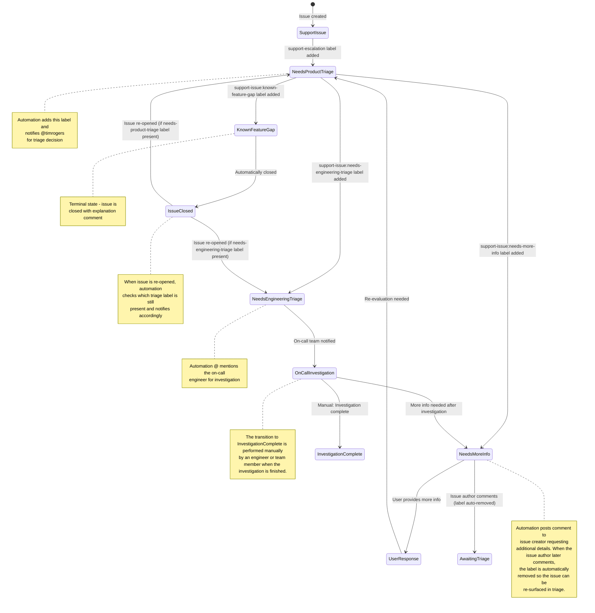

# Support Issue Triage Automation

This document describes the automated workflow for triaging support issues in the sweagentd repository.

## Workflow State Diagram

The following diagram illustrates the label-based state transitions implemented by the `support-issue-triage.yml` workflow:



## Workflow Triggers and Actions

### 1. Support Issue Identified
**Trigger:** Issue is labeled with `support-escalation`

**Actions:**
- Adds `support-issue:needs-product-triage` label
- Posts comment mentioning @timrogers with triage options

### 2. Known Feature Gap
**Trigger:** Issue is labeled with `support-issue:known-feature-gap`

**Actions:**
- Posts comment: "This issue has been closed as it represents a known feature gap."
- Closes the issue (terminal state)

### 3. More Information Required
**Trigger:** Issue is labeled with `support-issue:needs-more-info`

**Actions:**
- Posts comment to issue creator requesting them to review product/engineering inputs and provide additional information needed

### 3a. Issue Author Follows Up
**Trigger:** Issue author posts a new comment on an issue labeled with `support-issue:needs-more-info`

**Actions:**
- Removes the `support-issue:needs-more-info` label
- This ensures the issue becomes eligible to be surfaced again in the next day's Slack triage reminder, so follow-up engagement from the customer is not missed

### 4. Engineering Investigation Needed
**Trigger:** Issue is labeled with `support-issue:needs-engineering-triage`

**Actions:**
- Posts comment mentioning the current on-call engineer (looked up from PagerDuty), falling back to @github/coding-agent-core-team team if no on-call engineer is found
- Requests engineering investigation and triage
- Informs engineers they can apply `support-issue:needs-more-info` label if more information is needed

### 5. Issue Re-opened
**Trigger:** Issue is re-opened

**Actions:**
- Checks which triage label is still applied (`support-issue:needs-product-triage` or `support-issue:needs-engineering-triage`)
- If `support-issue:needs-product-triage` is present:
  - Posts comment mentioning @timrogers indicating the issue was re-opened, with triage options
- If `support-issue:needs-engineering-triage` is present:
  - Posts comment mentioning the current on-call engineer (looked up from PagerDuty) indicating the issue was re-opened and requires engineering investigation

## Label Flow Summary

```
support-escalation → support-issue:needs-product-triage → [triage decision]
                                                           ├─ support-issue:known-feature-gap → [CLOSED]
                                                           ├─ support-issue:needs-more-info → [awaiting user response]
                                                           └─ support-issue:needs-engineering-triage → [engineering investigation]
                                                                                                       ├─ support-issue:needs-more-info (if more info needed)
                                                                                                       └─ investigation complete
```
