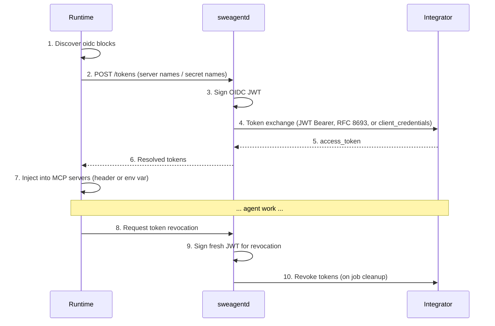

# `internal/auth/oidc` — OIDC Token Exchange for MCP Servers

This package implements OIDC-based workload identity federation for 3rd party MCP servers in the GitHub agentic platform. It handles the full token lifecycle: signing OIDC ID tokens, exchanging them for integrator access tokens via RFC 7523 JWT Bearer (default), RFC 8693 token exchange, or OAuth 2.0 client credentials, and revoking those tokens on job cleanup.

**Related ADRs:**
- [ADR 0013: OIDC Workload Identity Federation](../../../docs/adr/0013-oidc-workload-identity-federation.md) — core flow and configuration
- [ADR 0014: OIDC Token Exchange for User On-Behalf-Of](../../../docs/adr/0014-oidc-token-exchange-obo.md) — user identity layered on workload identity
- [ADR 0015: OIDC Architecture & Token Signing](../../../docs/adr/0015-oidc-architecture-and-token-signing.md) — signing infrastructure and system architecture


You can debug and test this package locally without the other parts of sweagentd by using the test utility at **cmd/oidctester/main.go**

## Architecture overview

```
internal/auth/oidc/
├── oidcconfig/              # Leaf package: config types (no dependency on oidc)
│   └── config.go            # Config, ConfigEntry, EndpointsConfig
├── varfetcher/              # Variable fetcher implementations (GitHub API, local .env)
│   └── fetcher.go           # VariableFetcher type, NewGitHubVariableFetcher, NewEnvVariableFetcher
├── service.go               # Service: extraction, parallel exchange, revocation
├── configloader.go          # ConfigLoader: loads & merges OIDC config from multiple sources
├── service_discovery.go     # OAuth/OIDC metadata discovery (RFC 8414, RFC 9728)
├── jwt.go                   # TokenSigner interface, TokenParams, BuildSubject
├── exchanger.go             # Logic to perform different types of token exchanges against integrator endpoints
├── revoker.go               # RFC 7009 token revocation
├── errors.go                # Error constants
├── authndsigner/            # Production TokenSigner: delegates to authnd IdentityManager
│   └── signer.go
└── devsigner/               # DX: Non-prod development TokenSigner with local RSA keys
    ├── signer.go
    └── signerhttp/          # DX: HTTP handler for OIDC endpoints to port forward publicly
        └── handler.go
```
The OIDC flow spans three components: **sweagentd** (this Go backend), the **runtime** (TypeScript agent runtime), and the **integrator** (3rd party token endpoint).

This package lives entirely within sweagentd and is responsible for steps 3-5 and 9-10 in the diagram below:



## Key types and interfaces

### `Service` (service.go)

Orchestrates the full token lifecycle. Constructed via `NewService` in production, or `NewLocalService` for local development and testing (see `service.go` for current signatures).

- **`ExchangeTokens(ctx, entries, params)`** — Issues an ID token for each config entry, exchanges it at the integrator endpoint, and returns an `*ExchangeResult` containing access tokens mapped by secret name and `IssuedToken` records for later revocation. All entries are processed in parallel. Returns `ErrPartialSuccess` when some entries succeed but others fail.
- **`RevokeAccessTokens(ctx, tokens, entries, params)`** — Revokes previously exchanged tokens by calling each integrator's revocation endpoint. Best-effort: collects all errors but attempts every revocation. Returns `ErrPartialRevocationFailed` wrapping individual errors.
- **`DiscoverConfiguration(ctx, entries)`** — Returns a copy of entries with endpoints populated from the base URL via metadata discovery when explicit endpoints are missing. Also determines the grant type from discovered metadata when not explicitly configured: JWT Bearer is preferred if supported, then `client_credentials`, then RFC 8693 ID token exchange. Also auto-discovers the audience from the issuer in metadata when not explicitly set.
- **`ResolveConfiguration(ctx, ResolveConfigurationParams)`** — High-level entry point that loads config from all sources via `ConfigLoader`, filters to the requested secret/server names, and runs endpoint discovery. Returns fully resolved `[]ConfigEntry` ready for `ExchangeTokens`.
- **`IssueIDToken(ctx, audience, subject, actSubject, additionalClaims)`** — Direct delegation to the underlying `TokenSigner` for callers that need a signed JWT without exchange.

### `ConfigLoader` (configloader.go)

Loads and merges OIDC configuration from multiple sources for a repository. Typically used indirectly via `Service`, or directly in local development via `NewLocalConfigLoader` (which skips all GitHub network calls).

The primary entry point is **`Load(ctx, params, serverFilter)`** where `params` is a `ResolveConfigurationParams` struct — Gathers config from multiple sources and merges them according to precedence rules. If `serverFilter` is non-nil, only MCP servers whose names are in the filter are resolved and processed, avoiding expensive variable fetching for unused servers. Before processing, variable references in OIDC fields are resolved (see [Variable resolution](#variable-resolution)).

**Config precedence** (lowest to highest — later sources overwrite earlier ones for the same server name):

1. `settings.json` (feature-flagged via `CopilotSWEAgentOIDCSettingsJSON`)
2. Non-file repo MCP config (via SweagentdAPI `MCPConfigurationForRepository`)
3. Repo `.mcp.json` file (via Spokes)
4. Additional MCP configs (e.g. from repo plugins, passed as `additionalMCPConfigs`)
5. App MCP configs (from the agentic app's plugin, passed as `appMCPConfigs` — uses agentic app identity)
6. Agent MCP config (from the custom agent's `MCPConfig()` method)

### `ExchangeResult`, `ExchangeFailure`, and `IssuedToken` (service.go)

`ExchangeResult` is returned by `ExchangeTokens`:

- **`Secrets`** (`map[string]string`) — Maps each full secret name (with prefix) to the access token obtained from the exchange.
- **`MCPServerTokens`** (`map[string]string`) — Maps MCP server names to the access token obtained from the exchange.
- **`IssuedTokens`** (`[]IssuedToken`) — Full token details needed for later revocation.
- **`Failures`** (`[]ExchangeFailure`) — Per-entry exchange failures. Entries that fail are not included in `Secrets` or `MCPServerTokens`.

`IssuedToken` tracks a single exchanged token:

```go
type IssuedToken struct {
    IDToken            string
    AccessToken        string
    RevocationEndpoint string
    ConfigEntry        oidcconfig.ConfigEntry
}
```

### `ConfigEntry` (oidcconfig/config.go)

Represents a single OIDC token exchange configuration. In a separate sub-package so it can be used w/o circular dependency risks. Entries originate from three sources:

| Source | Constructor | Secret prefix | Lookup key |
|---|---|---|---|
| `.github/copilot/settings.json` | `NewConfigEntry(...)` | `GITHUB_COPILOT_OIDC_` | `secret_names` from runtime |
| Agentic GitHub App | `NewConfigEntryForAgenticApp(...)` | `GITHUB_AGENTIC_APP_OIDC_` | `secret_names` from runtime |
| MCP server inline `oidc` block | `NewConfigEntryForMCP(...)` | *(none — uses ServerName)* | `mcp_server_names` from runtime |

Key fields:
- **`Audience`** — The `aud` claim in the OIDC JWT; typically the integrator's client/app ID. If not specified, the service will attempt to auto-discover it from the issuer in the authorization server metadata.
- **`Endpoints`** — Exchange, revoke, failure, and base URLs. For remote MCP servers, missing endpoints are inferred from the server URL or discovered via RFC 8414/9728 metadata at the base URL.
- **`AgentOnlySubject`** — Bool controlling `sub` claim composition (see [Subject claim](#subject-claim-composition)). When true, the subject identifies the agent/installation rather than the human user.
- **`RepoOnlySubject`** — Bool that, when true, sets the subject to a repository-scoped identity (`client_id:{PlatformClientID}:repository_id:{repo_id}`).
- **`UseAgenticAppIdentity`** — Bool that, when true, uses the agentic app's identity (installation_id or AppClientID) for the agent subject instead of the platform's (CCA's) PlatformClientID.
- **`GrantType`** — `""` (auto-detect, defaults to JWT Bearer), `"urn:ietf:params:oauth:grant-type:jwt-bearer"` (RFC 7523), `"urn:ietf:params:oauth:grant-type:token-exchange"` (RFC 8693), or `"client_credentials"` (e.g. Entra ID).
- **`Scope`** — Optional scope to include in exchange requests and as a JWT claim.
- **`Resource`** — Optional resource to include in exchange requests and as a JWT claim.
- **`ClientID`** — Overrides the default `client_id` sent in exchange/revocation requests.

### `TokenSigner` (jwt.go)

The central signing abstraction:

```go
type TokenSigner interface {
    IssueIDToken(ctx context.Context, audience, subject, actSubject string,
        additionalClaims map[string]string) (string, error)
}
```

| Implementation | Package | When used |
|---|---|---|
| `authndsigner.Signer` | `authndsigner/` | Staging / production — delegates token signing to the [authnd](https://github.com/github/authnd) IdentityManager service via `IssueIdentityToken`. Requires `AUTHND_URL` and `AUTHND_HMAC_KEY`. Enabled when `OIDC_AUTHND_ENABLED` is true. |
| `devsigner.Signer` | `devsigner/` | Development — signs JWTs locally with an auto-generated RSA-2048 key pair. Exposes OIDC discovery endpoints via `signerhttp.Handler` for end-to-end testing. |


### `TokenParams` (jwt.go)

Contextual information for building OIDC claims. Populated from the current job/session:

```go
type TokenParams struct {
    ActorID            int64
    Actor              string
    ActorType          jobs.ActorType       // User, bot, or agent
    OwnerID            int64
    Owner              string
    OwnerType          sweagentd.OwnerType  // Organization or user
    RepoID             int64
    Repo               string
    AppID              int64                // GitHub App numeric ID (used in agent_id claim)
    AppClientID        string               // OAuth client ID for the agentic app (agent_client_id claim)
    PlatformClientID   string               // OAuth client ID for the platform app (CCA) — always the client_id claim
    AppInstallationID  int64                // Installation ID for the agentic app
    SessionID          string               // Session ID for the current agent job
    CustomAgentName    string               // Custom agent name, if applicable
    CustomAgentVersion string               // Custom agent version or SHA, if applicable
}
```

`ToClaimsMap()` produces the standard claims always included in OIDC tokens: `repository`, `repository_id`, `repository_owner`, `repository_owner_id`, `client_id` (always CCA's platform client ID), and `session_id`. When the agentic app's client ID differs from the platform client ID, `agent_client_id` and `agent_id` are also included. Human actor claims (`preferred_username`, `user_id`) are conditionally included when the actor is not a bot/agent. `installation_id` is included when `AppInstallationID` is set.

## Token exchange flow

### 1. Configuration resolution

The primary entry point is `Service.ResolveConfiguration`, which orchestrates the full resolution pipeline:

1. **Loading** — `ConfigLoader.Load` gathers entries from `settings.json` (feature-flagged), repo-level MCP config (via SweagentdAPI), repo `.mcp.json` file, additional MCP configs (e.g. plugins), app MCP configs (from the agentic app's plugin), and agent MCP config. When called from `ResolveConfiguration`, a server filter built from `MCPServerNames` is passed so that only the needed MCP servers are resolved.
2. **Variable resolution** — Variable references in OIDC fields are extracted from the filtered config sources, fetched in a single batch, and substituted before further processing. See [Variable resolution](#variable-resolution).
3. **Filtering** — Only entries matching the requested `SecretNames` (by `FullSecretName()`) or `MCPServerNames` (by `ServerName()`) are kept.
4. **Discovery** — `DiscoverConfiguration` resolves missing endpoints and grant types via metadata discovery.

### 2. Variable resolution

Before OIDC entries are processed, `ConfigLoader.Load` resolves variable references in select OIDC-related fields (audience, scope, resource, clientID, endpoints, and server URL). When a `serverFilter` is provided, MCP sources are filtered to only the needed servers *before* variable extraction, so variables are only fetched for servers that will actually be used. This allows MCP server authors to parameterize OIDC configuration with repository-level variables.

**Supported reference forms:**
- `${{ vars.VAR_NAME }}` — GitHub Actions variable syntax
- `${VAR_NAME}` — Brace-delimited shell syntax
- `$VAR_NAME` — Bare shell syntax

**Scope:** Only variables with a `COPILOT_MCP_` prefix are processed. Other variable references are left as-is.

**How it works:**

1. **Extract** — `mcpconfig.ExtractServiceProcessedVariableReferences` scans OIDC fields across all raw config sources and collects unique variable names.
2. **Fetch** — The `variableResolver` calls the configured `VariableFetcher` once with the full set of needed names. Results are cached so each variable is fetched at most once.
3. **Resolve** — `mcpconfig.ResolveServiceProcessedVariables` returns a copy of each config with variable references replaced by their values. Unresolved references are left as-is.

**Variable fetcher implementations** (`varfetcher/`):

| Implementation | Constructor | When used |
|---|---|---|
| GitHub API fetcher | `NewGitHubVariableFetcher(cpf, ghTwirp)` | Production — calls `GetAgentVariableValue` per variable via a per-request GitHub client (authenticated as the app installation). Fetches concurrently with a max of 8 at a time. |
| Env file fetcher | `NewEnvVariableFetcher()` | Local development — reads variables from a `.env`-format file (e.g. `.env.mcp-dev`). Only returns variables with the `COPILOT_MCP_` prefix. |

The fetcher is configured at service creation via `ServiceConfig.VariableFetcher` and defaults to a no-op (no variable resolution) when nil.

### 3. Endpoint discovery

`DiscoverConfiguration` processes each entry that is missing endpoints, grant type, or audience. For entries with a base URL, it calls `discoverAuthorizationServerMetadata` which uses the following strategy:

**Step 1: Authorization server metadata discovery** — tries these candidate URLs in order (RFC 8414 Section 3.1 and Section 5):

1. `{origin}/.well-known/oauth-authorization-server/{path}` (path insertion)
2. `{origin}/.well-known/openid-configuration/{path}` (OIDC path insertion)
3. `{origin}/{path}/.well-known/openid-configuration` (OIDC path appending)
4. `{origin}/.well-known/oauth-authorization-server` (root, no path)
5. `{origin}/.well-known/openid-configuration` (root, no path)

**Step 2: Protected resource metadata fallback** — If authorization server discovery returns `ErrMetadataNotFound`, the service falls back to RFC 9728 protected resource metadata:

1. `{origin}/.well-known/oauth-protected-resource/{path}` (with path, if any)
2. `{origin}/.well-known/oauth-protected-resource` (root)

If protected-resource metadata returns an `authorization_servers` entry, the service fetches authorization server metadata from that URL using Step 1.

**Endpoint resolution from discovered metadata:**
- `token_endpoint` → `Endpoints.Exchange` (fallback: `{base}/token`)
- `revocation_endpoint` → `Endpoints.Revoke` (optional)
- `issuer` → `Audience` (when audience not explicitly set)

**Grant type auto-detection from discovered metadata** (preference order):
1. JWT Bearer (`SupportsJWTBearer()`)
2. Client credentials (`SupportsClientCredentials()`)
3. RFC 8693 token exchange (`SupportsTokenExchange()`)

### 4. JWT signing

For each entry with an exchange endpoint, the service:
1. Builds the `sub` and `act.sub` claims via `BuildSubject(SubjectOptions{...}, params)`.
2. Builds standard context claims via `ToClaimsMap()`.
3. Adds `scope` and `resource` as claims when configured on the entry.
4. Calls `signer.IssueIDToken(...)` to produce a signed RS256 JWT with a 5-minute expiry.

The JWT always includes standard claims: `iss`, `sub`, `aud`, `exp`, `iat`, `nbf`, `jti`, plus context claims from `TokenParams` (`repository`, `repository_id`, `repository_owner`, `repository_owner_id`, `client_id`, `session_id`, and conditionally `agent_client_id`, `agent_id`, `preferred_username`, `user_id`, `installation_id`). The `act` claim with `act.sub` is included to identify the agent performing the action.

### 5. Token exchange

The `Exchanger` supports three grant types:

**RFC 7523 JWT Bearer** (`ExchangeJWTBearer`) — the **default** grant type for workload identity federation:
```
POST {exchange_endpoint}
Content-Type: application/x-www-form-urlencoded

grant_type=urn:ietf:params:oauth:grant-type:jwt-bearer
assertion={signed_jwt}
[scope={scope}]
[resource={resource}]
```

**RFC 8693 token exchange** (`ExchangeIDToken`) — used only when explicitly configured via `GrantType`:
```
POST {exchange_endpoint}
Content-Type: application/x-www-form-urlencoded

grant_type=urn:ietf:params:oauth:grant-type:token-exchange
subject_token={signed_jwt}
subject_token_type=urn:ietf:params:oauth:token-type:id_token
requested_token_type=urn:ietf:params:oauth:token-type:access_token
audience={audience}
[client_id={client_id}]
[scope={scope}]
[resource={resource}]
```

**Client credentials** (`ExchangeClientCredentials`) — used by Azure AD / Entra ID:
```
POST {exchange_endpoint}
Content-Type: application/x-www-form-urlencoded

grant_type=client_credentials
client_assertion={signed_jwt}
client_assertion_type=urn:ietf:params:oauth:client-assertion-type:jwt-bearer
client_id={client_id}
[scope={scope}]
```

**Grant type selection logic:**

| `GrantType` value | Exchanger method | Fallback |
|---|---|---|
| `urn:ietf:params:oauth:grant-type:jwt-bearer` | `ExchangeJWTBearer` | *(none)* |
| `client_credentials` | `ExchangeClientCredentials` | *(none)* |
| `urn:ietf:params:oauth:grant-type:token-exchange` | `ExchangeIDToken` | *(none)* |
| `""` (empty / unset) | `ExchangeJWTBearer` | `ExchangeClientCredentials` (if `unsupported_grant_type` and `client_id` available) |

### 6. Token revocation

On job cleanup, `Service.RevokeAccessTokens` issues a fresh ID token for each entry and calls the integrator's revocation endpoint per RFC 7009:

```
POST {revoke_endpoint}
Content-Type: application/x-www-form-urlencoded

token={access_token}
token_type_hint=access_token
subject_token={fresh_id_token}
subject_token_type=urn:ietf:params:oauth:token-type:id_token
[client_id={client_id}]
```

Revocation is best-effort and runs in parallel. Individual failures are collected and returned as a wrapped `ErrPartialRevocationFailed`.

## Subject claim composition

`BuildSubject(opts SubjectOptions, params TokenParams)` composes both the `sub` claim and `act.sub` claim based on the provided options.

### SubjectOptions

```go
type SubjectOptions struct {
    AgentOnlySubject      bool // Forces sub to use agent identity even when a human user is present
    RepoOnlySubject       bool // Sets sub to just the repository identity
    UseAgenticAppIdentity bool // Use agentic app identity (installation_id/AppClientID) instead of platform (CCA)
}
```

### `act.sub` (always the agent identity)

The `act.sub` claim always identifies the agent performing the action. The format depends on `UseAgenticAppIdentity`:

| Condition | `act.sub` value |
|---|---|
| `UseAgenticAppIdentity: true` + installation ID set | `installation_id:{id}` |
| `UseAgenticAppIdentity: true` + no installation | `client_id:{AppClientID}:owner_id:{type}:{owner_id}` |
| `UseAgenticAppIdentity: false` | `client_id:{PlatformClientID}:owner_id:{type}:{owner_id}` |

When `CustomAgentName` is set, a suffix is appended: `:custom_agent:{repo_id}:{name}@{version}` (version defaults to `"latest"` when empty).

### `sub` (determined by options)

| Condition | `sub` value |
|---|---|
| `RepoOnlySubject: true` + `UseAgenticAppIdentity: true` + installation ID | `installation_id:{id}:repository_id:{repo_id}` |
| `RepoOnlySubject: true` + otherwise | `client_id:{PlatformClientID}:repository_id:{repo_id}` |
| `AgentOnlySubject: false` + human user (non-zero ActorID, ActorType is user) | `user_id:{actor_id}` |
| `AgentOnlySubject: true` + `UseAgenticAppIdentity: true` + installation ID | `installation_id:{id}` |
| `AgentOnlySubject: true` + `UseAgenticAppIdentity: true` + no installation | `client_id:{AppClientID}:owner_id:{type}:{owner_id}` |
| `AgentOnlySubject: true` + `UseAgenticAppIdentity: false` | `client_id:{PlatformClientID}:owner_id:{type}:{owner_id}` |
| Non-user actor (bot/agent) | Same as agent identity (uses `UseAgenticAppIdentity` to pick client ID) |

Where `{type}` is `org_id` for organization owners or `user_id` for user owners.

### Identity selection: platform vs agentic app

- **Platform identity** (`UseAgenticAppIdentity: false`) — Uses `PlatformClientID` (CCA's client ID). Used for MCP content not directly tied to the agentic app's config (e.g. repo MCP config, related plugins), since CCA is the actual client in all cases.
- **Agentic app identity** (`UseAgenticAppIdentity: true`) — Uses `AppInstallationID` (preferred) or `AppClientID`. Used for entries from the agentic app's own config.

### Subject type classification (consumer side)

Consumers of the token can classify the `sub` into three types:

| `sub` prefix | Type | Meaning |
|---|---|---|
| `user_id:` | `user` | Human user is the subject |
| Contains `repository_id:` (no `user_id:`) | `repo` | Repository-scoped identity |
| `client_id:...` or `installation_id:...` (no `repository_id:`) | `agent` | Agent/workload identity |

## Error handling

All errors are sentinel values in `errors.go`, designed for use with `errors.Is()`:

| Error | Meaning |
|---|---|
| `ErrInvalidConfig` | Configuration is malformed (missing fields, duplicate suffixes, invalid URLs). Defined in `oidcconfig`. |
| `ErrTokenExchangeFailed` | The exchange HTTP request failed or returned an unexpected error |
| `ErrPartialSuccess` | Some token exchange requests succeeded but others failed (check `ExchangeResult.Failures`) |
| `ErrIDPError` | The identity provider returned an unexpected response during token exchange |
| `ErrUnsupportedGrantType` | The endpoint returned `unsupported_grant_type` (triggers client_credentials fallback when unset) |
| `ErrInvalidGrant` | The endpoint returned `invalid_grant` (e.g., expired token or misconfiguration) |
| `ErrAuthorizationRequired` | The integrator returned `authorization_required` — user must complete an auth flow |
| `ErrNetworkError` | A network error occurred while communicating with the identity provider |
| `ErrInvalidURL` | A URL in the configuration is invalid (wrong scheme, missing hostname, etc.) |
| `ErrTokenRevocationFailed` | A single revocation request failed |
| `ErrPartialRevocationFailed` | Aggregate error wrapping one or more revocation failures |
| `ErrMetadataNotFound` | No metadata found at the expected discovery endpoints |
| `ErrUnableToDetermineGrantType` | Grant type not provided and auto-discovery failed |
| `ErrUnableToDetermineAuthConfig` | Automated authorization config detection failed |

## Observability

Both `Exchanger` and `Revoker` emit metrics via `observability.Exporters`:

| Metric | Tags | Description |
|---|---|---|
| `oidc.token_exchange.count` | `status` | Counter per exchange attempt |
| `oidc.token_exchange.latency_ms` | `status` | Distribution of exchange durations |
| `oidc.token_revocation.count` | `status` | Counter per revocation attempt |
| `oidc.token_revocation.latency_ms` | `status` | Distribution of revocation durations |

Status values: `success`, `error`, `authorization_required`, `unsupported_grant_type`, `invalid_grant`.

## Signing backends

### Production: `authndsigner`

Delegates token signing to the [authnd](https://github.com/github/authnd) IdentityManager service via its `IssueIdentityToken` RPC. This avoids managing private keys within sweagentd — authnd handles key management, rotation, and OIDC discovery.

Note that authnd is available locally in a codespace, so you can test using it instead of the `devsigner` if you prefer, but since the signing key will be different than in production, IdPs will not be able to verify tokens, so you cannot test end-to-end.

**Configuration:**
- `OIDC_AUTHND_ENABLED=true` — Selects `authndsigner` over `devsigner`.
- `AUTHND_URL` — Base URL of the authnd service (required). Use `http://localhost:8092/twirp` for local testing.
- `AUTHND_HMAC_KEY` — HMAC key for authenticating requests to authnd (required). Use `octocat` for local testing with the authnd dev server.

Created via `NewSigner(cfg, obsv)` (builds the authnd client internally) or `NewSignerWithClient(client)` (for tests / custom client configuration).

### Development: `devsigner`

Signs JWTs locally with an RSA-2048 key pair generated at startup. The `signerhttp.Handler` registers `/.well-known/openid-configuration` and `/.well-known/jwks.json` on the sweagentd HTTP server so integrators can verify tokens end-to-end in development.

The issuer URL (`IssuerURL`) is resolved in priority order:
1. Explicit `OIDC_ISSUER_URL` override.
2. Codespaces port forwarding URL (auto-detected from `CODESPACE_NAME` and `GITHUB_CODESPACES_PORT_FORWARDING_DOMAIN`).
3. `COPILOT_API_URL` with `/agents/swe` appended.
4. `http://localhost:{port}` final fallback.